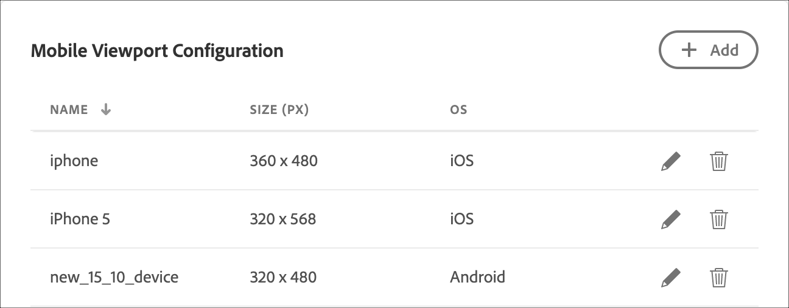

# Konfigurieren von Visual Experience Composer (VEC)

Legen Sie auf der Registerkarte **[!UICONTROL Visual Experience]** Composer **[!UICONTROL unter [!DNL Adobe Target]Administration]** kontenweite Standardeinstellungen für den [!UICONTROL Visual Experience Composer] (VEC) fest. Diese Einstellungen gelten immer dann, wenn Autoren Erlebnisse in Visual Experience Composer erstellen oder in der Vorschau anzeigen.

**Konfigurationsübersicht**

1. [Allgemeine Einstellungen](#general-settings): Standard-URL, Enhanced Experience Composer, gemischte Inhalte und Erlebnis-Momentaufnahmen.
1. [Konfiguration mobiler Viewports](#mobile-viewport-configuration): Vorschau von Geräten für responsive Erlebnisse (nur [Target Premium](/help/main/c-intro/intro.md#premium)).
1. [CSS-Selektoren](#css): So generiert Target Selektoren für die Inhaltsbereitstellung.

Um die Konfigurationsseite zu öffnen, klicken Sie auf **[!UICONTROL Administration]** > **[!UICONTROL Visual Experience Composer]**.

>[!NOTE]
>
>Die Einstellungen auf dieser Seite gelten für das gesamte [!DNL Target].

## Allgemeine Parameter {#general-settings}

Konfigurieren Sie im Abschnitt **[!UICONTROL Allgemeine Einstellungen]** die Standardeinstellungen, die beim Öffnen des VEC verwendet werden.

Die folgenden Einstellungen sind verfügbar:

* **Standard-URL**

  Die Standard-URL, die von [!UICONTROL Visual Experience Composer] verwendet wird. Dies ist die Standardseite, wie Ihre Startseite, die verwendet wird, wenn Sie ein Erlebnis für jede neue Aktivität einrichten. Sollten Sie keine Standard-URL festlegen, müssen Sie für jede Aktivität bei deren Erstellung eine eigene URL eingeben.

* **Enhanced Experience Composer aktivieren**

  Ermöglicht die Bearbeitung auf Sites, die iFrames zerstören, sowie auf Seiten mit gemischten Inhalten. Einige Sites sind möglicherweise nicht mit der erweiterten Version kompatibel. Deaktivieren Sie diese Option, um zum ursprünglichen [!UICONTROL Visual Experience Composer“ &#x200B;]. Die Aktivitätenbereitstellung auf Sites wird durch diese Auswahl nicht beeinträchtigt.

  Beachten Sie, dass [!UICONTROL Enhanced Experience Composer] in [!DNL Safari] nicht unterstützt wird.

  Weitere Informationen finden Sie unter [Fehlerbehebung beim Visual Experience Composer](/help/main/c-experiences/c-visual-experience-composer/r-troubleshoot-composer/troubleshoot-composer.md).

  Sie können den [!UICONTROL Enhanced Experience Composer] auch auf Aktivitätsebene aktivieren. Siehe [Erfahren Sie, wie Sie Enhanced Experience Composer auf Aktivitätsebene aktivieren](/help/main/c-experiences/c-visual-experience-composer/experience-composer-best-practices.md).

* **Laden von gemischtem Inhalt**

  Zulassen von gemischtem Inhalt beim Öffnen einer Website mit dem [!UICONTROL Enhanced Experience Composer] (EEC). Durch Aktivierung dieser Option wird der zusätzliche Aufwand zum Laden statischer Ressourcen über [!DNL Target] Proxy-Server vermieden.

  Diese Option ist beispielsweise hilfreich, wenn:

  * Ihre CSP-Header (Content Security Policy) ermöglichen das Laden gemischter Inhalte ohne die Verwendung von Proxy-Servern mit aktiviertem EEC.
  * Die Ladezeit Ihrer HTTP-Website in AEM wurde verlängert, da das Laden von JavaScript, Bildern usw. über einen Proxy länger dauert.

* **Erzeugen von Erlebnis-Momentaufnahmen im Aktivitäts-Flussdiagramm**

  Bei der Aktivierung von Erlebnismomentaufnahmen werden Miniaturen Ihrer Erlebnisse in der Übersicht des Aktivitätsarbeitsablaufs generiert. Die Deaktivierung von Momentaufnahmen kann bei einigen Benutzern zu einer Beschleunigung der Performance führen.

## Konfigurieren von mobilen Viewports {#mobile-viewport-configuration}

>[!NOTE]
>
>Die **[!UICONTROL Konfiguration mobiler Viewports]** sind eine [Target Premium](/help/main/c-intro/intro.md#premium)-Funktion.

Fügen Sie Geräte hinzu, die bei der Vorschau von Erlebnissen verwendet werden sollen. Jedem Gerät ist dabei eine Zielgruppe zugeordnet.

Gehen Sie wie folgt vor, um einen mobilen Viewport hinzuzufügen:

1. Klicken Sie auf **[!UICONTROL Hinzufügen]**.
1. Geben Sie einen beschreibenden Namen für den mobilen Viewport an, geben Sie die Breite und Höhe an und wählen Sie das gewünschte Betriebssystem aus.
1. Klicken Sie auf **[!UICONTROL Speichern]**.

Details zur Vorschau und Zielgruppe finden Sie unter [Erfahren Sie, wie Sie mobile Viewports für responsive Erlebnisse verwenden](/help/main/c-experiences/c-visual-experience-composer/mobile-viewports.md).

## CSS-Selektoren {#css}

Geben Sie an, wie [!DNL Target] CSS-Selektoren generiert.

Diese Optionen helfen [!DNL Target] dabei, die Struktur Ihrer Site zu verstehen, um bessere CSS-Selektoren für die Bereitstellung von Inhalten zu erzeugen. Standardmäßig erstellt [!DNL Target] die Selektoren auf Basis der Element-IDs auf der Seite. Wenn auf Ihrer Site nur wenige IDs verwendet werden oder IDs auf derselben Seite dupliziert werden, ist die Verwendung von Klassen wahrscheinlich die bessere Option.

Sie können eine oder beide der folgenden Optionen verwenden:

* **Element-IDs verwenden**

  Deaktivieren Sie diese Option, wenn die gleiche ID für mehrere Elemente verwendet wird oder sich die Element-ID beim Laden der Seite möglicherweise ändert.

* **Elementklassen verwenden**

  Standardmäßig verwendet [!DNL Target] nur Element-IDs. Wenn Ihre Seite jedoch so konzipiert ist, dass sie Klassen zur Identifizierung von Elementen verwendet, z. B. eine mit [!DNL Adobe Experience Manager] erstellte Seite, sollten Sie auch **[!UICONTROL Elementklassen verwenden]** auswählen. Die Selektorgenauigkeit ist im Allgemeinen am höchsten bei der Verwendung von IDs, niedriger bei der Verwendung von Klassen und am niedrigsten, wenn keine der Optionen ausgewählt ist. Testen Sie Ihre Seite in Visual Experience Composer, um zu überprüfen, ob die Selektoren korrekt sind.

  Sie können diese Einstellung für jede Aktivität außer Kraft setzen, indem Sie auf das Zahnradsymbol **[!UICONTROL Einstellungen]** klicken und **[!UICONTROL CSS-Selektoren]** auswählen. Dies ist nützlich, wenn Sites im selben Konto anders konfiguriert sind. Überschreibungen pro Aktivität sind in **[!UICONTROL Automated Personalization- oder {]**}Multivariate Testing **-Aktivitäten nicht verfügbar.** Informationen zum Selektorverhalten und zur Fehlerbehebung finden Sie unter [Element-Selektoren, die im Visual Experience Composer verwendet werden](/help/main/c-experiences/c-visual-experience-composer/vec-selectors.md).

## Schulungsvideo: Kontovoreinstellungen (7:33) 

>[!BEGINSHADEBOX]

Die Benutzeroberfläche des [!DNL Target] **[!UICONTROL Administration]**-Menüs (früher **[!UICONTROL Setup]**) wurde überarbeitet, um eine verbesserte Leistung zu erzielen, die Wartungszeit bei der Veröffentlichung neuer Funktionen zu reduzieren und das Benutzererlebnis im gesamten Produkt zu verbessern. Die Informationen im folgenden Video sind im Allgemeinen korrekt, allerdings können sich Optionen an etwas anderen Orten befinden. Aktualisierte Videos werden bald veröffentlicht.

>[!ENDSHADEBOX]

In diesem Video finden Sie Informationen zu Kontovoreinstellungen.

* Beschreibung der in [!DNL Target Standard] verfügbaren Kontoeinstellungen

>[!VIDEO](https://video.tv.adobe.com/v/17379)
