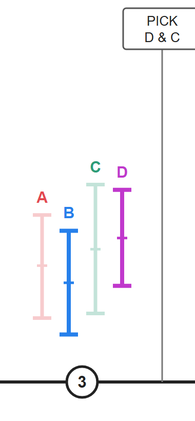

# [!UICONTROL Automatische Zuordnung] Übersicht {#auto-allocate-overview}

>[!BEGINSHADEBOX]

**Auf dieser Seite** Erfahren Sie, wie eine Aktivität **[!UICONTROL Automatische Zuordnung]** ein erfolgreichstes Erlebnis identifiziert und ihm Traffic zuordnet, wann er verwendet werden soll, wie der Algorithmus funktioniert und was Sie vor der Verwendung beachten müssen.

>[!ENDSHADEBOX]

Eine Aktivität **[!UICONTROL Automatische Zuordnung]** in [!DNL Adobe Target] identifiziert einen Gewinner aus zwei oder mehr Erlebnissen und ordnet automatisch dem Gewinner mehr Traffic zu, um die Konversionen während der Fortführung des Tests und des Lernens zu erhöhen.

Sie erstellen eine **[!UICONTROL Automatische Zuordnung]**-Aktivität mit dem Drei-Schritte-Workflow einer A/B-Aktivität: Wählen Sie die Option **[!UICONTROL Automatische Zuordnung zu bestem Erlebnis]** auf der Seite **[!UICONTROL Targeting]** (Schritt 2). Die Schritte finden Sie unter [Erstellen einer automatischen Zuordnungsaktivität](/help/main/c-activities/automated-traffic-allocation/create-auto-allocate-activity.md).

## Wozu dient [!UICONTROL Automatische Zuordnung] {#why-auto-allocate}

Mit A/B-Standardtests sind Kosten verbunden. Sie müssen Traffic ausgeben, um die Leistung der einzelnen Erlebnisse zu messen, und die Traffic-Verteilung bleibt unverändert, selbst wenn einige Erlebnisse die anderen übertreffen. Die Stichprobengröße ist kompliziert zu bestimmen, die Aktivität muss ihren gesamten Verlauf durchlaufen, bevor Sie auf einen Gewinner reagieren können, und es besteht noch die Möglichkeit, dass der identifizierte Gewinner kein echter Gewinner ist.

Eine Aktivität **[!UICONTROL Automatische Zuordnung]** reduziert diese Kosten und den Mehraufwand:

* Es überwacht die Leistung aller Erlebnisse anhand der Zielmetriken und sendet proportional mehr neue Teilnehmer an die Erlebnisse mit hoher Leistung. Es wird ausreichend Traffic für die Erkundung der anderen Erlebnisse reserviert.
* Die Optimierung erfolgt parallel zum Lernen, sodass Sie die Vorteile in Ihren Ergebnissen sehen können, während die Aktivität noch ausgeführt wird.
* Besucher erzielen immer mehr Erlebnisse, sodass Sie nicht warten müssen, bis die Aktivität beendet ist. Sie profitieren schneller von Steigerungen, da den Aktivitätsteilnehmern, die zu weniger erfolgreichen Erlebnissen geleitet worden wären, nun potenzielle erfolgreichste Erlebnisse angezeigt werden.

Die wichtigsten Vorteile:

* Behält die Strenge eines A/B-Tests bei.
* Findet einen statistisch signifikanten Gewinner schneller als einen manuellen A/B-Test.
* Bietet eine höhere durchschnittliche Steigerung der Kampagnenaktivität als ein manueller A/B-Test.

### Wie [!UICONTROL Automatische Zuordnung] einen Gewinner identifiziert {#true-winner}

Ein normaler A/B-Test in [!DNL Target] vergleicht jeden Herausforderer nur mit der Kontrolle. Wenn beispielsweise eine Aktivität die Erlebnisse A, B, C und D aufweist, wobei A die Kontrolle ist, vergleicht der Test A mit B, A mit C und A mit D. Die meisten Produkte, einschließlich [!DNL Target], verwenden einen [Welchs t-Test](https://en.wikipedia.org/wiki/Welch%27s_t-test){target=_blank} für diese Vergleiche, um ein auf p-Werten basierendes Vertrauen zu erzeugen. [!DNL Target] führt jedoch nicht automatisch die impliziten Vergleiche (B versus C, B versus D und C versus D) durch, die erforderlich sind, um das „beste“ Erlebnis zu finden, sodass Sie die Ergebnisse manuell analysieren müssen.

**[!UICONTROL Automatische Zuordnung]** entfernt diesen manuellen Schritt:

* Sie führt alle impliziten Vergleiche über alle Erlebnisse hinweg durch und ergibt dann einen „wahren“ Gewinner. Es gibt in diesem Test keinen Bedarf für ein „Kontrollerlebnis“.
* Sie ordnet Erlebnissen neue Besucher zu, bis sich das Konfidenzintervall des besten Erlebnisses nicht mit dem Konfidenzintervall eines anderen Erlebnisses überschneidet.
* Sie verwendet Konfidenzintervalle, die auf der [Bernstein-Ungleichung](https://en.wikipedia.org/wiki/Bernstein_inequalities_%28probability_theory%29){target=_blank} basieren, die wiederholte Auswertungen ausgleicht, die normalerweise falsch-positive Ergebnisse produzieren würden.
* Wenn er stoppt, gibt es - sofern keine wesentliche Zeitabhängigkeit zu den Besuchern besteht, die auf die Seite gelangen - eine Chance von mindestens 95 %, dass er ein Erlebnis zurückgibt, dessen wahre Antwort nicht schlechter als 1 % (relativ) kleiner ist als die wahre Antwort des erfolgreichsten Erlebnisses.

## Verwendung von [!UICONTROL Automatische Zuordnung] {#when-to-use}

Wählen Sie je nach **[!UICONTROL Aktivitäten]** Automatische Zuordnung **[!UICONTROL A/B]** und **&#x200B;**&#x200B;Automated Personalizationaus:

| Aktivität | Verwenden Sie sie, wenn | Unterschiede |
|---|---|---|
| **[!UICONTROL Automatische Zuordnung]** | Sie möchten Ihre Aktivität von Anfang an optimieren und die erfolgreichsten Erlebnisse so schnell wie möglich identifizieren. | Wenn Sie häufiger Erlebnisse mit hoher Performance bereitstellen, wird die Gesamtleistung der Aktivität gesteigert. |
| [**[!UICONTROL A/B-Test]**](/help/main/c-activities/t-test-ab/test-ab.md#test-ab) | Sie möchten die Leistung aller Erlebnisse charakterisieren, bevor Sie Ihre Site optimieren. | Mit einem A/B-Test können Sie alle Ihre Erlebnisse nach Rang ordnen, während **[!UICONTROL Automatische Zuordnung]** die besten Ergebnisse findet, aber keine Unterscheidung zwischen den leistungsschwächeren gewährleistet. |
| [**[!UICONTROL Automatisierte Personalisierung]**](/help/main/c-activities/t-automated-personalization/automated-personalization.md#automated-personalization-overview) | Sie wünschen sich Optimierungsalgorithmen von höchster Komplexität, z. B. Modelle für maschinelles Lernen, die Prognosen basierend auf einzelnen Profilattributen erstellen. | **[!UICONTROL Automatische Zuordnung]** untersucht das aggregierte Verhalten von Erlebnissen (genau wie Standard-A/B-Tests) und unterscheidet nicht zwischen Besuchern. |

## Funktionsweise des Algorithmus {#how-it-works}

Der Algorithmus der **[!UICONTROL automatischen Zuordnung]** ist ein [Multi-Armed-Bandit](https://en.wikipedia.org/wiki/Multi-armed_bandit){target=_blank}-Ansatz zur Optimierung, der entdeckendes Lernen und die Nutzung des Erlernten miteinander in Einklang bringt. Sie umfasst sowohl die gemessene Leistung (z. B. die Konversionsrate) als auch die Konfidenzintervalle der kumulativen Daten. Im Gegensatz zu einem standardmäßigen A/B-Test, bei dem der Traffic gleichmäßig auf die Erlebnisse aufgeteilt wird **[!UICONTROL ändert die]** Automatische Zuordnung“ die Traffic-Zuordnung über Erlebnisse hinweg:

* 80 % der Besucher werden anhand der in diesem Abschnitt beschriebenen Logik zugeordnet.
* 20 % der Besucher werden nach dem Zufallsprinzip allen Erlebnissen zugewiesen, um sich an das sich ändernde Besucherverhalten anzupassen.

Der Ansatz des mehrarmigen Banditen sorgt dafür, dass ein Teil des Traffics für die Exploration frei bleibt, während er die Erlebnisse nutzt, die sich gut entwickeln. Mehr neue Besucher werden in bessere Erlebnisse integriert, während die Fähigkeit, auf sich ändernde Bedingungen zu reagieren, erhalten bleibt. Die Modelle werden mindestens einmal pro Stunde aktualisiert, um sicherzustellen, dass sie auf die neuesten Daten reagieren.

Je mehr Besucher in die Aktivität eintreten, desto erfolgreicher werden einige Erlebnisse und desto mehr Traffic erhalten sie. 20 Prozent des Datenverkehrs werden weiterhin per Zufall verteilt, um alle Erlebnisse zu erforschen. Wenn ein Erlebnis mit einer schlechteren Leistung anfängt, sich zu verbessern, erhält es mehr Traffic. Wenn der Erfolg eines Erlebnisses mit höherer Leistung nachlässt, wird weniger Traffic zugewiesen. Dies kann beispielsweise vorkommen, wenn ein Ereignis dazu führt, dass Besucher auf Ihrer Medienseite nach anderen Informationen suchen, oder wenn der Wochenendverkauf auf Ihrer Einzelhandelswebsite andere Ergebnisse liefert.

Die folgende Abbildung zeigt, wie der Algorithmus bei einem Test mit vier Erlebnissen funktionieren könnte (klicken Sie hier, um die Abbildung zu erweitern):

{width="600" zoomable="yes"}

Die Abbildung zeigt, wie sich der den einzelnen Erlebnissen zugeordnete Traffic ändert, während die Aktivität mehrere Runden durchläuft, bis ein Gewinner gefunden ist.

| Round | Beschreibung |
|--- |--- |
| {width="200" zoomable="yes"} | **Aufwärmrunde (0)**: Jedes Erlebnis erhält gleichen Traffic, bis jedes Erlebnis in der Aktivität mindestens 1.000 Besucher und 50 Konversionen hat.<ul><li>Erlebnis A = 25 %</li><li>Erlebnis B = 25 %</li><li>Erlebnis C = 25 %</li><li>Erlebnis D = 25 %</li></ul>Nachdem jedes Erlebnis 1.000 Besucher und 50 Konversionen erreicht hat, startet [!DNL Target] die automatisierte Traffic-Zuordnung. Alle Zuweisungen erfolgen in Runden, und für jede Runde werden zwei Erlebnisse ausgewählt. Damit gelangen nur zwei Erlebnisse in die nächste Runde: D und C.<ul><li>Für die Zukunft bedeutet dies, dass die beiden Erlebnisse zu 80 % gleich verteilt werden.</li><li>Die anderen beiden Erlebnisse sind weiterhin Teil der Teilnahme, werden aber nur als Teil der 20-%-Traffic-Zuordnung bereitgestellt, wenn neue Besucher in die Aktivität eintreten.</li><li>Alle Zuordnungen werden stündlich aktualisiert (angezeigt durch die Runden entlang der X-Achse oben). Nach jeder Runde werden die kumulativen Daten verglichen.</li></ul> |
| {width="200" zoomable="yes"} | **Runde 1**: 80 % des Traffics werden den Erlebnissen C und D zugewiesen (jeweils 40 %). 20 % des Traffics werden auf zufälliger Basis den Erlebnissen A, B, C und D zugeordnet (jeweils 5 %). Während dieser Runde werden beim Erlebnis A gute Leistungen verzeichnet.<ul><li>Der Algorithmus wählt Erlebnis D aus, um in die nächste Runde zu wechseln, da er die höchste Konversionsrate hat (wie durch die vertikale Skala jeder Aktivität angegeben).</li><li>Außerdem wählt der Algorithmus auch das Erlebnis A für die nächste Runde aus, da es die höchste Obergrenze des Bernstein-95-%-Konfidenzintervalls der verbleibenden Erlebnisse erreicht hat.</li></ul>Die Erlebnisse D und A gelangen eine Runde weiter. |
| {width="200" zoomable="yes"} | **Runde 2**: 80 % des Traffics werden den Erlebnissen A und D zugewiesen (jeweils 40 %). 20 % des Traffics werden nach dem Zufallsprinzip zugeordnet, sodass die Erlebnisse A, B, C und D jeweils 5 % des Traffics erhalten. Während dieser Runde werden beim Erlebnis B gute Leistungen verzeichnet.<ul><li>Der Algorithmus wählt Erlebnis D aus, um in die nächste Runde zu wechseln, da er die höchste Konversionsrate hat (wie durch die vertikale Skala jeder Aktivität angegeben).</li><li>Außerdem wählt der Algorithmus auch das Erlebnis B für die nächste Runde aus, da es die höchste Obergrenze des Bernstein-95-%-Konfidenzintervalls der verbleibenden Erlebnisse erreicht hat.</li></ul>Die Erlebnisse D und B gelangen eine Runde weiter. |
| {width="200" zoomable="yes"} | **Runde 3**: 80 % des Traffics werden den Erlebnissen B und D zugewiesen (jeweils 40 %). 20 % des Traffics werden nach dem Zufallsprinzip zugeordnet, sodass die Erlebnisse A, B, C und D jeweils 5 % des Traffics erhalten. Während dieser Runde werden beim Erlebnis D weiterhin gute Leistungen verzeichnet und auch das Erlebnis C läuft gut.<ul><li>Der Algorithmus wählt Erlebnis D aus, um in die nächste Runde zu wechseln, da er die höchste Konversionsrate hat (wie durch die vertikale Skala jeder Aktivität angegeben).</li><li>Außerdem wählt der Algorithmus auch das Erlebnis C für die nächste Runde aus, da es die höchste Obergrenze des Bernstein-95-%-Konfidenzintervalls der verbleibenden Erlebnisse erreicht hat.</li></ul>Die Erlebnisse D und C gelangen eine Runde weiter. |
| {width="200" zoomable="yes"} | **Runde 4**: 80 % des Traffics werden den Erlebnissen C und D zugewiesen (jeweils 40 %). 20 % des Traffics werden nach dem Zufallsprinzip zugeordnet, sodass die Erlebnisse A, B, C und D jeweils 5 % des Traffics erhalten. Während dieser Runde werden beim Erlebnis C gute Leistungen verzeichnet.<ul><li>Der Algorithmus wählt Erlebnis C aus, um in die nächste Runde zu gelangen, da es die höchste Konversionsrate aufweist (wie durch die vertikale Skala jeder Aktivität angegeben).</li><li>Außerdem wählt der Algorithmus auch das Erlebnis D für die nächste Runde aus, da es die höchste Obergrenze des Bernstein-95-%-Konfidenzintervalls der verbleibenden Erlebnisse erreicht hat.</li></ul>Die Erlebnisse C und D gelangen eine Runde weiter. |
| {width="200" zoomable="yes"} | **Round *n***: Im Laufe der Aktivität beginnt ein leistungsstarkes Erlebnis zu entstehen, und der Prozess wird fortgesetzt, bis es ein erfolgreichstes Erlebnis gibt. Wenn sich das Konfidenzintervall des Erlebnisses mit der höchsten Konversionsrate nicht mit dem Konfidenzintervall eines anderen Erlebnisses überschneidet, wird es als Gewinner gekennzeichnet. Auf [&#x200B; Seite der erfolgreichsten Aktivität und in der Liste &#x200B;](/help/main/c-activities/automated-traffic-allocation/determine-winner.md)Aktivität&#x200B;**[!UICONTROL &#x200B; wird &#x200B;]**&#x200B;Abzeichen angezeigt.<ul><li>Der Algorithmus erklärt das Erlebnis C zum klaren Gewinner.</li></ul>Zu diesem Zeitpunkt bedient der Algorithmus 80 % des Traffics zu Erlebnis C, während 20 % des Traffics weiterhin nach dem Zufallsprinzip für alle Erlebnisse (A, B, C und D) bereitgestellt werden. C erhält insgesamt 85 % des Traffics. Für den unwahrscheinlichen Fall, dass sich das Konfidenzintervall des Gewinners erneut überschneidet, kehrt der Algorithmus zum Verhalten von Runde 4 zurück  **Wichtig**: Wenn Sie zuvor manuell einen Gewinner ausgewählt haben, wäre es einfach, das falsche Erlebnis auszuwählen. Daher empfiehlt es sich unbedingt, so lange zu warten, bis der Algorithmus das „siegreiche“ Erlebnis ermittelt hat. |

>[!NOTE]
>
>Wenn eine Aktivität nur zwei Erlebnisse hat, erhalten beide Erlebnisse gleichen Traffic, bis [!DNL Target] mit 75 % Zuversicht ein erfolgreichstes Erlebnis findet. Zu diesem Zeitpunkt werden zwei Drittel des Traffics dem Gewinner und ein Drittel dem Verlierer zugewiesen. Wenn danach ein Erlebnis 95 % Vertrauen erreicht, werden 90 % des Traffics dem Gewinner und 10 % dem Verlierer zugewiesen. [!DNL Target] sendet immer etwas Traffic an das „Verlierer“-Erlebnis, um am Ende falsch positive Ergebnisse zu vermeiden (d. h., um eine gewisse Exploration aufrechtzuerhalten).

Nachdem eine Aktivität **[!UICONTROL Automatische Zuordnung]** aktiviert wurde, sind die folgenden Vorgänge in der [!DNL Target]-Benutzeroberfläche nicht zulässig:

* Umschalten des **[!UICONTROL Traffic-]**) auf **[!UICONTROL Manuell]**.
* Ändern des Zielmetriktyps.
* Ändern von Optionen im Bedienfeld **[!UICONTROL Erweiterte Einstellungen]**.

Weitere Informationen finden Sie unter [Wie die automatische Zuordnung einen manuellen Test übertrifft](/help/main/c-activities/automated-traffic-allocation/faster-results-higher-revenue.md).

## Einschränkungen {#caveats}

Beachten Sie bei der Arbeit mit „Automatische Zuordnung **[!UICONTROL die folgenden Informationen]**.

### Es wird nur eine erweiterte Metrikeinstellung unterstützt

Die **[!UICONTROL Automatische Zuordnung]** funktioniert mit nur einer erweiterten Metrikeinstellung: **[!UICONTROL Anzahl erhöhen und Benutzer in Aktivität halten]**. Die folgenden erweiterten Metrikeinstellungen werden nicht unterstützt: **[!UICONTROL Anzahl erhöhen]**, **[!UICONTROL Benutzer freigeben]**, **[!UICONTROL Erneuten Eintritt erlauben und Anzahl erhöhen]** und **[!UICONTROL Benutzer freigeben und bei erneuten Eintritt sperren]**.

### Häufig wiederkehrende Besucher können die Konversionsraten in die Höhe treiben {#return-visitors}

Wenn ein Besucher, der Erlebnis A sieht, häufig zurückkehrt und mehrmals konvertiert, wird die Konversionsrate (CR) von Erlebnis A künstlich erhöht. Vergleichen Sie dieses Ergebnis mit Erlebnis B, bei dem Besucher konvertieren, aber nicht oft zurückkehren. Daher sieht die CR von Erlebnis A besser aus als die CR von Erlebnis B, sodass neue Besucher eher A als B zugewiesen werden. Wenn Sie sich dafür entscheiden, einmal pro Teilnehmer zu zählen, können die CR von A und die CR von B identisch sein.

Die Logik bevorzugt Besucherinnen und Besucher, die schnell konvertieren oder häufiger besuchen, da solche Besucherinnen und Besucher die Gesamtkonversionsrate des Erlebnisses, zu dem sie gehören, vorübergehend erhöhen. Der Algorithmus passt sich häufig von selbst an, sodass die Steigerung der Konversionsrate bei jeder Momentaufnahme verstärkt wird.

Wenn wiederkehrende Besucher zufällig verteilt werden, wird ihre Wirkung auf die Konversionsrate wahrscheinlich eher ausgeglichen. Um diese Auswirkung zu beschränken, sollten Sie die Änderung der Zählmethode der Zielmetrik erwägen, um jeden Teilnehmer nur einmal zu zählen.

### Es wird zwischen leistungsstarken und nicht zwischen leistungsschwachen Unternehmen unterschieden

**[!UICONTROL Automatische Zuordnung]** eignet sich gut zur Unterscheidung zwischen Erlebnissen mit hoher Leistung (und zur Ermittlung eines Gewinners). Es kann vorkommen, dass Sie nicht genügend zwischen den leistungsschwachen Erlebnissen unterscheiden.

Wenn Sie eine statistisch signifikante Unterscheidung zwischen allen Erlebnissen vornehmen möchten, sollten Sie den manuellen Traffic-Zuordnungsmodus verwenden.

### Zeitkorrelierte Konversionsraten können die Zuordnung verfälschen

Einige Faktoren, die bei einem standardmäßigen A/B-Test ignoriert werden können, da sie alle Erlebnisse gleichermaßen betreffen, können bei einer Aktivität **[!UICONTROL Automatische Zuordnung]** nicht ignoriert werden. Der Algorithmus ist gegenüber den beobachteten Konversionsraten empfindlich. Die folgenden Faktoren können sich ungleich auf die Erlebnisleistung auswirken:

* Erlebnisse mit unterschiedlicher kontextueller Relevanz (Zeit, Ort, Geschlecht usw.).

  Beispiel:

  * „Gott sei Dank ist Freitag“ führt zu höheren Konversionen am Freitag.
  * „Jump-start your Monday“ hat am Montag eine höhere Konversionsrate.
  * „Gear up for an East-Coast winter“ bietet höhere Konversionsraten an Ost- oder Winterstandorten.

  Die Verwendung von Erlebnissen mit unterschiedlicher kontextueller Relevanz kann die Ergebnisse in einem **[!UICONTROL Automatische Zuordnung]**-Test stärker verfälschen als in einem A/B-Test, da der A/B-Test die Ergebnisse über einen längeren Zeitraum analysiert.

* Erlebnisse mit variierenden Verzögerungen in der Konversion, möglicherweise aufgrund der Dringlichkeit der Nachricht.

  Beispielsweise signalisiert „30 % Verkauf endet heute“ dem Besucher, heute zu konvertieren, aber „50 % Rabatt auf den ersten Kauf“ erzeugt nicht dasselbe Gefühl der Dringlichkeit.

## Häufig gestellte Fragen {#faq}

Konsultieren Sie bei der Arbeit mit Aktivitäten des Typs **[!UICONTROL Automatische Zuordnung]** die folgenden Fragen und Antworten.

+++ Unterstützt [!UICONTROL Analytics for Target] (A4T) [!UICONTROL automatische Zuordnung]-Aktivitäten?

Ja. Weitere Informationen finden Sie unter [A4T-Unterstützung für automatische Zuordnungs- und automatische Targeting-Aktivitäten](/help/main/c-integrating-target-with-mac/a4t/a4t-at-aa.md).

+++

+++ Werden wiederkehrende Besucher automatisch Erlebnissen mit hoher Leistung zugewiesen?

Nein. Nur neue Besucher werden automatisch zugeordnet. Wiederkehrende Besucher sehen weiterhin ihr ursprüngliches Erlebnis, um die Gültigkeit des A/B-Tests zu schützen.

+++

+++ Wie behandelt der Algorithmus falsch-positive Ergebnisse?

Der Algorithmus garantiert eine Konfidenz von 95 % oder eine Falsch-Positiv-Rate von 5 %, wenn Sie warten, bis das Gewinner-Abzeichen angezeigt wird.

+++

+++ Wann beginnt [!UICONTROL Automatische Zuordnung] mit der Traffic-Zuordnung?

Der Algorithmus setzt ein, nachdem sämtliche Erlebnisse in der Aktivität mindestens 1.000 Besucher und 50 Konversionen erreicht haben.

+++

+++ Wie aggressiv nutzt der Algorithmus aus?

80 % des Traffics werden mit **[!UICONTROL Automatische Zuordnung]** und 20 % des Traffics wird nach dem Zufallsprinzip bereitgestellt. Wenn ein Gewinner ermittelt wurde, gehen 80 % des Traffics an ihn, während alle Erlebnisse im Rahmen der 20 % weiterhin Traffic erhalten, einschließlich des erfolgreichsten Erlebnisses.

+++

+++ Werden überhaupt Erlebnisse gezeigt?

Ja. Die Multi-Armed Bandit-Methode stellt sicher, dass mindestens 20 % des Datenverkehrs für die Erforschung von Änderungsmustern oder Konversionsraten in allen Erlebnissen reserviert werden.

+++

+++ Was passiert mit Aktivitäten mit langen Konversionsverzögerungen?

Solange alle Erlebnisse, die optimiert werden, ähnlichen Verzögerungen ausgesetzt sind, ist das Verhalten dasselbe wie bei einer Aktivität mit einem schnelleren Konversionszyklus. Es dauert jedoch länger, bis der Konversionsschwellenwert von 50 erreicht ist, bevor der Traffic-Zuordnungsprozess beginnt.

+++

+++ Wie unterscheidet sich [!UICONTROL Automatische Zuordnung] von [!UICONTROL Automated Personalization]?

**[!UICONTROL Automated Personalization]** verwendet die Profilattribute jedes Besuchers, um das beste Erlebnis zu ermitteln. Auf diese Weise wird nicht nur die Aktivität für diesen Besucher optimiert, sondern auch personalisiert.

**[!UICONTROL Automatische Zuordnung]** ist dagegen ein A/B-Test, der einen aggregierten Gewinner erzeugt (das beliebteste Erlebnis, aber nicht unbedingt das effektivste Erlebnis für jeden Besucher).

+++

+++ Erhöhen wiederkehrende Besucher die Konversionsrate meiner Erfolgsmetrik?

Ja, das können sie. Unter [Häufig wiederkehrende Besucher können die Konversionsraten in die Höhe treiben](#return-visitors) finden Sie eine Erklärung und erfahren, wie Sie diesen Effekt abschwächen können.

+++

+++ Kann ich den Stichprobengrößenrechner mit „Automatische Zuordnung[!UICONTROL &#x200B; verwenden] um zu schätzen, wie lange die Aktivität dauert, um den Gewinner zu ermitteln?

Sie können den vorhandenen [!DNL Adobe Target] ([) verwenden](/help/main/c-activities/t-test-ab/sample-size-determination.md#section_6B8725BD704C4AFE939EF2A6B6E834E6) um eine Schätzung der Dauer des Tests zu erhalten. Wenden Sie wie bei herkömmlichen A/B-Tests die Bonferroni-Korrektur an, wenn Sie mehr als zwei Angebote oder mehr als eine Konversionsmetrik oder Hypothese testen. Dieser Rechner ist für herkömmliche A/B-Tests mit festem Horizont konzipiert und bietet nur eine Schätzung. Die Verwendung des Taschenrechners für eine Aktivität **[!UICONTROL Automatische Zuordnung]** ist optional, da **[!UICONTROL Automatische Zuordnung]** für Sie einen Gewinner bestimmt. Sie müssen keinen festen Zeitpunkt auswählen, um die Testergebnisse anzuzeigen. Die angegebenen Werte sind immer statistisch gültig.

Interne [!DNL Adobe] haben Folgendes ergeben:

* Wenn Sie genau zwei Erlebnisse testen **[!UICONTROL findet die]** „Automatische Zuordnung“ schneller einen Gewinner als Tests mit festem Zeithorizont (d. h. den vom Stichprobengrößenrechner vorgeschlagenen Zeitrahmen), wenn der Leistungsunterschied zwischen Erlebnissen groß ist. Bei der **[!UICONTROL automatischen Zuordnung]** kann jedoch mehr Zeit erforderlich sein, um einen Gewinner zu ermitteln, wenn der Leistungsunterschied zwischen Erlebnissen gering ist. In diesen Fällen wären Fixed-Horizon-Tests in der Regel ohne ein statistisch signifikantes Ergebnis beendet worden.
* Beim Testen von mehr als zwei Erlebnissen findet **[!UICONTROL Automatische Zuordnung]** schneller einen Gewinner als Tests mit festem Zeithorizont (d. h. der vom Stichprobengrößenrechner vorgeschlagene Zeitrahmen), wenn ein einzelnes Erlebnis alle anderen Erlebnisse deutlich übertrifft. Wenn zwei oder mehr Erlebnisse beide im Vergleich zu anderen Erlebnissen „gewinnen“, aber eng aufeinander abgestimmt sind, kann **[!UICONTROL Automatische Zuordnung]** zusätzliche Zeit erfordern, um zu ermitteln, welches Erlebnis besser ist. In diesen Fällen hätten Tests mit festem Zeithorizont normalerweise mit dem Schluss beendet, dass die „erfolgreichsten“ Erlebnisse besser waren als die Erlebnisse mit schlechterer Leistung, aber nicht herausgefunden, welches Erlebnis besser war.

+++

+++ Sollte ich ein Erlebnis mit unzureichender Leistung aus einer Aktivität [!UICONTROL Automatische Zuordnung] entfernen, um den Prozess der Gewinnerbestimmung zu beschleunigen?

Es gibt keinen wirklichen Grund, ein leistungsschwaches Erlebnis zu beseitigen. **[!UICONTROL Automatische Zuordnung]** stellt automatisch häufiger Erlebnisse mit hoher Leistung bereit und seltener Erlebnisse mit geringer Leistung. Ein hinter den Erwartungen zurückbleibendes Erlebnis wirkt sich nicht wesentlich auf die Geschwindigkeit aus, mit der ein Gewinner ermittelt wird.

20 % der Besucher werden zufällig über alle Erlebnisse verteilt. Der Traffic, der einem Erlebnis mit schwacher Performance bereitgestellt wird, ist minimal (20 % geteilt durch die Anzahl der Erlebnisse).

+++

+++ Kann ich die Zielmetrik inmitten einer Aktivität mit automatisierter [!UICONTROL &#x200B; ändern]?

[!DNL Adobe] empfiehlt nicht, die Zielmetrik inmitten einer Aktivität zu ändern. Obwohl es möglich ist, die Zielmetrik während einer Aktivität in der [!DNL Target]-Benutzeroberfläche zu ändern, sollten Sie immer eine neue Aktivität starten. [!DNL Adobe] garantiert nicht, was passiert, wenn Sie die Zielmetrik in einer Aktivität nach deren Ausführung ändern.

Diese Empfehlung gilt für **[!UICONTROL Automatische Zuordnung]**, **[!UICONTROL Automatisches Targeting]** und **[!UICONTROL Automated Personalization]**-Aktivitäten, die [!DNL Target] oder [!DNL Analytics] (A4T) als Berichtsquelle verwenden.

+++

+++ Kann ich die Berichtsquelle mittendrin durch eine Aktivität [!UICONTROL Automatische Zuordnung] ändern?

[!DNL Adobe] empfiehlt nicht, die Berichtsquelle inmitten einer Aktivität zu ändern. Obwohl es möglich ist, die Berichtsquelle (von [!DNL Target] zu A4T oder umgekehrt) während einer Aktivität in der [!DNL Target]-Benutzeroberfläche zu ändern, sollten Sie immer eine neue Aktivität starten. [!DNL Adobe] garantiert nicht, was passiert, wenn Sie die Berichtsquelle in einer Aktivität ändern, nachdem sie ausgeführt wird.

Diese Empfehlung gilt für **[!UICONTROL Automatische Zuordnung]**, **[!UICONTROL Automatisches Targeting]** und **[!UICONTROL Automated Personalization]**-Aktivitäten, die [!DNL Target] oder [!DNL Analytics] (A4T) als Berichtsquelle verwenden.

+++

+++ Kann ich die Option [!UICONTROL Berichtsdaten zurücksetzen] während ich eine Aktivität [!UICONTROL Automatische Zuordnung] ausführe?

Die Verwendung **[!UICONTROL Option „Berichtsdaten zurücksetzen]** für **[!UICONTROL automatische Zuordnung]**-Aktivitäten wird nicht empfohlen. Diese Option entfernt zwar die sichtbaren Berichtsdaten, nicht aber alle Trainingsdatensätze aus dem Modell **[!UICONTROL Automatische Zuordnung]**. Statt die Option **[!UICONTROL Berichtsdaten zurücksetzen]** zu verwenden, eine neue Aktivität erstellen und die ursprüngliche Aktivität deaktivieren. Diese Anleitung gilt auch für **[!UICONTROL Automatisches Targeting]** und **[!UICONTROL Automated Personalization]**-Aktivitäten.

+++

+++ Wie erstellt [!UICONTROL Automatische Zuordnung] Modelle in Bezug auf Umgebungen?

**[!UICONTROL Automatische Zuordnung]** erstellt Modelle nur basierend auf dem Traffic- und Konversionsverhalten, das in der Standardumgebung aufgezeichnet wurde. Standardmäßig ist **[!UICONTROL Produktion]** die Standardumgebung, aber die Standardumgebung kann in [!DNL Target] geändert werden [Administration > Umgebungen](/help/main/administrating-target/environments.md).

Wenn ein Treffer in einer anderen (nicht standardmäßigen) Umgebung auftritt, wird der Traffic entsprechend dem beobachteten Konversionsverhalten in der Standardumgebung verteilt. Das Ergebnis dieses Treffers (Konversion oder Nicht-Konversion) wird zu Berichtszwecken aufgezeichnet, aber im Modell **[!UICONTROL Automatische Zuordnung]** nicht berücksichtigt.

Bei Auswahl einer anderen Umgebung zeigt der Bericht den Traffic und die Konversionen für diese Umgebung an. Die standardmäßig ausgewählte Umgebung für einen Bericht ist die Standardeinstellung für das gesamte Konto. Die Standardumgebung kann nicht für jede Aktivität festgelegt werden.

+++

+++ Kann mit [!UICONTROL &#x200B; Aktivität Automatische Zuordnung &#x200B;] Lookback-Fenster während eines Tests angepasst werden, um Veränderungen im Zeitverlauf zu berücksichtigen?

Kann die Aktivität beispielsweise den Monat Dezember heranziehen, um zu entscheiden, wie der Traffic zugeordnet werden soll, anstatt sich die Besucherdaten vom September anzusehen (als der Test begann)?

Nein. **[!UICONTROL Automatische Zuordnung]** berücksichtigt die Leistung der gesamten Aktivität.

+++

+++ Wird [!UICONTROL Automatische Zuordnung] einem wiederkehrenden Besucher das erfolgreichste Erlebnis angezeigt, wenn sich das erfolgreichste Erlebnis von dem unterscheidet, das der Besucher bei der Qualifizierung für die Aktivität gesehen hat?

**[!UICONTROL Automatische Zuordnung]** verwendet Sticky Decisioning aus denselben Gründen, aus denen **[!UICONTROL A/B-Test]**-Aktivitäten persistent sind. Die Traffic-Zuordnung funktioniert nur für neue Besucher.

+++

## Schulungsvideos {#section_893E5B36DC4A415C9B1D287F51FCCB83}

In den folgenden Videos erhalten Sie weitere Informationen zu den in diesem Artikel behandelten Konzepten.

### Aktivitäts-Workflow - Zielgruppenbestimmung (2:14) 

In diesem Video sind Informationen zur Einrichtung der Traffic-Zuordnung enthalten.

* Zuweisen einer Zielgruppe zur Aktivität
* Regulieren von Traffic nach oben oder unten
* Auswählen der Zuordnungsmethode für den Traffic
* Zuweisen von Traffic zu verschiedenen Erlebnissen

>[!VIDEO](https://video.tv.adobe.com/v/3507596?captions=ger)

### Erstellen von A/B-Tests (8:36) 

In diesem Video wird gezeigt, wie mithilfe des geleiteten Target-Arbeitsablaufs mit drei Schritten ein A/B-Test erstellt wird. **[!UICONTROL Automatische Zuordnung]** wird ab 4:45 Uhr besprochen.

* Erstellen einer A/B-Aktivität in [!DNL Adobe Target]
* Zuordnen von Traffic mithilfe einer manuellen Aufteilung oder automatischen Traffic-Zuordnung

>[!VIDEO](https://video.tv.adobe.com/v/30169?captions=ger)
