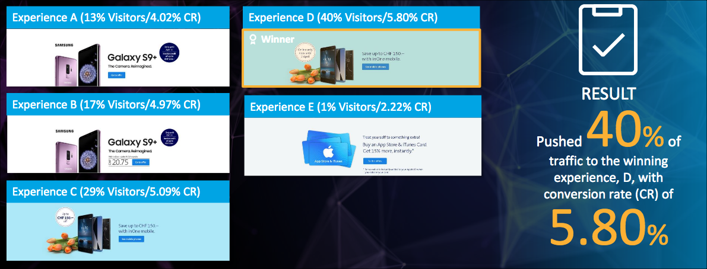

# Wie [!UICONTROL Automatische Zuordnung] einen manuellen Test übertrifft {#faster-results-higher-revenue}

>[!BEGINSHADEBOX]

**Auf dieser Seite** Erfahren Sie, warum eine Aktivität **[!UICONTROL Automatische Zuordnung]** schneller Ergebnisse und höhere Umsätze als manuelle A/B-Tests erzielen kann, wie sie funktioniert und wann die manuelle Traffic-Zuordnung die bessere Wahl bleibt.

>[!ENDSHADEBOX]

Bei einer manuellen A/B-Aktivität gehen Konversionen verloren, da das erfolgreichste Erlebnis erst dann für die gesamte Zielgruppe verfügbar ist, wenn die Aktivität abgeschlossen ist. Ihre Traffic-Verteilung bleibt fest, selbst wenn Sie erkennen, dass einige Erlebnisse andere übertreffen, und die Aktivität muss ihren gesamten Verlauf nehmen, bevor Sie auf einen Gewinner reagieren können.

## Automatisches Zuweisen von Traffic {#auto-allocating-traffic}

**[!UICONTROL Automatische Zuordnung]** ist die beste Option, wenn Sie das erfolgreichste Erlebnis öfter und früher in der Aktivität bereitstellen und gleichzeitig die Einrichtungs- und Berechnungskosten für die Auswahl von Stichprobengrößen, Konfidenzniveaus und anderen statistischen Konzepten entfernen oder reduzieren möchten.

## Wie funktioniert [!UICONTROL Automatische Zuordnung]? {#how-it-works}

**[!UICONTROL Automatische Zuordnung]** verwendet das Prinzip des mehrarmigen Banditen. Ein einarmiger Bandit ist ein umgangssprachlicher Begriff für einen Spielautomaten. Stellen Sie sich die automatische Zuordnung des Traffics als eine Reihe von Spielautomaten vor, in diesem Fall Testvarianten, deren Griffe zuerst gleich gezogen werden. Im Laufe der Zeit zahlen sich eine oder mehrere Maschinen oder Testvarianten möglicherweise mehr aus als andere. Wenn diese Situation eintritt, fängt ein Spieler natürlich an, die Griffe der Maschinen, die gewinnen häufiger zu ziehen. In Bezug auf die Traffic-Zuordnung bietet [!DNL Target] mehr Besuchern das Erlebnis oder die Erlebnisse, die mehr gewinnen.

Die folgende Abbildung zeigt eine zweiwöchige A/B-Aktivität. Mit **[!UICONTROL automatischen Zuordnung]** sich ein erfolgreichstes Erlebnis heraus und leitet [!DNL Target] zu Beginn des Tests einen größeren Teil des Traffics an den Gewinner um.

## Wie liefert [!UICONTROL Automatische Zuordnung] schnellere Ergebnisse? {#faster-results}

Mehr Besucher sehen die Varianten, die am besten abschneiden. Wenn eine einzelne Variante nach vorne fährt, werden noch mehr Besucher auf das erfolgreichste Erlebnis umgeleitet, während der Test noch läuft. Diese Methode ist besonders hilfreich, wenn die A/B-Aktivität während eines Kerngeschäfts ausgeführt wird, z. B. während eines Urlaubs, eines Produktstarts oder eines Weltereignisses.

## Wie kann [!UICONTROL Automatische Zuordnung] zu höheren Umsätzen führen? {#higher-revenue}

**[!UICONTROL Automatische Zuordnung]** findet den Gewinner schneller als eine manuelle A/B-Aufteilung und ermöglicht es Ihnen, diesen Gewinner sofort zu nutzen und Umsätze zu erfassen, die bei einem traditionellen oder manuellen Ansatz verloren gegangen wären. **[!UICONTROL Automatische Zuordnung]** leitet mehr Traffic an das Erlebnis mit der höchsten Konversionsrate, sodass Ihr Umsatz während der Ausführung und des Lernens der Aktivität gesteigert werden kann.

Im folgenden Beispiel erzielte **[!UICONTROL Automatische Zuordnung]** während des Tests mehr Umsatz, indem mehr Traffic (40 %) auf Experience D verschoben wurde, das die höchste Konversionsrate aufwies.

## In welchen Fällen sollte ich bei der manuellen Traffic-Zuordnung bleiben? {#manual-allocation}

Ein manueller A/B-Test ist die am besten geeignete Option, wenn Sie die Reihenfolge ändern müssen, in der jedes Erlebnis im Verhältnis zu den anderen durchgeführt wird. **[!UICONTROL Automatische Zuordnung]** findet und nutzt die besten Ergebnisse, garantiert jedoch nicht die Unterscheidung zwischen Erlebnissen mit schlechterer Leistung. Verwenden Sie die manuelle Traffic-Zuordnung , um vollständig zu steuern, wie viel Ihres Besucher-Traffics die einzelnen Testvarianten sieht, und um die statistischen Schwellenwerte anzupassen, die für Ihr Unternehmen relevant sind.

## Erste Schritte {#get-started}

Sind Sie bereit, Ihre erste Aktivität **[!UICONTROL Automatische Zuordnung]** zu starten? Siehe [Erstellen einer automatischen Zuordnungsaktivität](/help/main/c-activities/automated-traffic-allocation/create-auto-allocate-activity.md) und [Automatische Zuordnung - Übersicht](/help/main/c-activities/automated-traffic-allocation/automated-traffic-allocation.md).
