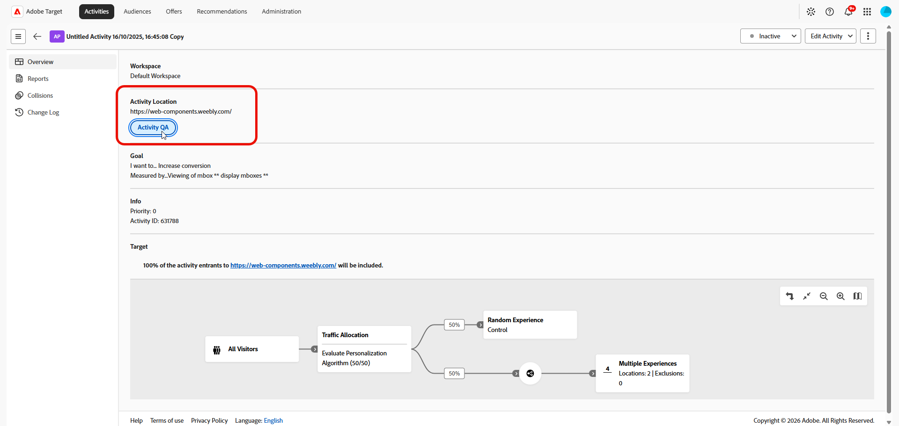

# Erste Schritte mit Aktivitäts-QA {#activity-qa}

>[!BEGINSHADEBOX]

**Auf dieser Seite** Erfahren Sie, wie Sie mit Aktivitäts-QA-Links eine Aktivität von Anfang bis Ende testen, die QS-Berichte überprüfen und den QA-Modus beenden können.

>[!ENDSHADEBOX]

**[!UICONTROL Aktivitäts-QA]** ermöglicht es Ihnen, Ihre [!DNL Adobe Target] Aktivitäten vollständig zu testen, bevor Sie sie live starten. Vorschau-Links, die sich nie ändern, optionale Zielgruppen-Targeting und QA-Berichte sorgen dafür, dass sie von den Live-Aktivitätsdaten getrennt bleiben. Die **[!UICONTROL Aktivitäts-QA]** umfasst:

* **Permanente Links:** Geben Sie Links für Team-Mitglieder frei, die sich nie ändern oder neu generiert werden müssen, unabhängig von Aktualisierungen an den Erlebnissen oder Aktivitäten.
* **Optionales Audience-Targeting** Testen Sie die Targeting-Kriterien oder ignorieren Sie sie, um das Erscheinungsbild von Erlebnissen zu überprüfen, ohne die Audience-Bedingungen erfüllen zu müssen.
* **Separate QS-Berichte:** Vergewissern Sie sich, dass die Metriken erwartungsgemäß inkrementiert werden. Die QS-Berichtsdaten werden vom Produktions-Reporting getrennt aufbewahrt (für Nicht-A4T-Reporting).
* **Vorschau mit anderen Aktivitäten:** Sie eine Vorschau eines Erlebnisses isoliert oder mit anderen Live-Aktivitäten an, die den Versandkriterien entsprechen (Seite/[!DNL Target]/Zielgruppe).
* **Vollbenutzer-Journey:** Greifen Sie mit dem QA-Link einmal auf Ihre Website zu und durchsuchen Sie dann die gesamte Website, während Sie in **[!UICONTROL Aktivitäts-QA]** sind. Sie verbleiben in **[!UICONTROL Aktivitäts-QA]** bis Sie die Sitzung beenden oder bis Sie die [QA-Target-Lesezeichenliste](/help/main/c-activities/c-activity-qa/activity-qa-bookmark.md) verwenden, um sich selbst herauszudrängen. Diese Funktion ist nützlich, wenn Sie eine Aktivität haben, die mehrere Web-Seiten umfasst.

  >[!NOTE]
  >
  >Diese Funktion gilt für at.js-Implementierungen mit Version 2.*x* oder höher. Bei at.js 1.*x*-Implementierungen gilt diese Funktion nur, wenn der Browser des Besuchers keine Cookies von Drittanbietern blockiert.

## Zugreifen auf und Freigeben einer QA-URL {#section_1C59BAA247B247BDB125D1BE8EAD4547}

Mit Aktivitäts-QA-Links können Sie und Ihr Team jedes Erlebnis einer Aktivität auf Ihrer Site anzeigen, bevor diese Aktivität live geschaltet wird. Der QA-Traffic wird getrennt vom Live-Traffic gemeldet, sodass die Tests keine Auswirkungen auf Ihre Live-Berichte haben.

1. Klicken Sie auf der **[!UICONTROL Übersicht]** der Aktivität auf **[!UICONTROL Aktivitäts-QA]**.

   

1. Legen Sie **[!UICONTROL Regeln für den Abgleich von Zielgruppen, um Erlebnisse anzuzeigen]** fest, um festzulegen, ob Tester sich für die Zielgruppe qualifizieren müssen. Aktivieren Sie sie, um zu bestätigen, dass der Zielgruppenabgleich funktioniert, oder deaktivieren Sie sie, um das Erscheinungsbild der Aktivität zu überprüfen.

   * **Ein:** Tester müssen die Targeting-Anforderungen erfüllen, um die Erlebnisse sehen zu können. Für Experience Targeting(XT)-Aktivitäten wird eine einzelne Aktivitäts-URL bereitgestellt. Das angezeigte Erlebnis hängt von der Targeting-Regel ab, für die Sie sich qualifizieren.
   * **Aus** Die Links zeigen die Erlebnisse an, unabhängig davon, ob Sie sich qualifizieren. Sie können während der Qualitätssicherung jederzeit zwischen den beiden Einstellungen wechseln.

   

1. Legen Sie **[!UICONTROL Standardinhalt für alle anderen Aktivitäten anzeigen]** fest, um festzulegen, ob andere Live-Aktivitäten auf der Seite angezeigt werden sollen.

   * **Ein:** Standardinhalt wird für alle anderen Aktivitäten angezeigt. Die Vorschau wird isoliert angezeigt, ohne die anderen Live-Aktivitäten auf derselben Seite/[!DNL Target]-Anfrage zu berücksichtigen.
   * **Aus** Wenn es zu Kollisionen zwischen der zu testenden Aktivität und anderen Live-Aktivitäten kommt, [normale Prioritätsregeln](/help/main/c-activities/priority.md#priority) angewendet, sodass möglicherweise die Aktivität, die Sie prüfen möchten, nicht angezeigt wird. Die Metriken werden für die angezeigten Aktivitäten inkrementiert, jedoch nicht in der QA-Berichtsumgebung.

1. Klicken Sie auf **[!UICONTROL Fertig]**, um Ihre Änderungen zu speichern.

1. Geben Sie die Aktivitäts-Link-URLs zum Testen für Mitglieder Ihrer Organisation frei.

   Jede Link-URL (für Erlebnis A, Erlebnis B usw.) startet die Benutzer-Journey aus dem entsprechenden Erlebnis. Pro Erlebnis wird nur eine URL generiert. Dies ist selbst dann der Fall, wenn das Erlebnis mehrere Seiten überspannt (Vorlagentest oder Test mit mehreren Seiten).

   Links laufen nie ab und bei Änderungen an einer Aktivität oder einem Erlebnis müssen Sie sie nicht erneut senden. Wenn Sie jedoch eine andere Zielgruppe als die **[!UICONTROL Zielgruppenbibliothek“ anwenden]** anstatt die Aktivität zu bearbeiten, wird ein neuer Link generiert, den Sie erneut freigeben müssen.

1. Klicken Sie auf die URL eines Erlebnisses und navigieren Sie dann wie gewohnt zu Ihrer Site, um die Erlebnisse auf mehreren Seiten anzuzeigen (wenn mehrere Seiten vorhanden sind).

   Sie können auf der Site navigieren, um die anderen Seiten anzuzeigen, da **[!UICONTROL Aktivitäts-QA]** Modus über Seiten hinweg persistent ist. Dies gilt für at.js-Implementierungen mit Version 2.*x* oder höher. Bei at.js 1.*x*-Implementierungen gilt dies nur, wenn der Browser des Besuchers keine Cookies von Drittanbietern blockiert.

1. Um die anhand der URLs des Aktivitäts-Links generierten Berichte anzuzeigen, rufen Sie die Seite **[!UICONTROL Berichte]** der Aktivität auf, klicken Sie auf das Symbol **[!UICONTROL Einstellungen]** (  ) und wählen Sie dann **[!UICONTROL QA-Modus Traffic]** aus der Dropdown-Liste **[!UICONTROL Umgebung]** aus.

   

## QA-Modus der Aktivität beenden

**[!UICONTROL Aktivitäts-QA]**-Modus bleibt bis zum Beenden erhalten. Nachdem Sie eine Website in **[!UICONTROL Aktivitäts-QA]** durchsucht haben, bleiben Sie im QA-Modus, bis Ihre [!DNL Target] abläuft oder Sie sich selbst zwingen. Sie müssen beenden, bevor Sie Ihre Site wie einen typischen Besucher anzeigen können.

### at.js 2.*x*

Wenn auf Ihrer Site at.js 2.*x* bereitgestellt ist, verwenden Sie die [Target QA Bookmarklet](/help/main/c-activities/c-activity-qa/activity-qa-bookmark.md), um sich selbst aus **[!UICONTROL Aktivitäts-QA]** zu entfernen. Wenn Sie, wie im nächsten Abschnitt beschrieben, eine Seite mit einem leeren Wert auf Ihrer Site laden, wird *nicht* das QA-Cookie aus dem Browser entfernt, wenn at.js 2.*x* bereitgestellt wird.

### at.js 1.*x*

Wenn auf Ihrer Site at.js 1.*x* bereitgestellt ist, können Sie zusätzlich zur Verwendung der [Target-QA-Lesezeichenliste](/help/main/c-activities/c-activity-qa/activity-qa-bookmark.md) manuell eine Abmeldung erzwingen, indem Sie eine Seite auf Ihrer Site laden, deren `at_preview_token` auf einen leeren Wert gesetzt ist. Beispiel:

`https://www.mysite.com/?at_preview_token=`

### [!DNL Adobe Experience Platform Web SDK]

Wenn auf Ihrer Site [[!UICONTROL Platform Web SDK]](https://experienceleague.adobe.com/docs/target-dev/developer/client-side/aep-web-sdk.html?lang=de){target=_blank} bereitgestellt ist, können Sie das Laden manuell erzwingen, indem Sie eine Seite auf Ihrer Site laden, deren `at_qa_mode` auf einen leeren Wert gesetzt ist. Beispiel:

`https://www.mysite.com/?at_qa_mode=`

## Zu beachten {#section_B256EDD7BFEC4A6DA72A8A6ABD196D78}

### Verfügbarkeit und Beschränkungen {#availability}

+++ Vorschau-URLs für Automated Personalization Experience Platform

**[!UICONTROL Aktivitäts-QA]** ist jetzt für alle [!DNL Target] Aktivitätstypen verfügbar, sodass die Funktion „Vorschau von Automated Personalization-Aktivitäten mit Erlebnisvorschau-URLs“ nicht mehr erforderlich ist.

+++

+++ Analytics als Berichtsquelle (A4T)

**[!UICONTROL Aktivitäts-QA]** URLs sind für Aktivitäten mit [Analytics als Berichtsquelle) &#x200B;](/help/main/c-integrating-target-with-mac/a4t/a4t.md)A4T) verfügbar. Treffer, die bei der Qualitätssicherung mit **[!UICONTROL Aktivitäts-QA]** generiert werden, fließen in dieselbe Report Suite, in der auch nach der Live-Schaltung der Aktivität die Aktivitätsdaten fließen.

+++

+++ Archivierte oder beendete Aktivitäten

**[!UICONTROL Aktivitäts-QA]** zeigt keine Inhalte für archivierte Aktivitäten oder Aktivitäten an, deren Enddatum überschritten ist. Wenn Sie eine beendete Aktivität deaktivieren, müssen Sie die Aktivität erneut speichern, **[!UICONTROL „Aktivitäts-QA]** funktioniert.

+++

+++ Importierte Aktivitäten

In [!DNL Target Standard/Premium] importierte Aktivitäten (z. B. aus [!DNL Target Classic]) unterstützen keine QA-URLs.

+++

+++ Modelle für automatische Zuordnung und Empfehlungen

In **[!UICONTROL Aktivitäten Automatische Zuordnung]** und **[!UICONTROL Recommendations]** ist das Modell von den in **[!UICONTROL Aktivitäts-QA]** erfassten Besuchen nicht betroffen.

+++

### Links und Browsen {#links-and-browsing}

+++ Aktivitäten mit der Bedingung „URL ist“

Wenn Sie beim Erstellen der Aktivität in den Optionen [Verfeinerungen im formularbasierten Composer](/help/main/c-experiences/form-experience-composer.md) oder [Seitenbereitstellung in Visual Experience Composer](/help/main/c-experiences/c-visual-experience-composer/viztarget-options.md) „URL ist“ angegeben haben, funktioniert die QA-URL nicht, da **[!UICONTROL Aktivitäts-]** URL-Parameter anhängt. Klicken Sie zur Lösung dieses Problems auf die QA-URL, um zu Ihrer Site zu navigieren. Entfernen Sie die angehängten Parameter aus der URL und laden Sie dann die neue URL.

+++

+++ Browser, die Drittanbieter-Cookies blockieren (at.js 1.*x*)

Wenn Sie at.js 1.*x* haben, bleibt **[!UICONTROL Aktivitäts-QA]**-Modus nicht seitenübergreifend bestehen, wenn Sie Safari oder einen anderen Browser verwenden, der Drittanbieter-Cookies blockiert. In diesen Fällen müssen Sie die Vorschauparameter zu jeder URL hinzufügen, zu der Sie navigieren. Dasselbe gilt, wenn Sie &quot;[&quot; &#x200B;](https://experienceleague.adobe.com/docs/target-dev/developer/implementation/implement-cname-support-in-target.html){target=_blank} haben.

+++

+++ Aktivitäten mit mehreren Erlebnis-Audiences

Wenn für eine Aktivität mehrere Erlebnis-Zielgruppen verwendet werden (z. B. eine Website aus den USA und Großbritannien, die Teil derselben Aktivität ist), werden für die vier Kombinationen (Experience A/US-Website, Experience A/UK-Website, Experience B/US-Website, Experience B/UK-Website) keine QA-Links erzeugt. Es werden nur zwei QA-Links (Erlebnis A und Erlebnis B) erstellt und Benutzer müssen sich für die entsprechende Zielgruppe qualifizieren, um die Seite sehen zu können. Eine Person, die für Fragen zur britischen Qualitätssicherung zuständig ist, kann die US-Website nicht sehen.

+++

+++ Mehrseitige Aktivitäten

Die **[!UICONTROL Target-QA-Modus]**-Benutzeroberfläche zeigt nur die erste URL eines Erlebnisses in einer mehrseitigen Aktivität an. Es wird davon ausgegangen, dass Sie einen Journey-Test erstellen und von URL1 zu URL2 wechseln. Wenn Sie jedoch unabhängig zu URL2 wechseln möchten, kopieren Sie alle für URL1 bereitgestellten URL-Parameter und wenden Sie sie nach dem Platzieren eines &quot;?“ auf URL2 an wie in URL1 zu sehen.

+++

### Vorschau von Links anzeigen, die nicht geladen werden {#preview-not-loading}

+++ Zu viele gespeicherte Aktivitäten

**[!UICONTROL Aktivitäts-QA]** Vorschau-Links für gespeicherte Aktivitäten werden möglicherweise nicht geladen, wenn im Konto zu viele gespeicherte Aktivitäten vorhanden sind. Versuchen Sie die Vorschaulinks erneut zu laden. Um zu verhindern, dass dieses Problem erneut auftritt, archivieren Sie gespeicherte Aktivitäten, die nicht mehr aktiv verwendet werden.

+++

+++ Doppelkodierte Vorschauparameter

Alle Parameter und Werte vom Typ `at_preview` sind bereits URL-kodiert. Meistens funktioniert alles wie erwartet. Einige Kunden verwenden jedoch Lastenausgleichsmodule oder Webserver, die versuchen, die Abfragezeichenfolgenparameter erneut zu codieren.

Bei dieser doppelten Codierung können [!DNL Target] beim Versuch, `at_preview_token` zu decodieren, nicht den richtigen Token-Wert extrahieren, sodass die Vorschau nicht funktioniert.

[!DNL Adobe] empfiehlt, mit Ihrem IT-Team zu sprechen, um sicherzustellen, dass alle Vorschauparameter auf die Zulassungsliste gesetzt werden, damit diese Werte nicht umgewandelt werden.

In der folgenden Tabelle sind die Parameter aufgeführt, die in Ihrer Domain auf die Zulassungsliste gesetzt werden können:

| Parameter | Typ | Wert | Beschreibung |
|--- |--- |--- |--- |
| `at_preview_token` | Verschlüsselte Zeichenfolge | Erforderlich; kein Standardwert | Eine verschlüsselte Entität, die die Liste der Kampagnen-IDs enthält, die im QA-Modus ausgeführt werden können. |
| `at_preview_index` | Zeichenfolge | Empty | Format des Parameters ist `<campaignIndex>` oder `<campaignIndex>_< experienceIndex>` Beide Indizes beginnen mit 1. |
| `at_preview_listed_activities_only` | Boolescher Wert (true/false) | Standardwert: false | Bei „true“ werden alle in den `at_preview_index`-Parametern angegebenen Kampagnen verarbeitet. Bei „false“ werden alle Kampagnen der Seite bearbeitet, selbst wenn sie nicht im Vorschau-Token angegeben wurden. |
| `at_preview_evaluate_as_true_audience_ids` | Zeichenfolge | Empty | Durch Unterstriche getrennte („_„) Liste der Segment-IDs, die immer (auf Targeting- und Reporting-Ebene) im Gültigkeitsbereich der [!DNL Target]-Anfrage als „true“ ausgewertet werden sollen. |
| `_AT_Debug` | Zeichenfolge | Fenster oder Konsole | Konsolenprotokollierung oder neues Fenster. |
| `adobe_mc_ref` |  |  | Übergibt gibt die verweisende URL der Standardseite an die neue Seite. Bei der Nutzung mit `AppMeasurement.js`-Version 2.1 (oder höher) verwendet [!DNL Adobe Analytics] diesen Parameterwert als Verweis-URL auf der neuen Seite. |
| `adobe_mc_sdid` |  |  | Übergibt die [!DNL Supplemental Data Id] (SDID) und [!DNL Experience Cloud Org Id] von der Standardseite an die neue Seite. Durch Übergeben dieser IDs kann [!UICONTROL Analytics for Target] (A4T) die [!DNL Target]-Anfrage auf der Standardseite mit der [!DNL Analytics]-Anfrage auf der neuen Seite „zusammenfügen“. |

+++

## Kompatibilität der Target JavaScript[!UICONTROL Bibliothek &#x200B;]QA-Modus) {#compatibility}

[!DNL Target] unterstützt die folgenden JavaScript-Bibliotheken:

* [at.js 1.x](https://experienceleague.adobe.com/docs/target-dev/developer/client-side/at-js-implementation/at-js/how-atjs-works.html)
* [at.js 2.x](https://experienceleague.adobe.com/docs/target-dev/developer/client-side/at-js-implementation/at-js/how-atjs-works.html)
* [Adobe Experience Platform Web SDK](https://experienceleague.adobe.com/docs/target-dev/developer/client-side/aep-web-sdk.html?lang=de)

In der folgenden Tabelle sind die verschiedenen Aktivitätstypen aufgeführt und angegeben, ob **[!UICONTROL Aktivitäts-QA]** Modus für jede Bibliothek unterstützt wird:

| Aktivitätstyp | at.js 1.x | at.js 2.x | Platform Web SDK |
| --- | --- | --- | --- |
| [!UICONTROL A/B-Test] | Ja | Ja | Ja |
| [!UICONTROL Automatische Zuordnung] | Ja | Ja | Ja |
| [!UICONTROL Automatisches Targeting] | Ja | Ja | Ja |
| [!UICONTROL Automated Personalization] (AP) | Ja | Ja | Ja |
| [!UICONTROL Experience Targeting] (XT) | Ja | Ja | Ja |
| [!UICONTROL Multivariate Tests] (MVT) | Ja | Ja | Ja |
| [!UICONTROL Recommendations] | Ja | Ja | Ja |
