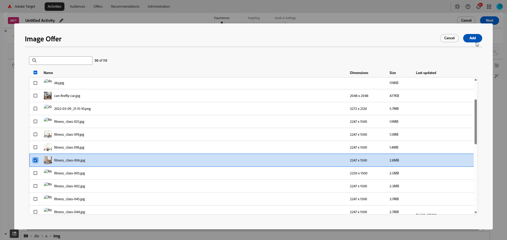

# Erstellen von Kombinationen {#create-combinations}

>[!BEGINSHADEBOX]

**Auf dieser Seite** Erfahren Sie, wie Sie das Bild und die HTML-Angebote erstellen, die die Kombinationen eines **[!UICONTROL Multivarianz-Tests“]**.

>[!ENDSHADEBOX]

In einem **[!UICONTROL Multivarianz-Test]** (MVT) enthält jeder Standort mehrere Angebote, und jede Kombination von Angeboten an den Standorten ist ein Erlebnis. Verwenden Sie den **[!UICONTROL Visual Experience Composer]** (VEC) in [!DNL Adobe Target], um die Angebote zu erstellen, die Sie in Ihren Test aufnehmen möchten.

Weitere Informationen zur Verwendung des VEC zum Erstellen und Bearbeiten von Angeboten finden Sie unter [Visual Experience Composer-Optionen](/help/main/c-experiences/c-visual-experience-composer/viztarget-options.md).

>[!NOTE]
>
>Sie können auf **[!UICONTROL Auswahl erweitern]** klicken, wenn Sie Objekte auf der Seite auswählen, um das übergeordnete Element zusätzlich zum ursprünglich ausgewählten Element auszuwählen. Wenn Sie ein übergeordnetes Element auswählen, werden alle untergeordneten Elemente dieses Elements automatisch ausgewählt. Sie können diese Auswahl mehrere Male erweitern.
>
>Sie können auch den [DOM-Pfad](/help/main/c-experiences/c-visual-experience-composer/viztarget-options.md#dom-path) zum Navigieren in Elementen verwenden.

## Bildangebote {#image-offers}

Testen Sie mehrere Bildangebote an einem Ort, um zu ermitteln, welches Bild am erfolgreichsten ist.

1. Klicken Sie auf ein Bild auf Ihrer Seite und wählen Sie **[!UICONTROL Bildangebot ändern]**.

   

1. Wählen **[!UICONTROL Dialogfeld „Bildangebot]** alle Bilder aus, die Sie in den Test einbeziehen möchten, und klicken Sie dann auf **[!UICONTROL Hinzufügen]**.

   

Jedes Bild wird zu einem eigenen Erlebnis an diesem Ort.

## HTML-Angebote {#html-offers}

Testen Sie mehrere HTML-Angebote an einem Ort, um zu ermitteln, welches Angebot am erfolgreichsten ist.

1. Klicken Sie auf Ihrer Seite auf ein HTML-Angebot und dann auf **[!UICONTROL HTML-Angebot]**.

   

1. Wählen Sie Ihr HTML-Angebot aus und klicken Sie **[!UICONTROL Angebot erstellen]** und dann auf **[!UICONTROL HTML-Angebot]**.

   

1. Benennen Sie das Angebot, geben Sie den Code für das HTML-Angebot ein, oder fügen Sie ihn ein. Klicken Sie dann auf **[!UICONTROL Erstellen]**.

   Wiederholen Sie den Vorgang für alle weiteren HTML-Angebote, die Sie einbeziehen möchten.

1. Klicken Sie auf **[!UICONTROL Speichern]**.

Jedes HTML-Angebot wird zu einem eigenen Erlebnis an diesem Ort.

Empfehlungen dazu, wie viele Kombinationen einbezogen werden sollten und wie sie vor dem Start des Tests überprüft werden können, finden Sie unter [Best Practices für Multivarianz-Tests](/help/main/c-activities/c-multivariate-testing/best-practices.md#create).
