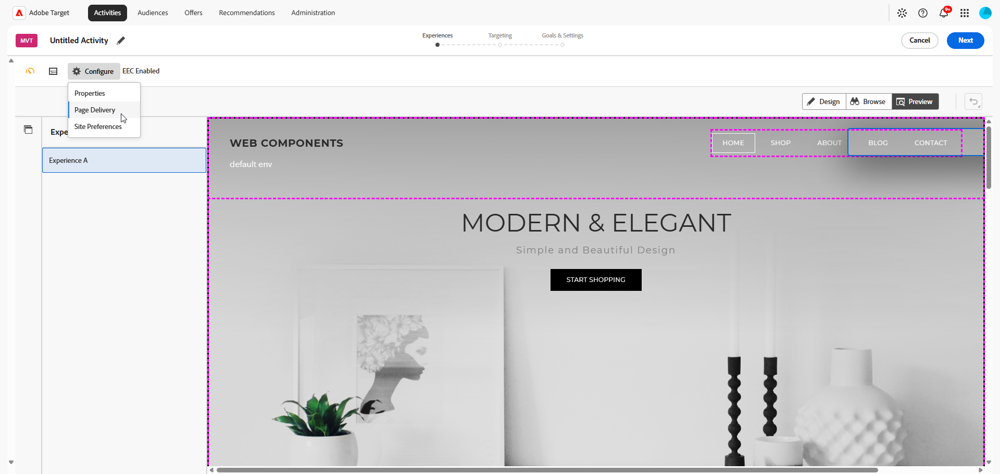

# Fehlerbehebung bei der Inhaltsbereitstellung {#content-trouble}

>[!BEGINSHADEBOX]

**Auf dieser Seite** Erfahren Sie, wie Sie die Inhaltsbereitstellung in [!DNL Adobe Target] debuggen, wenn Ihre Seite nicht den erwarteten Inhalt anzeigt.

>[!ENDSHADEBOX]

Wenn auf einer Seite der erwartete Inhalt nicht angezeigt wird, kann die Ursache ein Fehler im Aktivitäts-Code, eine fehlende oder falsch platzierte [!DNL Target] oder ein Konflikt mit einer anderen Aktivität sein. Überprüfen Sie Ihre Aktivität oder Ihren Kampagnen-Code sorgfältig, da ein Tippfehler oder ein anderer Fehler die Anzeige des erwarteten Inhalts verhindern kann. Verwenden Sie dann mboxTrace, mboxDebug oder Adobe Experience Cloud Debugger, um die [!DNL Target]-Anfrage zu überprüfen.

**mboxDebug** ist insbesondere bei der Einrichtung von [!DNL Target] auf Ihrer Seite hilfreich. Es stellt sicher, dass die [!DNL Target]-Anforderung ausgelöst und das Cookie gesetzt wird. Es geht jedoch nicht auf Details ein, die beim Debuggen der Inhaltsbereitstellung nützlich sind. Wenn Ihre Aktivität nicht auf Ihrer Seite erscheint oder unerwünschter Inhalt eingeblendet wird, verwenden Sie mboxTrace, um die Seite ausführlich zu untersuchen und Fehler zu diagnostizieren.

## Debugging-Tools {#debugging-tools}

### Abrufen des Autorisierungs-Tokens {#section_BED130298E794D1FA229DB7C3358BA54}

mboxTrace und mboxDebug können Kampagnendaten und Profildaten für externe Parteien verfügbar machen. Daher ist ein Autorisierungs-Token erforderlich. Das Autorisierungstoken kann in der [!DNL Target]-Benutzeroberfläche abgerufen werden. Das Token ist sechs Stunden lang gültig.

Für die Generierung eines Authentifizierungstokens benötigen Sie eine der folgenden Benutzerberechtigungen:

* Mindestens **[!UICONTROL Bearbeiter]** Berechtigung (oder **[!UICONTROL Genehmiger]**)

  Weitere Informationen für [!DNL Target Standard]-Kunden finden Sie unter [Festlegen von Rollen und Berechtigungen](/help/main/administrating-target/c-user-management/c-user-management/user-management.md#roles-permissions) für *Benutzer*. Weitere Informationen für [!DNL Target Premium]-Kunden finden Sie unter [Konfigurieren von Enterprise-Berechtigungen](/help/main/administrating-target/c-user-management/property-channel/properties-overview.md).

* Administratorrolle auf der Ebene Arbeitsbereich/Produktprofil

  Arbeitsbereiche stehen nur [!DNL Target Premium]-Kunden zur Verfügung. Weitere Informationen finden Sie unter [Konfigurieren von Enterprise-Berechtigungen](/help/main/administrating-target/c-user-management/property-channel/properties-overview.md).

* Administratorrechte (Berechtigung „Sysadmin“) auf der [!DNL Adobe Target]-Produktebene

So wird das Autorisierungstoken abgerufen:

1. Rufen Sie **[!UICONTROL Administration]** > **[!UICONTROL Implementierung]** auf.
1. Klicken Sie im Abschnitt mit den Debuggingwerkzeugen auf **[!UICONTROL Neues Authentifizierungstoken erstellen]**.

   

1. Fügen Sie das generierte Token Ihrer URL als Parameter hinzu, um eines der erweiterten Debuggingwerkzeuge zu aktivieren.

   

### mboxTrace {#section_256FCF7C14BB435BA2C68049EF0BA99E}

Mit mboxTrace können Sie an [!DNL Target]-Antworten angehängte Trace-Informationen abrufen. Trace-Informationen spiegeln das Ergebnis eines [!DNL Target]-Aufrufs (z. B. eine Konversion oder eine Impression) sowie alle weiteren Daten wider, die dazu beitragen festzustellen, weshalb es zu diesem Ergebnis gekommen ist, beispielsweise eine Reihe verfügbarer Niederlassungen, zwischen denen während einer Kampagne eine Auswahl getroffen wurde. Verwenden Sie diese Informationen für eine Fehlerdiagnose der Inhaltsbereitstellung.

Die folgenden Parameter stehen zur Verfügung:

| mboxTrace-Optionen | Resultat |
|--- |--- |
| `?mboxTrace=console` | Wird im Konsolenprotokoll als Objekt ausgegeben.<br>Bei „at.js“ können Sie kein neues Browser-Fenster öffnen oder wie bei „mbox.js“ (inzwischen nicht mehr unterstützt) eine Ausgabe in der Konsole veranlassen. Sie müssen stattdessen die Netzwerkanforderung prüfen und unter „Vorschau“ (Chrome) oder „Antwort“ (Firefox) nachsehen. |
| `?mboxTrace=json` | Wird im Konsolenprotokoll als buchstäbliche JSON-Zeichenfolge ausgegeben |
| `?mboxTrace=window` | Wird im Pop-up-Fenster als JSON-Zeichenfolge ausgegeben |
| `?mboxTrace=disable` | Schaltet den Trace-Sitzungsmodus ab |

**Beispiel für mboxTrace-Aufruf**

`https://www.mysite.com/page.html?mboxTrace=window&authorization=f543abf-0111-4061-9619-d41d665c59a6`

Die Ausgabe zeigt detaillierte Informationen über Ihren Inhalt an. mboxTrace zeigt Details zu Ihrer Kampagne oder Aktivität und Ihrem Profil an. Außerdem enthält es eine Momentaufnahme des Profils vor der Ausführung sowie eine Momentaufnahme der Änderungen nach der Ausführung. Es zeigt außerdem, welche Kampagnen oder Aktivitäten für jeden Ort ausgewertet wurden.

Ein Teil der Informationen umfasst übereinstimmende und nicht übereinstimmende Segment- und Ziel-IDs:

* **SegmentId**: IDs von Segmenten, entweder aus der Bibliothek mit den wiederverwendbaren Segmenten oder anonyme Segmente, die für die spezifische Kampagne erstellt wurden.
* **TargetId**: IDs von Zielen, entweder aus der Bibliothek mit den Zielausdrücken oder anonyme Ziele für beliebige Segmente aus der Kampagne.
* **Unmatched**: Die Anforderung in diesem Aufruf wurde für diese Segmente oder Ziele nicht zugelassen.
* **Matched**: Die Anforderung wurde für die angegebenen Segmente oder Ziele zugelassen.

**Verwenden von mboxTrace auf Seiten mit Empfehlungen**: Wenn Sie mboxTrace als Abfrageparameter auf Seiten mit Empfehlungen hinzufügen, wird das Recommendations-Design der Seite durch ein mboxTrace-Detailfenster ersetzt. In diesem Fenster werden ausführliche Informationen zu Ihren Empfehlungen angezeigt, darunter:

* Zurückgegebene Empfehlungen im Vergleich zu abgefragten Empfehlungen
* Der verwendete Schlüssel und ob er Empfehlungen generiert
* Nach Kriterien erstellte Empfehlungen im Vergleich zu Backup-Empfehlungen
* Kriterienkonfiguration
* Angewendete Aus- und Einschlüsse
* Auflistungsregeln

Sie müssen `=console`, `=json` oder `=window` nicht in den Abfrageparameter einbeziehen. Wenn Sie mit den mboxTrace-Details fertig sind, fügen Sie `=disable` hinzu und drücken Sie **[!UICONTROL Eingabetaste]**, um zum normalen Anzeigemodus zurückzukehren.

Die normale Funktionsweise und Erscheinung Ihrer Website wird durch mboxTrace nicht beeinträchtigt. Besucher sehen Ihr normales Recommendations-Design.

### mboxDebug {#mboxdebug}

Ergänzen Sie zur Verwendung von mboxDebug Ihre URL um einen mboxDebug-Parameter. Die folgende Tabelle enthält Informationen zu URL-Parametern von [!DNL Target] für Antworten.

Beachten Sie, dass einige mboxDebug-Parameter mit oder ohne Authentifizierung verfügbar sind.

| URL-Parameter | Zielsetzung |
|--- |--- |
| `mboxDebug=1` | Debugger<br>Wenn Sie diesen Parameter zu einer URL mit definierten Target-Anforderungen hinzufügen, wird ein Pop-up-Fenster mit hilfreichen Details zur Fehlerbehebung geöffnet. Cookie-Informationen, die PCid und Sitzungs-ID-Werte sind ausgeschrieben und alle URLs sind sichtbar. Klicken Sie auf eine Target-Anforderungs-URL, um die Antwort für diese [!DNL Target]-Anforderung einzublenden. Weitere Details finden Sie unter [mbox_debug.pdf](/help/main/assets/mbox_debug.pdf). |
| `mboxDisable=1` | Deaktivieren von Mboxes auf der Seite |
| `mboxOverride.browserIp=<Insert IP address>` | Geotargeting-Test<br>Mit diesem URL-Parameter wird das Geotargeting getestet. Geben Sie als Wert für dieses Attribut eine IP-Adresse ein; das [!DNL Target]-Geotargeting wertet diese IP-Adresse aus, damit sie mit einem in einer Kampagne festgelegten Geotargeting oder Segmentierungssatz abgeglichen wird. |

>[!NOTE]
>
>Geben Sie das URL-Fragment nach den Zeichenfolgeparametern der Abfrage ein. Alles nach dem ersten `#` wird als Fragmentkennung interpretiert und würde dazu führen, dass die Debugging-Parameter nicht korrekt funktionieren.

### Adobe Experience Cloud-Debugger {#section_A2798ED3A431409690A4BE08A1BFCF17}

Der Adobe Experience Cloud-Debugger hilft Ihnen, Ihre [!DNL Target] zu verstehen. Sie können die Bibliothekskonfiguration anzeigen, sicherstellen, dass Ihre benutzerdefinierten Parameter korrekt weitergeleitet werden, die Konsolenprotokollierung aktivieren und alle [!DNL Target] deaktivieren. Nachdem Sie sich bei Experience Cloud authentifiziert haben, können Sie mboxTrace verwenden, um Ihre Aktivität und Zielgruppenqualifikationen sowie Ihr Besucherprofil zu überprüfen.

Weitere Informationen finden Sie in den [Schulungsvideos](#training-videos) am Ende dieser Seite und unter &quot;[.js mit Adobe Experience Cloud Debugger &#x200B;](https://experienceleague.adobe.com/docs/target-dev/developer/client-side/at-js-implementation/functions-overview/target-debugging-atjs.html?lang=de){target=_blank}.

## Häufige Probleme {#common-problems}

+++ Topverkäufe werden nicht in Recommendations angezeigt.

Der *`SiteCatalyst: purchase`* kann nicht für Traffic-Daten des Einkaufsalgorithmus verwendet werden. Verwenden Sie stattdessen den Aufruf *`orderConfirmPage`*.

+++

</br>

+++ Formularbasierte Aktivitäten kollidieren mit Target Classic-Aktivitäten

Formularbasierte Aktivitäten, die mit [!DNL Target Standard/Premium] erstellt wurden, kollidieren möglicherweise mit Aktivitäten, die in der Benutzeroberfläche von [!DNL Target Classic] erstellt wurden und die gleiche [!DNL Target]-Anforderung verwenden. Weitere Informationen finden Sie unter [Aktivitätspriorität](/help/main/c-activities/priority.md).

+++

</br>

+++ Das [!DNL Target]-Cookie wird nicht gesetzt

Wenn Ihre Site über eine Subdomain verfügt, z. B. [!DNL us.domain.com], Sie jedoch das [!DNL Target] Cookie auf [!DNL domain.com] setzen müssen (anstelle von [!DNL us.domain.com]), müssen Sie die `cookieDomain` überschreiben. Weitere Informationen finden Sie unter [targetGlobalSettings()](https://experienceleague.adobe.com/docs/target-dev/developer/client-side/at-js-implementation/functions-overview/targetglobalsettings.html?lang=de){target=_blank}.

+++

</br>

+++ Inhalte flackern oder werden nicht angezeigt, wenn ein Element auch Teil der Adobe Experience Manager-Personalisierung ist

Wenn ein DOM-Element zum Adobe Experience Manager (AEM)-Personalisierungstargeting und zu einer [!DNL Target]-Aktivität gehört, flackert [!DNL Target] Inhalt möglicherweise, oder er wird nicht angezeigt.

Um dies zu beheben, können Sie die AEM-Personalisierung für Seiten deaktivieren, auf denen [!DNL Target] ausgeführt wird.

+++

</br>

+++ Umleitungs- und Remote-Angebote können aufgrund einer ungültigen URL nicht bereitgestellt werden

Wenn das Umleitungs- oder Remote-Angebot eine ungültige URL verwendet, kann es möglicherweise nicht bereitgestellt werden.

* Bei Umleitungsangeboten kann die [!DNL Target]-Antwort `/* invalid redirect offer URL */` enthalten.
* Bei Remote-Angeboten kann die [!DNL Target]-Antwort `/* invalid remote offer URL */` enthalten.

Sie können die [!DNL Target] im Browser oder mit mboxTrace überprüfen. Weitere Informationen zu gültigen URLs finden Sie unter [https://tools.ietf.org/html/std66](https://tools.ietf.org/html/std66).

+++

</br>

+++ [!DNL Target] werden auf meiner Site nicht ausgelöst

at.js löst keine [!DNL Target] aus, wenn Sie einen ungültigen Doctype verwenden. at.js erfordert den Doctype HTML 5.

+++

## Aktivitäten mit Abfragezeichenfolgen-Parametern in der URL {#query-strings}

Die **[!UICONTROL Aktivitäts-URL]** bestimmt die Seite, die Besucher für die Aktivität qualifiziert, und rendert die Aktivitätserlebnisse für Benutzer. Wenn Sie bei der Aktivitätserstellung dazu aufgefordert werden, stellt das Eingeben der vollständigen URL nicht immer sicher, dass der Inhalt auf dieser Website auch bereitgestellt wird, insbesondere bei URLs, die Abfragezeichenfolgen-Parameter enthalten.

Standardmäßig öffnet der [!UICONTROL Visual Experience Composer] (VEC) die Seite, die in Ihren [Visual Experience Composer-Einstellungen) &#x200B;](/help/main/administrating-target/visual-experience-composer-set-up.md) ist. Sie können während der Erstellung der Aktivität eine andere Seite angeben.

Um nach dem Öffnen von VEC eine andere Seite anzuzeigen, klicken Sie auf **[!UICONTROL Zahnradsymbol konfigurieren]** wählen Sie **[!UICONTROL Seitenbereitstellung]** und geben Sie dann die gewünschte URL im Feld **[!UICONTROL Aktivitäts-URL]** an.



Wenn die URL Abfragezeichenfolgenparameter enthält, ist die Seite möglicherweise nicht für die Aktivität qualifiziert oder zeigt den personalisierten Inhalt an. Unabhängig von Ihrer Zielgruppe können Sie zur Definition Ihrer Abfrageparameter zusätzlich zur Basis-URL Vorlagenregeln einfügen.

Die folgenden Optionen können verwendet werden, um zusätzliche Vorlagenregeln einzuschließen:

* **Option 1** Die URL replizieren und in der Vorlagenregel belassen, indem die Option „contains“ ausgewählt wird.

  +++ Anzeigen der Vorlagenregel-Einrichtung

  Diese Option stellt sicher, dass diese URL für die Aktivität geeignet ist. Beachten Sie jedoch, dass damit Sonderfälle verbunden sind, die Ihre Berichtsdaten mit zusätzlichen Einträgen zu URLs beeinflussen können, die die Basis-URL enthalten.

  In diesem Szenario lautet die URL `https://shopping.mycart.com?type=Summers%20Offers`, und zusätzliche Vorlagenregeln „enthalten“ dieselbe URL, getrennt durch einen OR-Operator:

  

  +++

* **Option 2:** Beschränken Sie die URL-Bedingung „contains“ auf die Abfragezeichenfolge.

  +++ Anzeigen der Vorlagenregel-Einrichtung

  Der in der vorherigen Option beschriebene Sonderfall wird in dieser Option angewendet, aber hier ist die bedingte Einrichtung auf die Abfragezeichenfolge beschränkt.

  In diesem Szenario lautet die URL `https://shopping.mycart.com?type=Summers%20Offers` und zusätzliche Vorlagenregeln „enthalten“ nur die Abfragezeichenfolge, getrennt durch einen OR-Operator:

  

  +++

* **Option 3:** Verwenden Sie anstelle der vollständigen URL einen bestimmten Teil der URL

  +++ Anzeigen der Vorlagenregel-Einrichtung

  In diesem Szenario lautet die URL `https://shopping.mycart.com?type=Summers%20Offers`, und zusätzliche Vorlagenregeln geben eine **[!UICONTROL Abfrage]** mit **[!UICONTROL type]** > **[!UICONTROL ist (von Schreibweise abhängig)]** > type=Summers%20Offers an, getrennt durch einen OR-Operator:

  

  +++

## Maskieren von Anführungszeichen in Profilattributwerten {#escape}

Wenn Sie Werte senden, die doppelte Anführungszeichen in einem [!DNL Target] Profilattribut enthalten, müssen Sie sie wie unten dargestellt doppelt mit Escape-Zeichen versehen.

```
adobe.target.trackEvent({
    "mbox": "data-collection",
    "params":    {
        "profile.tagLine": "Escape \\\"Double Quotes\\\" like this."
    }
});
```

## Schulungsvideos {#training-videos}

In den folgenden Videos erhalten Sie weitere Informationen zu den in diesem Artikel behandelten Konzepten.

### Fügen Sie die Erweiterung 

>[!VIDEO](https://video.tv.adobe.com/v/23114t2/)

### Grundlegende Fehlerbehebung in Adobe Target 

>[!VIDEO](https://video.tv.adobe.com/v/23115t2/)

### Mbox Trace 

>[!VIDEO](https://video.tv.adobe.com/v/23113t2/)
