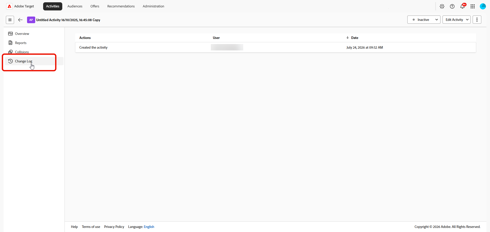

# Aktivitätsänderungsprotokoll {#change-log}

>[!BEGINSHADEBOX]

**Auf dieser Seite** Erfahren Sie, wie Sie die Aktionen anzeigen können, die an einer Aktivität, von wem und wann durchgeführt wurden.

>[!ENDSHADEBOX]

Im [!DNL Adobe Target] **[!UICONTROL Änderungsprotokoll]** werden die Aktionen aufgezeichnet, die für eine Aktivität durchgeführt wurden, einschließlich Änderungen, der Urheber der Änderungen und des Zeitpunkts ihrer Durchführung. Er gibt einen klaren Verlauf der Aktivität an und die Seite **[!UICONTROL Änderungsprotokoll]** wird für Echtzeit-Einblicke ausgefüllt.

So greifen Sie auf die **[!UICONTROL Änderungsprotokoll]** zu:

1. Klicken Sie **[!UICONTROL Aktivitäten]** und dann auf die Aktivität in der Liste.
1. Klicken Sie **[!UICONTROL der linken Leiste auf]**&#x200B;Änderungsprotokoll“.

   Auf der Seite werden die ausgeführte Aktion, das Datum der Aktion und der Benutzer aufgelistet, der sie ausgeführt hat, sobald eine Aktivität erstellt, aktualisiert, aktiviert oder deaktiviert wird. Änderungen an benutzerdefinierten Zielen und in der Aktivität verwendeten Angeboten werden ebenfalls aufgelistet.

   

1. Um die Aktionen in auf- oder absteigender Reihenfolge aufzulisten, klicken Sie auf die Spaltenüberschrift **[!UICONTROL Datum]**.

1. Aktualisieren Sie die Seite, um die Statusänderungen zu sehen.

## Target-Auditprotokoll-APIs

* [Revisionen: Auditprotokoll nach dem Namen des letzten Autors und einem Zeitstempel nach der Änderung abrufen](https://developer.adobe.com/target/administer/admin-api/#tag/Revisions){target=_blank}
* [Aktivitäts-Änderungsprotokoll auflisten](https://developer.adobe.com/target/administer/admin-api/#tag/Activities/operation/getChangelog){target=_blank}
