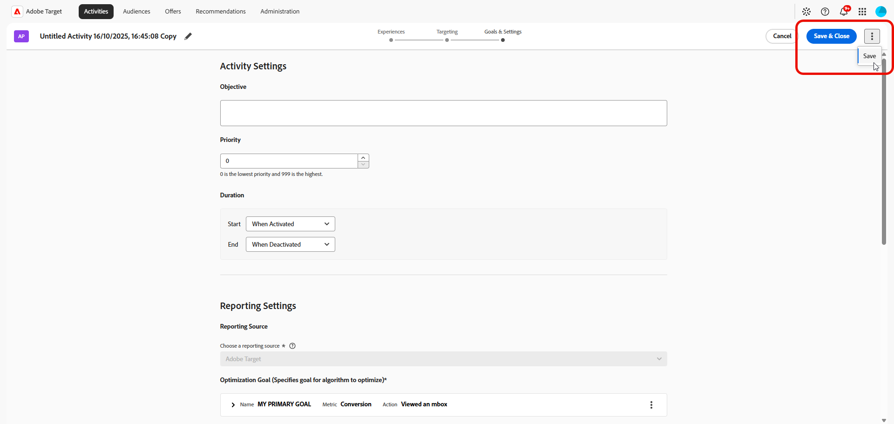

# Bearbeiten einer Aktivität {#edit-activity}

>[!BEGINSHADEBOX]

**Auf dieser Seite** Erfahren Sie, wie Sie eine vorhandene Aktivität auf der Seite **[!UICONTROL Aktivitäten]** bearbeiten, eine Aktivität bei Verwendung von Arbeitsbereichen kopieren und welche Aktionen für ältere Aktivitäten gelten.

>[!ENDSHADEBOX]

Vorhandene Aktivitäten können an verschiedenen Stellen der [!DNL Adobe Target] bearbeitet werden, sodass Änderungen an Erlebnissen, Zielgruppenbestimmungsregeln oder Zielen keine Neuerstellung der Aktivität erfordern. Die Schritte variieren je nach ausgewählter Methode. Die Funktion **[!UICONTROL Als Entwurf speichern]** ist nicht mehr verfügbar. Weitere Informationen finden Sie unter **[!UICONTROL Status]** unter [Filter auf die Aktivitätenliste anwenden](/help/main/c-activities/activities.md#filters).

## Bearbeiten über das Symbol [!UICONTROL Mehr Aktionen] {#section_29EE2ECA6B88473A8F9AC5600FFBB174}

So bearbeiten Sie eine Aktivität anhand des dreistufigen Workflows:

1. Klicken Sie auf der **[!UICONTROL Aktivitäten]** auf das Symbol **[!UICONTROL Mehr Aktionen]** (  ) neben der Aktivität und dann auf **[!UICONTROL Bearbeiten]**.

   [!DNL Target] öffnet die Aktivität im **[!UICONTROL Visual Experience Composer]** (VEC) und zeigt die Seite **[!UICONTROL Erlebnisse]** an, die den ersten Schritt des Workflows darstellt.

   

1. Bearbeiten Sie die Aktivität mithilfe der [VEC-Optionen](/help/main/c-experiences/c-visual-experience-composer/viztarget-options.md).

1. Klicken Sie **[!UICONTROL Weiter]**, um mit dem nächsten Schritt fortzufahren, und nehmen Sie dann die erforderlichen Änderungen vor.

1. Speichern Sie auf **[!UICONTROL Seite „Ziele]** Einstellungen“ die Änderungen mithilfe einer der folgenden Optionen:

   * **[!UICONTROL Speichern und schließen]:** Speichert die Änderungen und zeigt die Seite **[!UICONTROL Übersicht]** der Aktivität an.
   * **[!UICONTROL Speichern]:** Klicken Sie auf das Symbol **[!UICONTROL Mehr Aktionen]** (  ) und wählen Sie dann **[!UICONTROL Speichern]**, um die Änderungen zu speichern und im VEC zu bleiben, wo Sie weitere Änderungen vornehmen können. Warten Sie, bis das Speichern abgeschlossen ist, bevor Sie weitere Änderungen vornehmen. Nach Abschluss des Speichervorgangs wird VEC mit den aktualisierten Änderungen neu geladen.

     

## Aus dem Aktivitätsnamen bearbeiten {#section_176180DAD17E40CEA441903F39E0AA1C}

So gehen Sie direkt zu dem Schritt, der geändert werden muss, ohne den Workflow schrittweise zu durchlaufen:

1. Klicken Sie auf der **[!UICONTROL Aktivitäten]** auf die Aktivität, um sie zu öffnen, und wählen Sie dann eine der Optionen aus der Dropdown-Liste **[!UICONTROL Aktivität bearbeiten]** aus:

   * **[!UICONTROL Erlebnisse bearbeiten]:** Öffnet die Seite **[!UICONTROL Erlebnisse]** (der erste Schritt des Workflows).
   * **[!UICONTROL Targeting bearbeiten]:** Öffnet die Seite **[!UICONTROL Targeting]** (zweiter Schritt des Workflows).
   * **[!UICONTROL Ziele und Einstellungen]:** Öffnet die Seite **[!UICONTROL Ziele und Einstellungen]** (der dritte Schritt des Workflows).

     

1. Nehmen Sie die Änderungen vor und speichern Sie dann die Aktivität mit **[!UICONTROL Speichern und schließen]** oder **[!UICONTROL Speichern]**, wie im vorherigen Abschnitt beschrieben.

## Kopieren und Bearbeiten mit Arbeitsbereichen {#section_45A92E1DD3934523B07E71EF90C4F8B6}

Mithilfe eines Arbeitsbereichs können Organisationen bestimmte Benutzergruppen bestimmten Eigenschaftsgruppen zuweisen. Arbeitsbereiche ähneln auf vielerlei Weise den Report Suites in [!DNL Adobe Analytics].

>[!NOTE]
>
>Arbeitsbereiche sind Teil der Funktionen **[!UICONTROL Eigenschaften und Berechtigungen]** , die als Teil der [!DNL Target Premium]-Lösung verfügbar sind. Für [!DNL Target Standard] sind sie nicht ohne [!DNL Target Premium]-Lizenz verfügbar.

Wenn Sie Teil einer multinationalen Organisation sind, besitzen Sie eventuell einen Arbeitsbereich für Ihre europäischen Webseiten, Eigenschaften oder Sites und einen weiteren Arbeitsbereich für Ihre amerikanischen Webseiten, Eigenschaften oder Sites. Wenn Sie einer Organisation angehören, die mehrere Marken besitzt, haben Sie eventuell für jede Marke einen eigenen Arbeitsbereich.

Weitere Informationen zu Arbeitsbereichen und der Funktionalität für Enterprise-Benutzerberechtigungen finden Sie unter [Enterprise-Benutzerberechtigungen](/help/main/administrating-target/c-user-management/property-channel/property-channel.md#concept_E396B16FA2024ADBA27BC056138F9838).

Wenn Sie **[!UICONTROL Enterprise-Benutzerberechtigungen]** in Ihrer Umgebung aktiviert haben, können Sie Aktivitäten in denselben Arbeitsbereich oder in einen anderen Arbeitsbereich kopieren. Es ist zurzeit nicht möglich, eine Aktivität von einem Arbeitsbereich in einen anderen zu verschieben. Um eine Aktivität in einen anderen Arbeitsbereich zu kopieren, klicken Sie auf der Seite **[!UICONTROL Aktivitäten]** auf das Symbol **[!UICONTROL Mehr Aktionen]** (  ) neben der Aktivität, die Sie kopieren möchten, und klicken Sie dann auf **[!UICONTROL Kopieren]**.

Beachten Sie die folgenden Informationen, wenn Sie die Kopier- und Bearbeitungsfunktionalität mit Arbeitsbereichen verwenden:

* Wenn Sie eine Aktivität im selben Arbeitsbereich oder aus dem Standardarbeitsbereich in einen nicht standardmäßigen Arbeitsbereich kopieren, wird der Aktivitätsassistent automatisch geöffnet. In arbeitsbereichsübergreifenden Kopien müssen Sie möglicherweise nur die Eigenschaften der Aktivität aktualisieren.
* Wenn eine Aktivität von einem nicht standardmäßigen Arbeitsbereich in einen anderen Arbeitsbereich kopiert wird (unabhängig davon, ob es sich um einen standardmäßigen oder nicht standardmäßigen Arbeitsbereich handelt), wird der Aktivitätsassistent geöffnet. Zum Abschließen der Einrichtung sind einige manuelle Eingaben erforderlich:
  * **[!UICONTROL Eigenschaften]**: Eigenschaften können je nach Arbeitsbereich unterschiedlich sein. Diese Situation könnte einen Trigger für einen Warnhinweis darstellen:

    * In **[!UICONTROL Form-Based Experience Composer]** werden Warnungen direkt in der Benutzeroberfläche angezeigt, um eine sofortige Sichtbarkeit zu gewährleisten.

      

    * In VEC werden Warnungen angezeigt, wenn Sie auf **[!UICONTROL Konfigurieren]** > **[!UICONTROL Eigenschaften]** klicken.

      Um dieses Problem zu beheben, klicken Sie auf **[!UICONTROL Hinzufügen/Entfernen]** sodass nur die im Zielarbeitsbereich verfügbaren Eigenschaften zur Auswahl angezeigt werden.

  * **Audiences und Angebote**: Beim Kopieren einer Aktivität in einen neuen Arbeitsbereich werden alle zugehörigen [!DNL Target]- oder Ad-hoc-Audiences und -Angebote aus dem ursprünglichen Arbeitsbereich mithilfe des folgenden Formats dupliziert: `<Entity Name> Copy <Date>` für [!DNL Target] Audiences und für Ad-hoc-Angebote `<Entity Name>`.

    Verhaltensdetails:

    * Kopierte Zielgruppen und Angebote werden erst dann in den Listen **[!UICONTROL Zielgruppen]** und **[!UICONTROL Angebote]** angezeigt, wenn die Aktivität gespeichert und erneut geöffnet wird.
    * Diese Entitäten können nicht sofort nach dem Kopieren bearbeitet werden. Kunden sehen möglicherweise während der ersten Bearbeitungssitzung leere Inhalte in Visual Experience Composer für diese Elemente.
    * Kunden können kopierte Zielgruppen oder Angebote bei Bedarf aus dem Zielarbeitsbereich durch andere ersetzen.

    Dieser Prozess sorgt für eine reibungslosere Duplizierung von Arbeitsbereich-übergreifenden Aktivitäten und bietet gleichzeitig Flexibilität bei der Anpassung.

    Beim Kopieren einer Aktivität müssen Nicht-Target-Zielgruppen und Angebote, die weder im aktuellen noch im Standardarbeitsbereich gespeichert sind, manuell ersetzt werden.

    Durch das manuelle Ersetzen dieser Zielgruppen, Zielgruppen und Angebote wird sichergestellt, dass in der kopierten Aktivität nur gültige, barrierefreie Entitäten verwendet werden. Außerdem werden Fehler während der Bearbeitung oder des Versands vermieden.

    

>[!NOTE]
>
>Wenn in Ihrer Umgebung die Funktion **[!UICONTROL Enterprise-Benutzerberechtigungen]** nicht aktiviert ist, werden alle Aktivitäten im Bearbeitungsmodus geöffnet, bevor sie kopiert werden.

## Alte [!DNL Recommendations Classic] Aktivitäten {#classic}

Die **[!UICONTROL Aktivitäten]** zeigt Aktivitäten an, die in verschiedenen Quellen erstellt wurden, darunter auch [!DNL Recommendations Classic]. Die folgenden Aktionen sind für veraltete Aktivitäten verfügbar, die in [!DNL Recommendations Classic] erstellt wurden:

* **[!UICONTROL Aktivieren]**
* **[!UICONTROL Deaktivieren]**
* **[!UICONTROL Archivieren]**
* **[!UICONTROL Kopieren]**
* **[!UICONTROL Löschen]**

Eine [!DNL Recommendations] kann nicht direkt bearbeitet werden. Um sie zu bearbeiten, erstellen Sie mithilfe von [!DNL Target Premium] eine Kopie der Aktivität und speichern Sie die neue Aktivität, die dann nach Bedarf bearbeitet werden kann.
