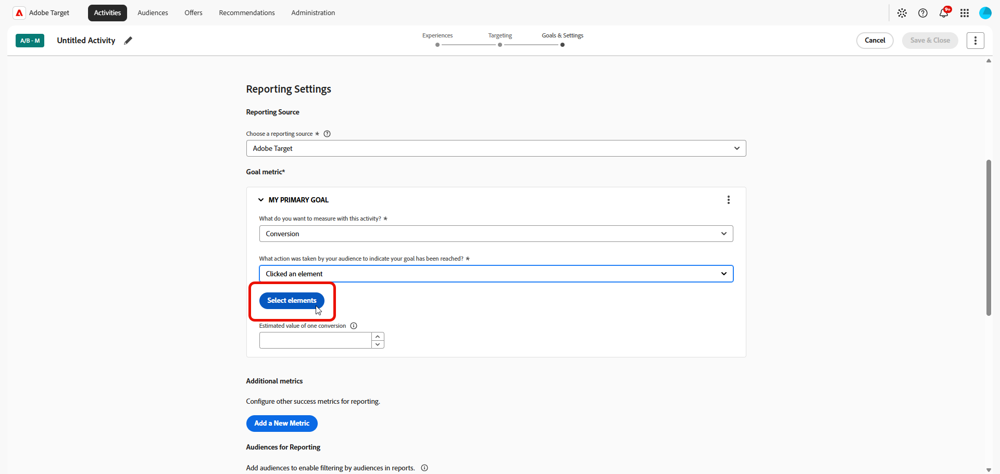
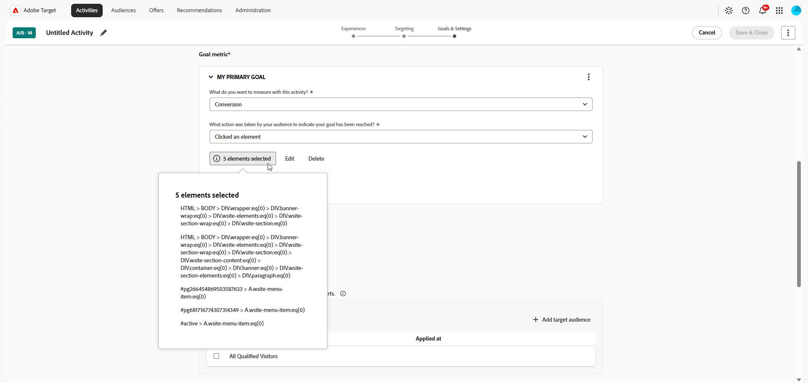
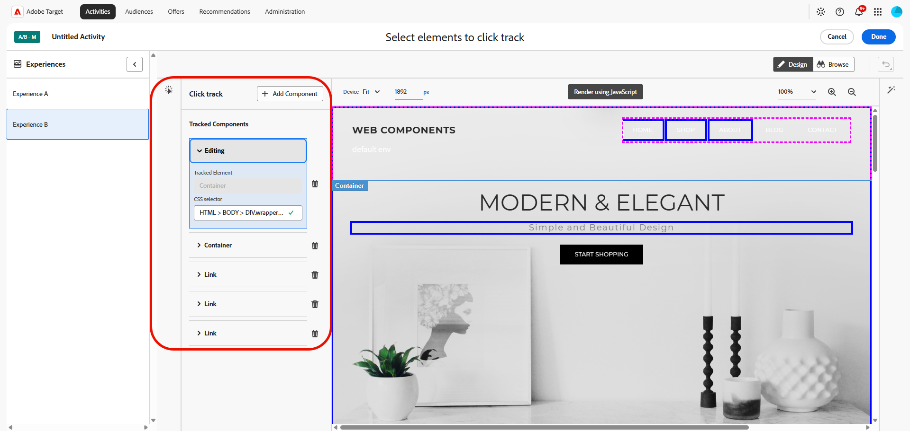
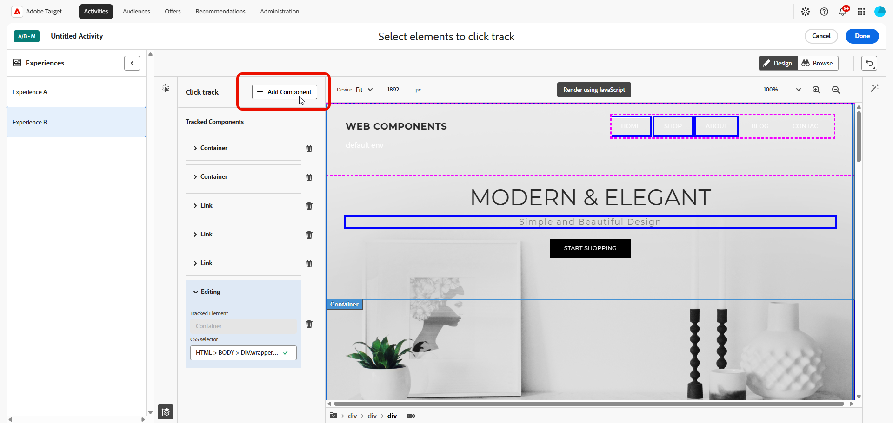
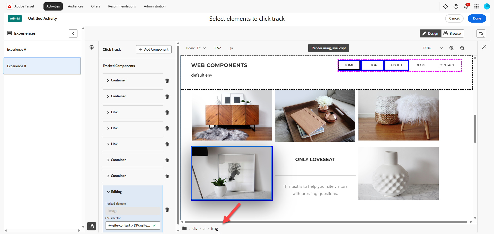

# Klick-Tracking {#click-tracking}

>[!BEGINSHADEBOX]

**Auf dieser Seite** Erfahren Sie, wie Sie Klicks auf Seitenelemente als Erfolgsmetrik verfolgen, wie Sie die ausgewählten Elemente verwalten und was bei der Auswahl von Elementen zu beachten ist.

>[!ENDSHADEBOX]

[!DNL Adobe Target] können Sie Klicks auf beliebige Elemente als Erfolgsmetrik verfolgen. Klick-Tracking bezieht sich auf den Prozess der Überwachung und Aufzeichnung von Benutzerinteraktionen, insbesondere Klicks auf Elemente innerhalb einer Web-Seite oder eines Erlebnisses. Dies ist ein wichtiger Bestandteil zur Messung der Interaktion und Leistung bei A/B-Tests, multivariaten Tests und Personalisierungsaktivitäten.

>[!NOTE]
>
>Das Tracking von Klicks wird bei der globalen [!DNL Target]-Anfrage bei Verwendung als Standort in einer formularbasierten Aktivität nicht unterstützt.

## Klick-Tracking einrichten {#section_5540C5A533114E57BAE022A600B02E72}

Klick-Tracking ist eine Art von Konversionserfolgsmetrik. Es zählt die Klicks, die Aktivitätsteilnehmer auf die von Ihnen ausgewählten Seitenelemente ausführen, sodass Sie messen können, wie Besucherinnen und Besucher mit diesen Elementen interagieren. Jedes Element einer Seite kann verfolgt werden, z. B. ein Link, eine Schaltfläche oder ein Bild.

1. Wenn Sie Ihre Ziele auf der Seite **[!UICONTROL Ziele und Einstellungen]** für Ihre Aktivität festlegen, wählen Sie die Erfolgsmetrik **[!UICONTROL Konversion]** aus.

1. Wählen Sie als Aktion **[!UICONTROL Klicks auf ein Element]** aus und klicken Sie anschließend auf **[!UICONTROL Elemente auswählen]**.

   

   Ihre Seite wird im **[!UICONTROL Visual Experience Composer]** (VEC) geöffnet.

1. Wählen Sie die Elemente aus, die Sie verfolgen möchten.

   Unter [Überlegungen](#considerations) finden Sie Tipps zum Auswählen von Elementen.

1. Klicken **[!UICONTROL oben]** Bildschirm auf „Fertig“, um Ihre Auswahl zu speichern.

   Die Zielmetrik auf der Seite **[!UICONTROL Ziele und Einstellungen]** zeigt dann die Anzahl der ausgewählten Elemente an. Bewegen Sie den Mauszeiger darüber, um die Elemente zu sehen.

   

Wenn ein Aktivitätsteilnehmer auf ein ausgewähltes Element klickt, wird dieser Klick als Konversion gezählt.

## Bedienfeld „Ausgewählte Elemente“ {#selected-elements}

Für **[!UICONTROL A/B]**-, **[!UICONTROL Erlebnis-Targeting]** (XT)-, **[!UICONTROL Automated Personalization]** (AP)- und **[!UICONTROL Multivarianz-Test]**(MVT)-Aktivitäten werden im Bereich **[!UICONTROL Ausgewählte Elemente]** die für Klick-Tracking ausgewählten Elemente auf der linken Seite aufgeführt.

Es gibt mehrere Aktionen, die ausgeführt werden können, wenn Sie im Bedienfeld „Ausgewählte Elemente“ auf **[!UICONTROL Element]**. In der folgenden Tabelle werden die einzelnen Aktionen beschrieben, die für ein Element durchgeführt werden können:

| Aktion | Beschreibung |
| --- | --- |
| **[!UICONTROL Getrackte Aktionen]** | Zeigt die Elementaktion an. |
| **[!UICONTROL CSS-Auswahl]** | Ermöglicht die Bearbeitung des CSS-Selektors. |
| [!DNL Delete] | Löscht das Element. |

### Element hinzufügen

Wenn Sie den DOM-Pfad zum Selektor bereits kennen, können Sie ihn manuell hinzufügen, indem Sie auf das Symbol **[!UICONTROL Komponente hinzufügen]** oben im Bedienfeld klicken.

## Zu beachten {#considerations}

### Elemente auswählen

* Wenn Sie auf ein Element klicken, wird das Menü VEC-Optionen angezeigt, und der DOM-Pfad des Elements wird unten auf der Seite angezeigt. Verwenden Sie den DOM-Pfad, um Informationen zum Element anzuzeigen (Typ, ID und Klasse), und um den Pfad nach oben oder unten zu verschieben, um das gewünschte Element auszuwählen.

  Das Element, das Sie im DOM-Pfad auswählen, wird im VEC **[!UICONTROL Ausgewählt]** angezeigt. Um die Auswahl aufzuheben, klicken Sie erneut im DOM-Pfad darauf oder klicken Sie **[!UICONTROL VEC auf]** Feld „Ausgewählt“.

  

  Weitere Informationen finden Sie unter [Navigate elements using the DOM path (In Elementen über den DOM-Pfad navigieren)](/help/main/c-experiences/c-visual-experience-composer/viztarget-options.md#dom-path) in *Visual Experience Composer–Optionen*.

* Sie können eine andere Seite aufrufen, um Klicks auf einer Seite zu verfolgen, auf der Sie möglicherweise keine Inhalte ändern. Diese andere Seite muss mithilfe der [Mehrseiten-Funktion“ in die Aktivität aufgenommen ](/help/main/c-experiences/c-visual-experience-composer/multipage-activity.md) und dafür [!DNL at.js] implementiert werden.
* Achten Sie darauf, die Ebene des Elements auszuwählen, die Sie verfolgen möchten. Wenn Sie zum Beispiel eine Schaltfläche angeben möchten, achten Sie darauf, den Link und nicht den Schaltflächentext auszuwählen.
* Wenn Sie mehr als ein Element auswählen und ein Teilnehmer auf eines der ausgewählten Elemente klickt, wird der Klick gezählt. Sie können die Elemente getrennt zählen, indem Sie jeweils einzelne Erfolgsmetriken für sie festlegen. Wenn nur ein einzelnes Element gezählt werden soll, obwohl auf mehrere Elemente der Seite geklickt wird, müssen Sie dem CSS-Element-Selektor mehrere Elemente zuordnen.
* Bei **[!UICONTROL Automated Personalization]** (AP)- und Auto-Targeting-Aktivitäten in Single Page Applications (SPAs) können Sie Elemente für das Klick-Tracking auswählen, die zu einer bestimmten [!DNL Target] gehören. Weitere Informationen zu Ansichten finden Sie unter [Adobe Target-Ansichten und Einzelseitenanwendungen](/help/main/c-experiences/spa-visual-experience-composer.md).

### Anzahl der Klicks

* Klickereignisse werden auf derselben Seite des Klicks an [!DNL Target] gesendet.
* Klick-Tracking-Metriken sind mit keinem bestimmten Erlebnis in einer Aktivität verknüpft.
* Verwenden Sie Zielgruppen, wenn Sie den Umfang der Klick-Tracking-Metriken einschränken müssen.
* Mehrere Aktivitäten können eine Click-Tracking-Metrik für denselben Selektor definieren. Wenn dies der Fall ist und ein Besucher sich für eine dieser Aktivitäten qualifiziert und auf diesen Selektor klickt, erhöht sich die Klick-Tracking-Metrik für alle zugehörigen Aktivitäten, für die der Besucher qualifiziert ist.

### Analytics und at.js

* Wenn es sich bei der Klick-Tracking-Metrik um die Zielmetrik einer **[!UICONTROL Analytics for Target]** (A4T)-Aktivität handelt, muss der Besucher innerhalb von 60 Sekunden nach dem Laden der Seite auf dieses Element klicken, damit das Metrik-Tracking erfolgt.
* Wenn Sie [!DNL at.js]-Klick-Tracking und [!DNL Analytics]-AppMeasurement verwenden, hebt [!DNL at.js]-Klick-Tracking alle anderen Klick-Ereignishandler auf. Aus diesem Grund wird der AppMeasurement-Klick-Handler niemals ausgeführt.

  [!DNL at.js] behandelt Klick-Tracking auf besondere Art und Weise, wenn das zugrundeliegende Element ein `A`-Tag (Link) oder ein `FORM`-Tag ist. Es werden die folgenden Schritte von [!DNL at.js] ausgeführt, wenn das Klick-Tracking-Ereignis zu einem `A`-Tag (Link) oder einem `FORM`-Tag hinzugefügt wird:

  1. `event.preventDefault()` aufrufen

  1. Lösen Sie die [!DNL Target]-Anfrage aus.

  1. Nach erfolgreicher [!DNL Target]-Anfrage oder nach „error“-Rückruf wird ein Standardverhalten ausgeführt:

     * `A`-Tag (Link): Das Standard-Verhalten ist es, zu der URL zu navigieren, die durch das HREF-Attribut definiert wird.
     * `FORM`-Tag: Das Standard-Verhalten ist es, das Formular zu übermitteln.

  Bei diesem Standardverhalten kommt es möglicherweise zu Konflikten mit [!DNL Analytics]-Klick-Tracking. Wenn Sie [!DNL Analytics] verwenden, sollten Sie das Klick-Tracking über [!DNL Analytics] ausführen statt über [!DNL Target].

### Beschränkungen

* Klick-Tracking funktioniert nicht bei Elementen, in deren Selektoren Escapezeichen enthalten sind, unter anderem die folgenden:

  | Zeichen | Beschreibung |
  |---|---|
  | # | Nummernzeichen oder Hash |
  | : | Doppelpunkt |
  | . | Punkt |
  | $ | Dollarzeichen |
  | `[ ]` | Eckige Klammern |

* Klick-Tracking wird nicht auf Seiten aufgezeichnet, wo die Seite und die Aktivitäts-URL zu unterschiedlichen Präsenzen gehören. Berechtigungen für Unternehmensbenutzer sind eine [!DNL Target Premium]-Funktion. Weitere Informationen finden Sie unter [Enterprise-Benutzerberechtigungen](/help/main/administrating-target/c-user-management/property-channel/property-channel.md).

## Schulungsvideo {#section_36607204DAE146E3B8E2C609D244EDB1}

In diesem Video sind Informationen zur Erstellung von Klick-Tracking-Erfolgsmetriken enthalten.

* Erläuterung von „Zielmetriken“
* Verstehen und Erstellen **[!UICONTROL Metriken]** Konversion **[!UICONTROL Umsatz]** und **[!UICONTROL Interaktion]**
* Erstellen einer Metrik mit Klick-Tracking

>[!VIDEO](https://video.tv.adobe.com/v/17380)
