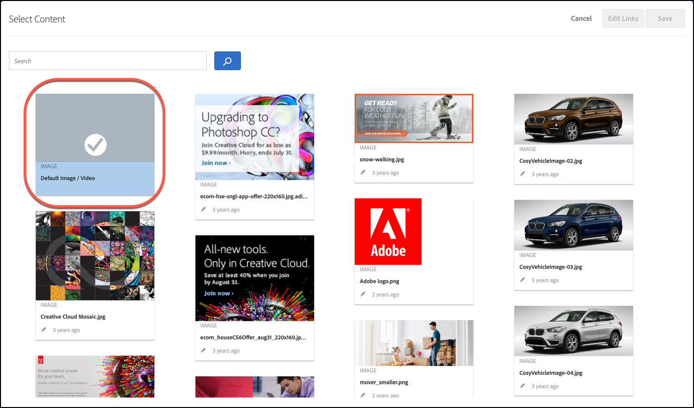

# Verwalten von Ausschlüssen {#manage-exclusions}

>[!BEGINSHADEBOX]

**Auf dieser Seite** Erfahren Sie, wie Sie in **[!UICONTROL Automated Personalization-Aktivitäten doppelte Angebote verhindern, bestimmte Erlebnisse ausschließen und Standardinhalte]**.

>[!ENDSHADEBOX]

Ausschlüsse steuern, welche Angebote und Erlebnisse eine **[!UICONTROL Automated Personalization]** (AP)-Aktivität bereitstellt. Sie verhindern, dass dasselbe Angebot zweimal angezeigt wird, entfernen Angebotskombinationen, die nicht zusammenarbeiten, und entfernen Standardinhalte, sodass die Aktivität sauberere und relevantere Erlebnisse bietet, die mit Ihren Zielen und Ihrer Audience übereinstimmen.

## Doppelte Angebote zulassen oder nicht zulassen {#allow-duplicate-offers}

Verhindern Sie, dass Angebote aus der Angebotsbibliothek dupliziert werden, wenn sie an verschiedenen Stellen in AP-Aktivitäten verwendet werden.

Eine Aktivität kann beispielsweise sechs Orte auf einer Seite mit zwölf Angeboten umfassen, sodass dasselbe Angebot an mehr als einer Stelle platziert werden kann. Durch das Deaktivieren doppelter Angebote wird verhindert, dass dasselbe Angebot gleichzeitig an verschiedenen Stellen innerhalb derselben Aktivität angezeigt wird.

1. Klicken [&#x200B; beim Erstellen oder Bearbeiten einer AP](/help/main/c-activities/t-automated-personalization/create-ap-activity.md#create-ap-activity)Aktivität auf das Symbol **[!UICONTROL Konfigurieren]** (  ).

1. Klicken Sie **[!UICONTROL Duplizierte Angebote zulassen]**, um diese Funktion je nach Bedarf zu aktivieren oder zu deaktivieren.

   

## Ausschließen spezifischer Erlebnisse {#exclude-experiences}

Schließen Sie bestimmte Erlebnisse aus, um bestimmte Angebotskombinationen aus Ihrer API-Aktivität zu entfernen. Einige Kombinationen funktionieren möglicherweise nicht zusammen oder die Anzahl der getesteten Erlebnisse kann begrenzt werden, um die Traffic-Anforderungen der Aktivität zu senken.

1. Klicken [&#x200B; beim Erstellen oder Bearbeiten einer AP](/help/main/c-activities/t-automated-personalization/create-ap-activity.md#create-ap-activity)Aktivität auf das Symbol **[!UICONTROL Inhalt verwalten]** (  ).

   Die Liste **[!UICONTROL Erlebnisse]** zeigt jedes Erlebnis an, das anhand der Permutationen sämtlicher Inhalts- und Positionsoptionen generiert wurde.

1. Schließen Sie die Erlebnisse aus, die Sie nicht testen möchten.

   * Um ein einzelnes Erlebnis auszuschließen, klicken Sie auf das Symbol **[!UICONTROL Mehr Aktionen]** (  ) und dann auf **[!UICONTROL Ausschließen]**.
   * Um mehrere Erlebnisse gleichzeitig auszuschließen, aktivieren Sie das Kontrollkästchen für jedes Erlebnis und klicken Sie dann auf **[!UICONTROL Ausschließen]**. Das Symbol **[!UICONTROL Ausschließen]** wird angezeigt, wenn ein oder mehrere Erlebnisse ausgewählt sind.

   

   Die Erlebnisse sind jetzt von der Aktivität ausgeschlossen und ihr **[!UICONTROL Status]** wird als **[!UICONTROL Ausgeschlossen]** angezeigt.

## Standardinhalt ausschließen {#exclude-default-content}

Schließen Sie Standardinhalte aus, wenn sie nicht Teil Ihrer API-Aktivität sein sollen, sodass ein Speicherort nur ein Angebot enthält, das sich von Ihrem Standardinhalt unterscheidet. Mit diesem Ansatz können Sie auch das Erscheinungsbild der restlichen Seite ändern, sodass sie zu den getesteten Angeboten passt. Um beispielsweise die Farbpalette der Angebote abzustimmen, können Sie die Hintergrundfarbe der Seite ändern und die standardmäßige Hintergrundfarbe ausschließen.

1. Wählen [&#x200B; beim Erstellen oder Bearbeiten &#x200B;](/help/main/c-activities/t-automated-personalization/create-ap-activity.md#create-ap-activity) AP-Aktivität den zu ersetzenden Inhalt aus und klicken Sie dann auf **[!UICONTROL Text/HTML ändern]**, **[!UICONTROL Bildangebot ändern]** oder **[!UICONTROL Hintergrundfarbe ändern]**. Die verfügbaren Optionen variieren je nach Inhaltstyp.

   

1. Erstellen neuer Inhalte.

1. Klicken Sie auf das Symbol **[!UICONTROL Mehr Aktionen]** (  ) und klicken Sie dann auf den **Standardangebot ausschließen/Standardangebot einschließen** , um das Standardangebot auszuschließen oder einzuschließen.

   <!--
   Depending on the content or offer type, the [!UICONTROL Include] checkbox is in a slightly different place. 

   For Text/HTML content: 

   

   For Image/Video content: 

   

   For background color: 

   
   -->

<!--
1. Click **[!UICONTROL Save]**.

   You can see the experiences created from the offers you specified under [!UICONTROL Manage Content]. You notice that no experiences are created in [!UICONTROL Manage Content] using the default offer you excluded. 

   

**To exclude default content using the [!UICONTROL Form-Based Experience Composer]:** 

1. While creating or editing an AP activity, click **[!UICONTROL Change Text/HTML]** or **[!UICONTROL Change Image Offer]** under **[!UICONTROL Content]**. 
1. In the dialog box, create your new content and uncheck **[!UICONTROL Include]** to the right of the default content (or uncheck the Default Image/Video in the [!UICONTROL Select Content] screen). 

   Depending on the content or offer type, the [!UICONTROL Include] checkbox is in a slightly different place. 

   For Text/HTML content: 

   

   For Image/Video content: 

   

1. Click **[!UICONTROL Save]**. 

   You can see the experiences created from the offers you specified under [!UICONTROL Manage Content]. You notice that no experiences are created in [!UICONTROL Manage Content] using the default offer you excluded. 

   
-->
