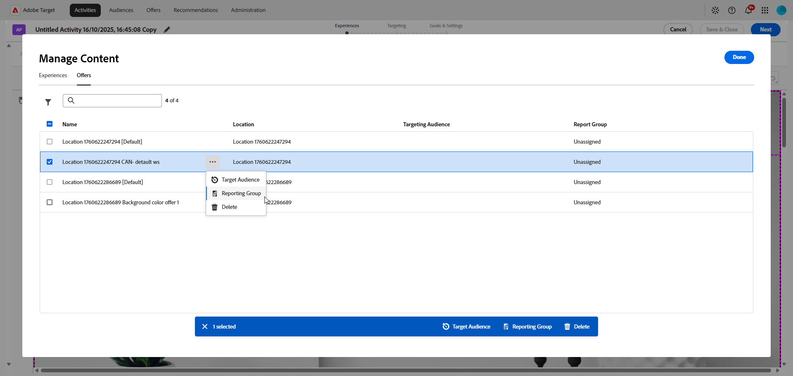

# Berichtsgruppen für Angebote in [!UICONTROL Automated Personalization] {#offer-reporting-groups}

>[!BEGINSHADEBOX]

**Auf dieser Seite** Erfahren Sie, wie Berichtsgruppen für Angebote in **[!UICONTROL Automated Personalization]**-Aktivitäten funktionieren, wie Sie sie einrichten und wie Sie sie in Berichten anzeigen können.

>[!ENDSHADEBOX]

Mit Berichtsgruppen können Sie die Angebote einer [!DNL Adobe Target] [Automated Personalization](/help/main/c-activities/t-automated-personalization/automated-personalization.md) (AP)-Aktivität in Gruppen organisieren. Berichtsgruppen erfüllen zwei grundlegende Funktionen:

* Über sie können Sie Angebote gruppiert in AP-Aktivitätsberichten anzeigen.
* Sie spielen eine wichtige Rolle bei der Funktionsweise der [!DNL Target] Personalisierungsmodelle.

Wenn Sie Berichtsgruppen verwenden, erstellt [!DNL Target] für jede Berichtsgruppe ein Personalisierungsmodell, das die Daten aller Angebote in dieser Gruppe verwendet. Ohne Berichtsgruppen erstellt [!DNL Target] ein Personalisierungsmodell für jedes Angebot in Ihrer AP-Aktivität.

Berichtsgruppen reduzieren auch die Datenanforderungen für die Verwendung von **[!UICONTROL Automated Personalization]** wenn Ihre Aktivitätseinrichtung nicht über genügend Daten verfügt, um ein Personalisierungsmodell pro Angebot zu erstellen. Sie helfen beim „Kaltstart“-Problem mit neuen Angeboten, die mit ähnlichen Angeboten gruppiert sind, sodass jedes Modell über mehr Daten verfügt, die trainiert werden können.

Dieser Ansatz funktioniert gut, wenn Besucher auf alle Angebote in einer Gruppe auf dieselbe Weise reagieren, sodass Gruppenangebote mit ähnlichen Konversionsraten angezeigt werden. Unterteilen Sie niemals alle Angebote in eine einzige Berichtsgruppe und gruppieren Sie keine Angebote mit unterschiedlichen Konversionsraten, da beide Optionen die Effektivität der [!DNL Target] Personalisierungsmodelle beeinträchtigen können.

>[!NOTE]
>
>Wenn ein Angebot aus einer Berichtsgruppe entfernt oder in einer Berichtsgruppe ersetzt wird, wird der historische Traffic, der zu diesem Angebot geführt hat, auch aus der Gruppe gelöscht, sodass gelöschte Angebote nicht zu den Daten beitragen, die die [!DNL Target] Personalisierungsmodelle zum Lernen verwenden.

## Zu beachten

### Berichtsgruppen für Live-Aktivitäten verwenden

Berichtsgruppen beeinflussen, wie [!DNL Target] seine Modelle erstellt. Daher empfiehlt [!DNL Adobe], Berichtsgruppen nur zu verwenden, wenn Sie Angebote während der Live-Schaltung einer Aktivität ersetzen oder hinzufügen möchten. Wenn ein neues Angebot in eine Live-Aktivität eingeführt wird, können [!DNL Target] durch Einfügung des neuen Angebots in eine Gruppe mit vorhandenen ähnlichen Angeboten die bereits für die anderen Angebote der Gruppe erfassten Daten verwenden, um mehr über das neue Angebot zu erfahren.

### Wie Daten für Angebote und Standorte aufgezeichnet werden

AP-Aktivitäten verfügen über Kombinationen aus Standort und Angebot (Modellvariablen). Wenn [!DNL Target] Daten in Berichten aufzeichnet, berücksichtigt sie diese Kombinationen, sodass klar ist, aus welchem Ereignis (Anzeige, Klick usw.) das Angebot stammt.

Eine Aktivität kann beispielsweise über mehrere Standorte und Angebote verfügen, die sich überschneiden können. Wenn ein Besucher mehr als eines dieser Angebote an verschiedenen Orten sieht, zeichnet [!DNL Target] nur Daten für diese Angebote auf. Wenn derselbe Besucher später auf ein Angebot klickt, zeichnet [!DNL Target] nur ein Ereignis aus dieser Kombination auf (nicht für alle Kombinationen).

Wenn der Klick von einem anderen Ort stammt, der in einer Metrik vorhanden ist, aber kein Angebot anzeigt, wird das Ereignis unter der Aktivität protokolliert, jedoch nicht für eine Kombination aus Angebot und Ort. Daher wird dieses Angebot nicht in der Berichtsgruppe für Angebote angezeigt. Dieses Verhalten tritt auf, weil der Klick möglicherweise aus einer anderen Mbox als der stammt, die das Angebot bereitgestellt hat. In diesem Fall ist die Metrik mit der Aktivität verknüpft, aber nicht mit dem Angebot.

## Einrichten von Berichtsgruppen

Durch die Zuweisung von Angeboten zu Berichtsgruppen wird festgelegt, wie [!DNL Target] seine Personalisierungsmodelle erstellt und wie die Angebote in den Aktivitätsberichten angezeigt werden. Die Gruppen können eingerichtet werden, während Sie die Aktivität erstellen, oder auch später, wenn Sie einer Live-Aktivität neue Angebote hinzufügen.

1. Klicken Sie auf **[!UICONTROL Seite]** Erlebnisse“ einer AP-Aktivität auf das Symbol **[!UICONTROL Inhalt verwalten]** (  ).

1. Klicken Sie auf die Registerkarte **[!UICONTROL Angebote]** oben im Dialogfeld **[!UICONTROL Inhalt verwalten]**.

   

1. (Bedingt) Wählen Sie die Angebote aus, die einer Berichtsgruppe hinzugefügt werden sollen.

   * Um ein einzelnes Angebot hinzuzufügen, klicken Sie auf das Symbol **[!UICONTROL Mehr Aktionen]** (  ) für das Angebot und dann auf **[!UICONTROL Berichtsgruppe]**.
   * Um mehrere Angebote gleichzeitig hinzuzufügen, aktivieren Sie die Kontrollkästchen für die Angebote und klicken dann unten **[!UICONTROL Dialogfeld auf]** Berichtsgruppe“.

1. Weisen Sie die ausgewählten Angebote einer Reporting-Gruppe zu.

   * Um die Angebote einer bestehenden Berichtsgruppe zuzuweisen, wählen Sie **[!UICONTROL Bestehend]**, wählen Sie die Berichtsgruppe aus der Dropdown-Liste aus und klicken Sie dann auf **[!UICONTROL Bestätigen]**.
   * Um eine Berichtsgruppe für die Angebote zu erstellen, wählen Sie **[!UICONTROL Neu]**, benennen Sie die neue Berichtsgruppe und klicken Sie dann auf **[!UICONTROL Bestätigen]**.

Um die Liste der Angebote einzugrenzen, filtern Sie sie mit der Liste **[!UICONTROL Standort]** oder mit der Liste **[!UICONTROL Berichtsgruppe]** nach Berichtsgruppe. Die Liste **[!UICONTROL Berichtsgruppe]** bietet auch die Option **[!UICONTROL Nicht zugewiesene Angebote]**. Diese Option zeigt die Angebote an, die noch nicht zu einer Berichtsgruppe gehören, sodass Sie sie einer Berichtsgruppe zuweisen können.

Weitere Informationen zur Zielgruppenbestimmung eines Angebots für bestimmte Zielgruppen finden Sie unter [Target **[!UICONTROL Automated Personalization]**-Angebote](/help/main/c-activities/t-automated-personalization/ap-target-offers.md#set-up-targeting-rules).

## Anzeigen von Angeboten in einer Berichtsgruppe

Der Bericht **[!UICONTROL Angebotsebene]** zeigt die Leistung der Angebote einer Aktivität an, gruppiert nach Berichtsgruppe, sodass Sie die Gruppen und die einzelnen Angebote vergleichen können.

1. Klicken Sie auf **[!UICONTROL Aktivitäten]**, klicken Sie in der Liste auf die Aktivität **[!UICONTROL Automated Personalization]** und anschließend auf die Registerkarte **[!UICONTROL Berichte]**, um den Bericht [Angebotsebene](/help/main/c-reports/personalization-reports/reports-ap.md) anzuzeigen.

   Wenn Sie viele Aktivitäten haben, klicken Sie auf das Symbol **[!UICONTROL Filter anzeigen]** (funnel) und aktivieren Sie dann das Kontrollkästchen **[!UICONTROL Automated Personalization]**, um nur **[!UICONTROL Automated Personalization]**-Aktivitäten anzuzeigen.

1. Klicken Sie **[!UICONTROL der Tabelle auf]** Kontrolle **[!UICONTROL oder Targeting]**, um die nicht gruppierten Angebote und die Angebote innerhalb der Berichtsgruppen anzuzeigen.

   

Informationen zur Verwendung von **[!UICONTROL Automated Personalization]**-Berichten (einschließlich des Berichts **[!UICONTROL Angebotsebene]** finden Sie unter [Automated Personalization-Zusammenfassungsberichte](/help/main/c-reports/personalization-reports/reports-ap.md).
