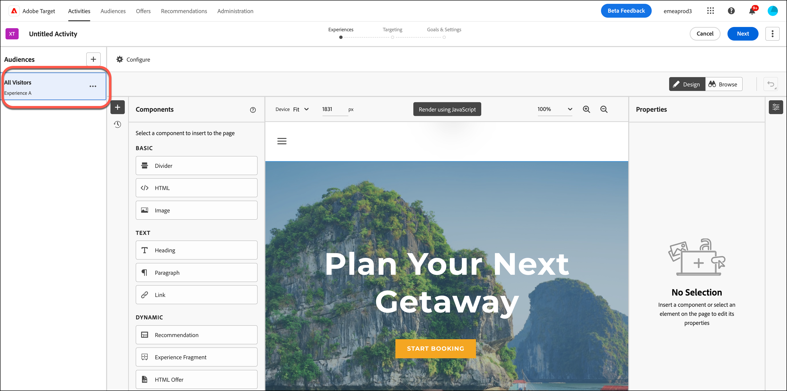
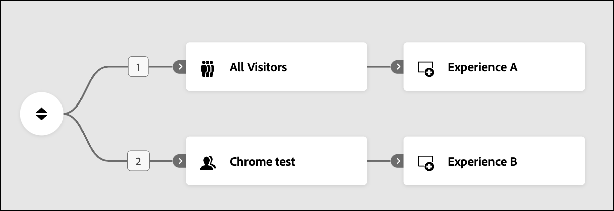
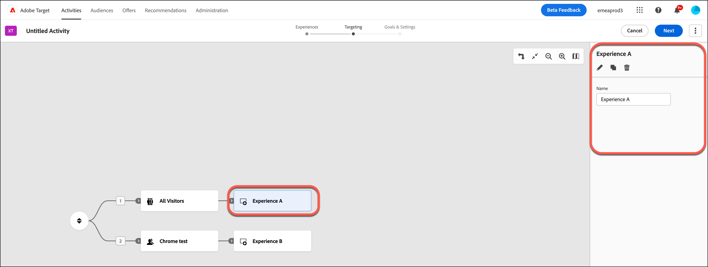

# Erstellen von Erlebnissen [!UICONTROL Erlebnis-Targeting]-Aktivitäten (XT) {#xt-add-experience}

>[!BEGINSHADEBOX]

**Auf dieser Seite** Erfahren Sie, wie Sie in einer Experience Targeting-Aktivität Erlebnisse erstellen und Zielgruppen ansprechen, wie Sie sie in Ordnung bringen und wie Sie sie umbenennen, bearbeiten, duplizieren oder löschen.

>[!ENDSHADEBOX]

Der **[!UICONTROL Visual Experience Composer]** (VEC) in [!DNL Adobe Target] bietet eine visuelle Benutzeroberfläche zum Bearbeiten der Erlebnisse auf Ihrer Seite in einer **[!UICONTROL Experience Targeting]**-Aktivität (XT).

* [Erstellen zielgerichteter Erlebnisse](#create-experiences)
* [Erlebnisse neu anordnen](#reorder-experiences)
* [Umbenennen, Bearbeiten, Duplizieren oder Löschen eines Erlebnisses](#manage-experiences)

## Erstellen zielgerichteter Erlebnisse {#create-experiences}

Beim [Erstellen einer **[!UICONTROL Experience Targeting]**-Aktivität](/help/main/c-activities/t-experience-target/t-xt-create/xt-create.md) zeigt Schritt 1 des dreiteiligen geleiteten Workflows (**[!UICONTROL Erlebnisse]**) die Standardzielgruppe **[!UICONTROL Erlebnis A]** mit einer **[!UICONTROL Alle Besucher]** an.

1. Wählen Sie die zu ändernden Elemente aus und nehmen Sie die gewünschten Änderungen vor. Alle Änderungen, die Sie jetzt vornehmen, gelten für **[!UICONTROL Erlebnis A]**.

   Wenn Sie den Mauszeiger über die Elemente auf der Seite bewegen, werden die Elemente hervorgehoben. Alle hervorgehobenen Elemente können mit dem VEC geändert werden. Eine Liste der Aktionen, die für ein Element durchgeführt werden können, um das Erlebnis zu ändern, finden Sie unter [Visual Experience Composer-Optionen](/help/main/c-experiences/c-visual-experience-composer/viztarget-options.md).

   >[!NOTE]
   >
   >Standardmäßig gestattet der VEC das Ändern von Elementen mit JavaScript nicht (zum Beispiel sich drehende Banner). Sie können JavaScript deaktivieren, um diese Elemente mithilfe des VEC zu ändern.

1. Um weitere Erlebnisse zu erstellen, klicken Sie auf **[!UICONTROL Hinzufügen]** (  ).

   Das **[!UICONTROL Zielgruppe hinzufügen]** wird angezeigt. Um ein Erlebnis für eine Audience auszuwählen, wählen Sie die Audience aus, bevor Sie das Erlebnis hinzufügen.

   +++ Weitere Informationen zu Zielgruppen

   Die Zielgruppenbibliothek enthält Zielgruppen, die bereits definiert wurden, einschließlich einiger häufiger Zielgruppen, die als Teil von [!DNL Target] vorgefertigt sind. Sie können eine Zielgruppe aus der Bibliothek auswählen oder [eine neue Zielgruppe erstellen](/help/main/c-target/c-audiences/audiences.md#concept_65BE870D290E412D8BBF557EEA67C271).

   Zusätzlich zur Auswahl einer bestehenden Zielgruppe können Sie auch mehrere Zielgruppen kombinieren, um nach Bedarf kombinierte Zielgruppen zu erstellen, anstatt eine neue Zielgruppe zu erstellen. Weitere Informationen finden Sie unter [Mehrere Zielgruppen kombinieren](/help/main/c-target/combining-multiple-audiences.md#concept_A7386F1EA4394BD2AB72399C225981E5).

   Beim Erstellen einer Zielgruppe können Sie einen Speicherort auswählen und Parameter für diesen Speicherort angeben. Wählen **[!UICONTROL unter]** (**[!UICONTROL Zielgruppe erstellen]** > **[!UICONTROL Benutzerdefiniert]** den Speicherort aus und geben Sie dann die gewünschten Parameter an.

   Audiences werden automatisch im Hintergrund importiert, wenn Sie die Audience-Liste öffnen. Die importierten Audiences sind älter als zehn Minuten.

   +++

1. Wählen Sie eine oder mehrere Zielgruppen für das Erlebnis aus und klicken Sie dann auf **[!UICONTROL Zielgruppe zuweisen]**.

   **[!UICONTROL Erlebnis B]** wird jetzt in der vorherigen Abbildung angezeigt und dieses Erlebnis ist auf die entsprechende Zielgruppe ausgerichtet.

1. Wählen Sie die Elemente aus, die Sie für dieses Erlebnis ändern möchten, und nehmen Sie die gewünschten Änderungen vor, wie in Schritt 1 beschrieben.

1. Wiederholen Sie die obigen Schritte, um nach Bedarf zusätzliche Target-Erlebnisse zu erstellen.

1. Klicken Sie **[!UICONTROL Weiter]** wenn Sie mit dem Entwerfen Ihrer Erlebnisse fertig sind.

   Das Aktivitätsdiagramm wird angezeigt:

   

>[!NOTE]
>
>Sie können ein Bild aus einer anderen Quelle als der Hauptseite bereitstellen (z. B. ein auf `akamai.net` gehostetes und auf `adobe.com` bereitgestelltes Bild). An anderer Stelle gehostete Bilder werden nicht in der Miniaturansicht der Seite angezeigt, die im Flussdiagramm angezeigt wird.

## Erlebnisse neu anordnen {#reorder-experiences}

Beim Erstellen oder Bearbeiten einer **[!UICONTROL Experience Targeting]**-Aktivität können Sie Zielgruppen- und Erlebnispaare per Drag-and-Drop verschieben, um sie in der gewünschten Reihenfolge anzuordnen. Die Besucher werden der Reihe nach von oben nach unten für Erlebnisse bewertet. **[!UICONTROL Erlebnis-Targeting]** geht davon aus, dass die Reihenfolge wichtig ist. Wenn ein Besucher in das erste Zielgruppen- und Erlebnispaar fällt, wird das erste Erlebnis bereitgestellt.

Um die Paare neu anzuordnen, klicken Sie auf das Symbol „Neu anordnen“  ), um die Spalte **[!UICONTROL Erlebnisse]** auf der rechten Seite anzuzeigen, und ordnen Sie dann die Erlebnisse nach Bedarf neu an.

+++ Beispiel: Zielgruppen, die sich nicht gegenseitig ausschließen

Angenommen, Ihnen war nicht bewusst, dass beim Erstellen einer Experience Targeting **[!UICONTROL Aktivität die Reihenfolge]**. Später stellen Sie während des Tests fest, dass Besucher, die Ihrer Meinung nach sich für Erlebnis B oder C qualifizieren sollten, sich stattdessen für Erlebnis A qualifizieren. Dies könnte daran liegen, dass sich die Zielgruppen nicht gegenseitig ausschließen und nicht in der richtigen Reihenfolge sind (z. B. Erlebnis A = Vereinigte Staaten, Erlebnis B = San Francisco und Erlebnis C = Kalifornien).

In diesem Szenario können alle Benutzer aus den USA die Kriterien für Erlebnis A erfüllen, auch wenn sie sich in San Francisco oder anderswo in Kalifornien befinden. Sie können die Audience-Erlebnis-Paare von der restriktivsten zur am wenigsten restriktiven (San Francisco > Kalifornien > USA) neu anordnen, ohne die gesamte Aktivität neu zu erstellen.

+++

Wenn Sie eine Zielgruppe **[!UICONTROL Alle Besucher]** haben, stellen Sie sicher, dass sie nicht die erste Zielgruppe im Diagramm ist. Ein Erlebnis, das auf &quot;**[!UICONTROL Besucher]** ausgerichtet ist, kann als letztes Erlebnis in der Aktivität **[!UICONTROL Erlebnis-Targeting]** verwendet werden, um alle Besucher zu „fangen“, die nicht in ein anderes Erlebnis gefallen sind.

## Umbenennen, Bearbeiten, Duplizieren oder Löschen eines Erlebnisses {#manage-experiences}

Klicken Sie auf ein Erlebnis im Diagramm in einer Aktivität **[!UICONTROL Erlebnis]**, um die Spalte **[!UICONTROL Erlebnisse]** auf der rechten Seite anzuzeigen.

Wählen Sie nach Bedarf aus den folgenden Optionen:

* **[!UICONTROL Umbenennen]**: Geben Sie den gewünschten Namen in das Feld **[!UICONTROL Name]** ein.
* **[!UICONTROL Bearbeiten]**: Klicken Sie auf das Symbol Bearbeiten  ) und nehmen Sie dann die gewünschten Änderungen vor.
* **[!UICONTROL Duplizieren]**: Kopieren Sie ein Erlebnis in einer **[!UICONTROL Erlebnis-Targeting]**-Aktivität, damit Sie kleinere Änderungen daran vornehmen können, ohne das gesamte Erlebnis neu erstellen zu müssen. Klicken Sie auf **[!UICONTROL Duplizieren]**-Symbol (  ) und bearbeiten Sie dann das Erlebnis nach Bedarf.
* **[!UICONTROL Löschen]**: Klicken Sie auf das **[!UICONTROL Löschen]**-Symbol ( ) und bestätigen Sie dann den Löschvorgang.

## Schulungsvideo: Verwenden von Visual Experience Composer

In diesem Video erfahren Sie, wie Sie die Optionen **[!UICONTROL Erlebnis-Targeting]** (VEC) verwenden.

* Inhalt einer Seite ändern
* Layout einer Seite ändern

>[!VIDEO](https://video.tv.adobe.com/v/17399)
