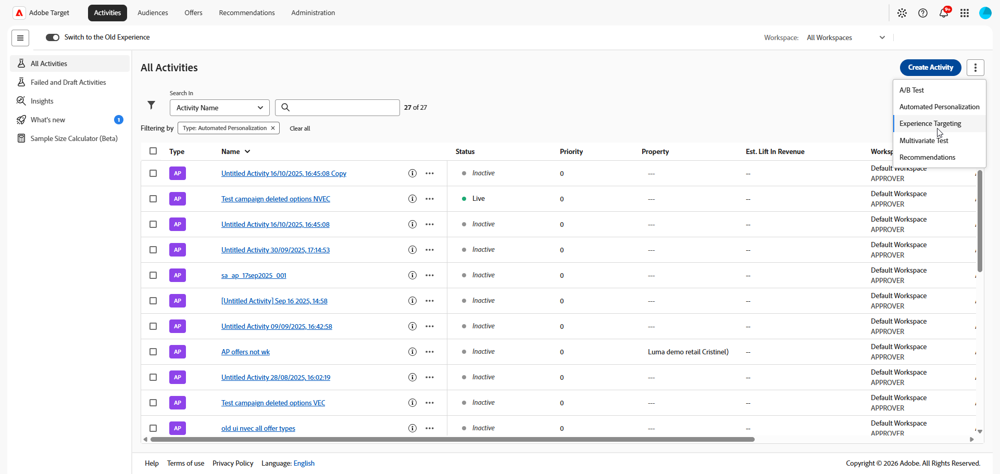
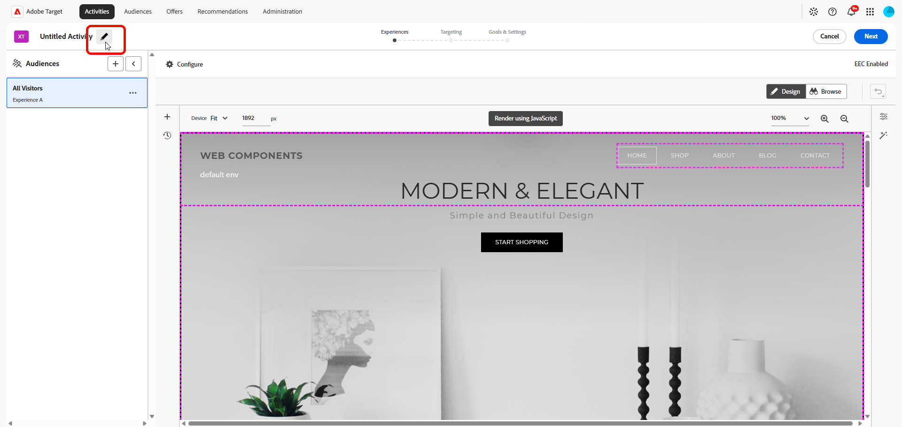

# Erstellen einer [!UICONTROL Experience Targeting]-Aktivität (XT) {#create-xt-activity}

>[!BEGINSHADEBOX]

**Auf dieser Seite** Erfahren Sie, wie Sie eine **[!UICONTROL Experience Targeting]**-Aktivität (XT) im **[!UICONTROL Visual Experience Composer]** (VEC) erstellen. Sie erstellen die Aktivität, fügen Erlebnisse für verschiedene Zielgruppen hinzu und konfigurieren dann Ziele und Einstellungen.

>[!ENDSHADEBOX]

Verwenden Sie den **[!UICONTROL Visual Experience Composer]** (VEC), um eine **[!UICONTROL Experience Targeting]**-Aktivität (XT) auf einer [!DNL Target]-aktivierten Seite zu erstellen und Teile der Seite innerhalb von [!DNL Adobe Target] zu ändern.

Beim **[!UICONTROL Experience Targeting]** (XT) werden Inhalte für eine bestimmte Zielgruppe basierend auf einem Satz aus Regeln und Kriterien, die von den Werbungtreibenden definiert werden, bereitgestellt. Dies ist nützlich für die Definition von Regeln, die auf ein bestimmtes Erlebnis oder bestimmte Inhalte für eine bestimmte Zielgruppe, einschließlich [Geo-Targeting](/help/main/c-target/c-audiences/c-target-rules/geo.md), abzielen. Für eine Aktivität können mehrere Regeln definiert werden, um verschiedene Inhaltsvarianten für verschiedene Zielgruppen bereitzustellen.

Weitere Informationen zu **[!UICONTROL Erlebnis-Targeting]** einem Anwendungsfall und Schulungsvideos finden Sie unter [Erlebnis-Targeting](/help/main/c-activities/t-experience-target/experience-target.md).

1. Klicken Sie in der **[!UICONTROL Aktivitäten]** auf **[!UICONTROL Aktivität erstellen]** > **[!UICONTROL Experience Targeting]**.

   >[!NOTE]
   >
   >Die verfügbaren Aktivitätstypen hängen von Ihrem [!DNL Target]-Konto ab. Einige Aktivitätstypen werden in Ihrer Liste eventuell nicht angezeigt. Beispielsweise ist **[!UICONTROL Automated Personalization]** eine [Target Premium-Funktion](/help/main/c-intro/intro.md#premium).
   >
   >Weitere Informationen zu den verschiedenen in [!DNL Target] verfügbaren Aktivitätstypen und ihren Unterschieden finden Sie unter [Aktivitäten](/help/main/c-activities/activities.md#concept_D317A95A1AB54674BA7AB65C7985BA03). Unter [Target-Aktivitätstypen](/help/main/c-activities/target-activities-guide.md) können Sie festlegen, welche Aktivitätstypen Ihre Anforderungen am besten erfüllen.

   

1. Wählen Sie im **[!UICONTROL Experience Targeting]** Aktivität erstellen Ihren Experience Composer:

   * **[!UICONTROL Visual]**.
   * **[!UICONTROL Form-Based Experience Composer]** finden Sie unter [Form-Based Experience Composer](/help/main/c-experiences/form-experience-composer.md) für weitere Informationen.

   >[!NOTE]
   >
   >Zusätzlich zum VEC und **[!UICONTROL Form-Based Experience Composer]** bietet [!DNL Target] den Single Page Application VEC. Weitere Informationen zu den verschiedenen Composern finden Sie unter [Erlebnisse und Angebote](/help/main/c-experiences/experiences.md).
   >
   >Informationen zur Fehlerbehebung bei VEC finden Sie unter [Fehlerbehebung beim Visual Experience Composer](/help/main/c-experiences/c-visual-experience-composer/r-troubleshoot-composer/troubleshoot-composer.md).

1. (Bedingt) Wenn Sie [!DNL Target Premium] sind, wählen Sie [einen Arbeitsbereich aus](/help/main/administrating-target/c-user-management/property-channel/property-channel.md).

1. Geben Sie Ihre [Aktivitäts-URL](/help/main/c-activities/t-test-ab/t-test-create-ab/ab-activity-url.md#ab-activity-url) an und klicken Sie dann auf **[!UICONTROL Erstellen]**. Der VEC wird geöffnet und zeigt die Seite an, auf die die URL verweist.

   Wenn Ihr Konto [mit einer Standard-URL konfiguriert wurde](/help/main/administrating-target/visual-experience-composer-set-up.md), dann wird diese URL standardmäßig angezeigt. Sie können bei Bedarf von der Standard-URL zu einer anderen URL wechseln.

1. Um die Aktivität zu benennen, klicken Sie auf das Symbol **[!UICONTROL Bearbeiten]** (  ), geben Sie einen beschreibenden Namen für die Aktivität ein und klicken Sie dann auf **[!UICONTROL Speichern]**.

   {{activity-name-rules}}

   

1. Erstellen Sie neue Erlebnisse für unterschiedliche Zielgruppen. Schrittweise Anweisungen finden Sie unter [Erlebnis hinzufügen](/help/main/c-activities/t-experience-target/t-xt-create/xt-add-experience.md#xt-add-experience).

1. Legen Sie [Ziele und Einstellungen](/help/main/c-activities/t-test-ab/t-test-create-ab/ab-goals-and-settings.md#ab-goals-and-settings) für die Aktivität fest.
