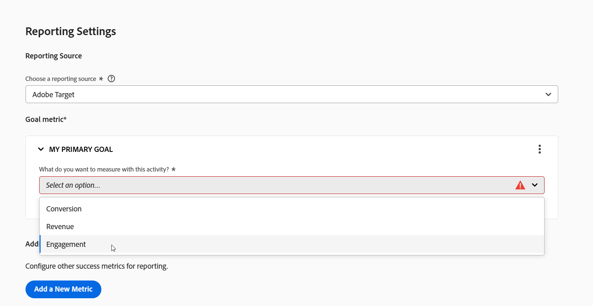

# Festlegen von Metriken {#ab-set-metrics}

>[!BEGINSHADEBOX]

**Auf dieser Seite** Erfahren Sie, wie Sie die Zielmetrik und zusätzliche Metriken einer A/B-, Experience Targeting (XT)- oder Multivarianz-Test (MVT)-Aktivität festlegen und welche Zeichen in Metriknamen nicht zulässig sind.

>[!ENDSHADEBOX]

Verwenden Sie Metriken in einer [!DNL Adobe Target] A/B-, [!UICONTROL Erlebnis-Targeting] (XT)- oder [!UICONTROL Multivarianz-Test]&#x200B;(MVT)-Aktivität, um zu bestimmen, wann ein Besuch erfolgreich war. Ausführliche Informationen zu Erfolgsmetriken finden Sie unter [Erfolgsmetriken](/help/main/c-activities/r-success-metrics/success-metrics.md#overview).

>[!NOTE]
>
>Diese Seite gilt, wenn [!DNL Adobe Target] die Berichtsquelle ist. Informationen zu den anderen Berichtsquellen finden Sie unter [[!DNL Adobe Analytics] als Berichtsquelle für [!DNL Target]](/help/main/c-integrating-target-with-mac/a4t/a4t.md) and [[!DNL Target] Reporting in [!DNL Adobe Customer Journey Analytics]](/help/main/c-integrating-target-with-mac/cja/target-reporting-in-cja.md).

## Festlegen einer Metrik {#set-a-metric}

1. Wählen **[!UICONTROL Abschnitt &quot;]**&quot; auf der Seite **[!UICONTROL Ziele und Einstellungen]** eine [Erfolgsmetrik](/help/main/c-activities/r-success-metrics/success-metrics.md#overview).

   Die Option **[!UICONTROL Metriken auswählen]** listet die Erfolgsmetriken auf, die Sie für Ihre Aktivität auswählen können. Die Erfolgsmetriken sind in folgende Kategorien unterteilt:

   * **[!UICONTROL Konversion]**
   * **[!UICONTROL Umsatz]**
   * **[!UICONTROL Interaktion]**

   Sie können die vorgefertigten Erfolgsmetriken verwenden oder eine benutzerdefinierte Erfolgsmetrik erstellen. Sie können auch eine Erfolgsmetrik als primäre Metrik kennzeichnen. Berichte und Experience Cloud-Karten zeigen standardmäßig die primäre Metrik, falls eine festgelegt ist.

   

1. Geben Sie die Einstellungen für Ihre Metriken an. Die verfügbaren Einstellungen hängen von der verwendeten Erfolgsmetrik ab.

1. Wenn diese Option aktiviert ist **[!UICONTROL liefert das Feld „Geschätzter Wert]** Konversion“ einen Wert für Ihr Ziel:

   * Der Wert ermöglicht es [!DNL Target], eine geschätzte Steigerung des Umsatzes zu berechnen.
   * Das Feld ist optional. Der inkrementelle Umsatz für eine andere Metrik als Umsatz kann jedoch ohne dieses Feld nicht berechnet werden.
   * Das Feld ist nicht für die Metriken **[!UICONTROL Seitenbewertung]** verfügbar.
   * Der Datentyp ist eine Währung.
   * Das Feld wird nach und nach angezeigt, nachdem der/die Benutzende die Aktion angegeben hat, die zum Erreichen des Ziels durchgeführt wurde.

   Weitere Informationen finden Sie unter [Schätzen der Umsatzsteigerung](/help/main/administrating-target/r-target-account-preferences/estimating-lift-in-revenue.md). Die korrekte Konfiguration von Erfolgsmetriken ist wichtig, um sicherzustellen, dass Sie die erwarteten Daten erhalten.

   

1. (Optional) Um mehr als die Zielmetrik zu verfolgen, klicken Sie auf **[!UICONTROL Neue Metrik hinzufügen]** und wählen Sie dann jede zusätzliche Metrik wie in den vorherigen Schritten beschrieben aus und konfigurieren Sie sie.

1. Wenn Sie mit dem Festlegen Ihrer Metriken fertig sind, klicken Sie auf **[!UICONTROL Weiter]** in einer XT-Aktivität oder **[!UICONTROL Speichern und schließen]** in einer MVT-Aktivität.

## In Metriknamen nicht zulässige Zeichen {#metric-name-rules}

Wenn Sie eine Metrik benennen oder umbenennen, sind die folgenden Zeichen nicht zulässig:

| Zeichen | Beschreibung |
|--- |--- |
| `/` | Vorwärtsschrägstrich |
| `?` | Fragezeichen |
| `#` | Raute |
| `:` | Doppelpunkt |
| `=` | Gleich |
| `+` | Plus |
| `-` | Minus |
| `@` | At-Zeichen |
