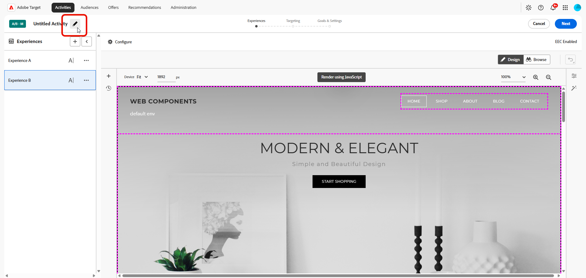
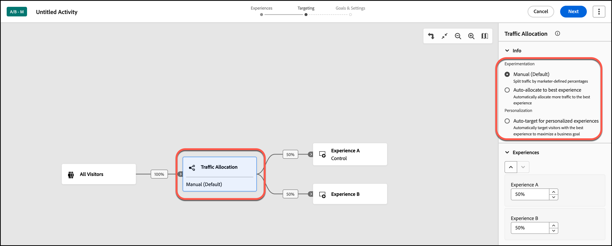

# Erstellen einer A/B-Test -Aktivität {#create-ab-activity}

>[!BEGINSHADEBOX]

**Auf dieser Seite** Erfahren Sie, wie Sie eine manuelle **[!UICONTROL A/B-Test]**-Aktivität im **[!UICONTROL Visual Experience Composer]** (VEC) erstellen. Sie erstellen Ihre Erlebnisse, legen Zielgruppenbestimmungen und die Traffic-Zuordnung fest und konfigurieren dann Ziele und Einstellungen.

>[!ENDSHADEBOX]

Nutzen Sie den **[!UICONTROL Visual Experience Composer]** (VEC) in [!DNL Adobe Target], um **[!UICONTROL A/B-Test]**-Aktivitäten direkt auf einer [!DNL Target]-aktivierten Seite zu erstellen und Seitenabschnitte in [!DNL Target] zu ändern.

>[!NOTE]
>
>Zusätzlich zur Aktivität **[!UICONTROL Manuell]** (Standard) **[!UICONTROL A/B-Test]** (siehe Abschnitt in diesem Artikel) bietet [!DNL Target] zwei zusätzliche Typen von **[!UICONTROL A/B-Test]**-Aktivitäten: **[!UICONTROL Automatische Zuordnung]** und **[!UICONTROL Automatisches Targeting]**.
>
>Siehe [Typen von A/B-Testaktivitäten](/help/main/c-activities/t-test-ab/test-ab.md#types) in *A/B-Test - Übersicht*.

Die Aktivität folgt dem in VEC angeleiteten dreistufigen Workflow:

1. [Erstellen von Erlebnissen](#build-experiences)
1. [Zielgruppenbestimmung und Traffic-Zuordnung festlegen](#set-targeting)
1. [Ziele und Einstellungen konfigurieren](#configure-goals-and-settings)

## Schritt 1: Erstellen Sie Erlebnisse {#build-experiences}

Erstellen Sie die Aktivität und entwerfen Sie dann die alternativen Erlebnisse, die Sie mit dem Steuerelement testen möchten.

### Erstellen der Aktivität {#create-activity}

Öffnen Sie die zu testende Seite im **[!UICONTROL Visual Experience Composer]** und benennen Sie die Aktivität.

1. Klicken Sie in der **[!UICONTROL Aktivitäten]** auf **[!UICONTROL Aktivität erstellen]** > **[!UICONTROL A/B-Test]**.

   

1. Wählen Sie im **[!UICONTROL Erstellen einer A/B]** Testaktivität“ Ihren Experience Composer:

   * **[!UICONTROL Visual]**.
   * **[!UICONTROL Form-Based Experience Composer]** finden Sie unter [Form-Based Experience Composer](/help/main/c-experiences/form-experience-composer.md) für weitere Informationen.

   >[!NOTE]
   >
   >Zusätzlich zum VEC und **[!UICONTROL Form-Based Experience Composer]** bietet [!DNL Target] das **[!UICONTROL Single Page Application]** VEC. Weitere Informationen zu den verschiedenen Composern finden Sie unter [Erlebnisse und Angebote](/help/main/c-experiences/experiences.md).
   >
   >Informationen zur Fehlerbehebung bei VEC finden Sie unter [Fehlerbehebung beim Visual Experience Composer](/help/main/c-experiences/c-visual-experience-composer/r-troubleshoot-composer/troubleshoot-composer.md).

1. (Bedingt) Wenn Sie [Target Premium-Kunde sind](/help/main/c-intro/intro.md#premium) wählen Sie aus der Dropdown-Liste **[!UICONTROL Workspace auswählen]** einen ([) ](/help/main/administrating-target/c-user-management/property-channel/property-channel.md).

1. Geben **[!UICONTROL im Feld]**-URL eingeben Ihre [Aktivitäts-URL](/help/main/c-activities/t-test-ab/t-test-create-ab/ab-activity-url.md) an.

   Wenn Ihr Konto [mit einer Standard-URL konfiguriert wurde](/help/main/administrating-target/visual-experience-composer-set-up.md), dann wird diese URL standardmäßig angezeigt. Sie können bei Bedarf von der Standardeinstellung zu einer anderen URL wechseln.

1. Klicken Sie **[!UICONTROL Erstellen]**. Der **[!UICONTROL Visual Experience Composer]** wird geöffnet und zeigt die Seite an, auf die die URL verweist.

1. Um die Aktivität zu benennen, klicken Sie auf das Symbol **[!UICONTROL Bearbeiten]** (  ), geben Sie einen beschreibenden Namen für die Aktivität ein und klicken Sie dann auf **[!UICONTROL Speichern]**.

   {{activity-name-rules}}

   

### Gestalten der Erlebnisse {#design-experiences}

Erstellen Sie neue Erlebnisse, indem Sie die Elemente auf der Seite ändern.

Nach dem Erstellen einer neuen Aktivität zeigt **[!UICONTROL Visual Experience Composer]** auf der linken Seite zwei Registerkarten an: Erlebnis A und Erlebnis B.

* **Erlebnis A** ist das Kontrollerlebnis. Sie können sie löschen, wenn Sie kein standardmäßiges Site-Erlebnis als Option einbeziehen möchten.
* **Erlebnis B** ist das alternative Erlebnis, das Sie Ihrem Test hinzufügen. Der Fokus liegt auf dieser Registerkarte, die Sie nach Bedarf ändern können.

Um dem Test weitere Erlebnisse hinzuzufügen, klicken Sie auf das Symbol **[!UICONTROL Hinzufügen]** (  ).

Weitere Informationen zum Hinzufügen und Ändern von Erlebnissen in **[!UICONTROL Visual Experience Composer]** finden Sie unter [Erlebnis hinzufügen](/help/main/c-activities/t-test-ab/t-test-create-ab/ab-add-experience.md#ab-add-experience).

## Schritt 2: Zielgruppenbestimmung und Traffic-Zuordnung festlegen {#set-targeting}

Nach dem Zugriff auf das **[!UICONTROL Targeting]**-Menü wird das Flussdiagramm geöffnet.

Das Flussdiagramm führt Sie durch die Zuweisung einer Zielgruppe und ihres Traffic-Prozentsatzes, die Auswahl der Traffic-Zuordnungsmethode und die Angabe der Traffic-Zuordnung für jedes Erlebnis in der Aktivität.

1. (Bedingt) Klicken Sie auf das Steuerelement **[!UICONTROL Alle Besucher]**, um eine andere Zielgruppe für die Aktivität auszuwählen.

   Die **[!UICONTROL Alle Besucher]**-Zielgruppe ist als Standard festgelegt. Wenn Sie eine andere Zielgruppe auswählen, wird deren Name im Steuerelement ganz links angezeigt. Beispiel: Sie können Einträge auf 50 % aller Besucher oder 45 % der Zielgruppe aus Kalifornien begrenzen.

   +++ Schritte zur Auswahl einer anderen Audience

   Daraufhin wird der rechte Rahmen angezeigt, über den Sie eine Zielgruppe hinzufügen oder löschen und den Prozentsatz der Besuchenden für die Aktivität zuweisen können.

   1. Um die Audience zu ändern, klicken Sie auf **[!UICONTROL Ersetzen]**-Symbol (  ) im rechten Rahmen.
   1. Wählen Sie **[!UICONTROL Dialogfeld]** Zielgruppe hinzufügen[ die gewünschte Zielgruppe aus ](/help/main/c-activities/t-test-ab/t-test-create-ab/ab-audience.md) klicken Sie dann auf **[!UICONTROL Zielgruppe zuweisen]**.

      Um eine Zielgruppe zu erstellen, die mehrere Zielgruppen kombiniert, klicken Sie auf **[!UICONTROL Zielgruppen kombinieren]**. Weitere Informationen finden Sie unter [Kombinieren mehrerer Zielgruppen](/help/main/c-target/combining-multiple-audiences.md).

      Um eine neue Zielgruppe zu erstellen, die sich noch nicht in der **[!UICONTROL Zielgruppenbibliothek]** befindet, klicken Sie auf **[!UICONTROL Zielgruppe erstellen]**. Wählen Sie [ Workflow „Zielgruppe erstellen](/help/main/c-target/c-audiences/audiences.md) eine der folgenden Optionen:

      * **[!UICONTROL Zielgruppenbibliothek]**: Erstellen Sie eine On-Demand-Zielgruppe, die in der **[!UICONTROL Zielgruppenbibliothek]** gespeichert und in anderen Aktivitäten wiederverwendet werden kann.
      * **[!UICONTROL Nur diese Aktivität]**: Erstellen Sie eine [aktivitätsspezifische Zielgruppe](/help/main/c-target/creating-activity-only-audience.md) die nicht in der **[!UICONTROL Zielgruppenbibliothek]** gespeichert wird und nur in der aktuellen Aktivität verwendet werden kann.

   1. Klicken Sie **[!UICONTROL rechten Feld auf]** Besucherprozentsatz) und wählen Sie dann den Prozentsatz der qualifizierten Besucher aus, die Sie in die Aktivität eingeben möchten.

   +++

1. Klicken Sie auf **[!UICONTROL Traffic-]**) und wählen Sie dann im rechten Bereich eine Traffic-Zuordnungsmethode aus. Siehe [Traffic-Zuordnungsmethoden](#traffic-allocation-methods).

   

   +++Traffic-Zuordnungsoptionen

   | Methode | Funktion |
   |---|---|
   | **[!UICONTROL Manuell (Standard)]** | Geben Sie den Prozentsatz der Eintritte an, die für jedes Erlebnis angezeigt werden sollen. Sie können den Prozentsatz gleichmäßig auf alle Erlebnisse aufteilen oder für jedes Erlebnis einen höheren oder niedrigeren Prozentsatz festlegen. Die gesamte Anzahl aller Erlebnisse muss 100 % betragen. |
   | **[!UICONTROL Automatische Zuordnung zu bestem Erlebnis]** | Die meisten Aktivitätsteilnehmer werden automatisch zu Erlebnissen mit höherer Leistung weitergeleitet. Einige Besucher werden allen Erlebnissen zugeordnet, um die Erforschung von Erlebnissen beizubehalten und Änderungen an Leistungstrends zu erkennen. Weitere Informationen finden Sie unter [**[!UICONTROL Automatische Zuordnung ]**- Übersicht](/help/main/c-activities/automated-traffic-allocation/automated-traffic-allocation.md#concept_A1407678796B4C569E94CBA8A9F7F5D4). |
   | **[!UICONTROL Automatisches Targeting für personalisierte Erlebnisse]** | [!DNL Target] nutzt fortschrittliche Machine Learning-Algorithmen zur Personalisierung von Inhalten und Förderung von Konversionen, indem mehrere leistungsstarke, von Marketingexperten definierte Erlebnisse identifiziert werden. Anschließend wird Besuchern auf der Grundlage ihrer individuellen Kundenprofile und des bisherigen Verhaltens ähnlicher Besucher das jeweils passendste Erlebnis bereitgestellt. Weitere Informationen finden Sie unter [Automatisches Targeting - Übersicht](/help/main/c-activities/auto-target/auto-target-to-optimize.md). |

   +++

1. Klicken Sie **[!UICONTROL rechten Bereich auf]** Erlebnisse“ und geben Sie dann für jedes Erlebnis die gewünschte Traffic-Zuordnung an.

1. Wenn Sie mit der Auswahl Ihrer Audience, Erlebnisoptionen und Traffic-Zuordnung zufrieden sind, klicken Sie auf **[!UICONTROL Weiter]**, um zum dritten Schritt des Drei-Schritte-Workflows überzugehen.

## Schritt 3: Ziele und Einstellungen konfigurieren {#configure-goals-and-settings}

Auf der Seite **[!UICONTROL Ziele und Einstellungen]** geben Sie [!DNL Target] an, wie die Aktivität gemessen werden soll. Die verfügbaren Einstellungen hängen davon ab, ob Sie [!DNL Target] oder [Analytics als Berichtsquelle](/help/main/c-integrating-target-with-mac/a4t/a4t.md) verwenden.

1. Überprüfen Sie die Abschnitte der Seite und legen Sie fest, was Sie benötigen. Siehe [Was Sie auf der Seite Ziele und Einstellungen festgelegt haben](#goals-settings-overview).

   | Abschnitt | Was Sie festgelegt haben |
   |---|---|
   | **[!UICONTROL Aktivitätseinstellungen]** | Ein optionales Ziel, die **[!UICONTROL Priorität]** (verwendet, wenn mehrere Aktivitäten einen Standort und eine Zielgruppe gemeinsam haben) und die **[!UICONTROL Dauer]** (Start- und Enddatum). |
   | **[!UICONTROL Berichterstellungseinstellungen]** | Die Berichtsquelle, die Zielmetrik (z. B. eine **[!UICONTROL Konversions]**-Metrik), zusätzliche Metriken, Zielgruppen für das Reporting und die statistische Methodik. |
   | **[!UICONTROL Erweiterte Einstellungen]** | Abhängigkeiten zwischen Erfolgsmetriken, was passiert, wenn ein Besucher die Zielmetrik erreicht, und wie die Anzahl erhöht wird. |
   | **[!UICONTROL Sonstige Metadaten]** | Hinweise zu den Aktivitäten, die für Sie oder andere Team-Mitglieder nützlich sind. |

1. Klicken Sie **[!UICONTROL Speichern und schließen]** oder **[!UICONTROL Speichern]**.

Nachdem Sie die Aktivität erstellt haben, zeigt **[!UICONTROL Registerkarte]**&#x200B;Übersicht“ Informationen zur Aktivität an, einschließlich eines Diagramms Ihrer Aktivität.
