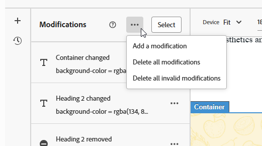

# Erste Schritte mit Änderungen {#vec-code-editor}

>[!BEGINSHADEBOX]

**Auf dieser Seite** Erfahren Sie, wie Sie Änderungen im Bedienfeld **[!UICONTROL Änderungen]** des [!UICONTROL Visual Experience Composer] (VEC) anzeigen, bearbeiten, löschen und hinzufügen und benutzerdefinierten Code verwenden.

>[!ENDSHADEBOX]

Das Bedienfeld **[!UICONTROL Änderungen]** in [!DNL Adobe Target] zeigt alle Änderungen an, die an der Seite im [!UICONTROL Visual Experience Composer] (VEC) vorgenommen wurden, und ermöglicht zusätzliche Änderungen, indem auf jedes Element auf der Seite geklickt und [eine Aktion ausgewählt wird](/help/main/c-experiences/c-visual-experience-composer/viztarget-options.md). Jede Änderung wird als separate Aktion oder Element in der Liste **[!UICONTROL Änderungen]** angezeigt. Änderungen der folgenden Typen können auch direkt hinzugefügt werden: CSS-Selektor, Mbox und benutzerdefinierter Code.

## Änderungen – Überblick {#modifications-overview}

Die **[!UICONTROL Änderungen]** nimmt kleine Änderungen an dem Selektor vor, den [!DNL Target] auswählt, wenn der VEC konfiguriert, wie Inhalte bereitgestellt werden. Der Inhalt oder ein HTML-Attribut können geändert werden. Der Code kann auch bearbeitet werden, um das Äquivalent eines HTML-Angebots innerhalb einer Mbox zu erstellen.


Die **[!UICONTROL Änderungen]** kann verwendet werden, um:

* Anzeigen einer Aktion, die im Visual Composer durchgeführt wurde.

  

* Bearbeiten einer vorhandenen Aktion. Rufen Sie das erweiterte Menü auf und wählen Sie **[!UICONTROL Bearbeiten]** aus.

  

  Nehmen Sie die Änderungen vor.

  

* Löschen einer vorhandenen Aktion. Rufen Sie das erweiterte Menü auf und wählen Sie **[!UICONTROL Änderung löschen]**.

  

* Hinzufügen einer neuen Änderung. Rufen Sie das **[!UICONTROL Änderungen]** Menü Erweitert auf, wählen Sie **[!UICONTROL Änderung hinzufügen]** und geben Sie dann die Änderungen wie in [Änderungen hinzufügen](#add-modifications) beschrieben an.

  

## Änderungen hinzufügen {#add-modifications}

Änderungen werden über das Bedienfeld **[!UICONTROL Änderungen]** für das Erlebnis hinzugefügt, das in Visual Experience Composer ausgewählt ist.

1. Um die **[!UICONTROL Änderungen“ anzuzeigen]** klicken Sie auf **[!UICONTROL Änderungen anzeigen]**.

   

   Um das Bedienfeld **[!UICONTROL Änderungen]** im formularbasierten Experience Composer zu öffnen, erstellen oder bearbeiten Sie ein HTML-Angebot. Weitere Informationen finden Sie unter [Form-Based Experience Composer](/help/main/c-experiences/form-experience-composer.md).

1. So fügen Sie eine Änderung hinzu:

   * Wenn keine vorherigen Änderungen für das Erlebnis vorgenommen wurden, klicken Sie im Bedienfeld **[!UICONTROL Änderungen]** auf **[!UICONTROL Änderungen]**.
   * Wenn frühere Änderungen am Erlebnis vorhanden sind, rufen Sie das erweiterte Menü **[!UICONTROL Änderungen]** auf und wählen Sie **[!UICONTROL Änderung hinzufügen]** aus.

   Das **[!UICONTROL Änderungen]**-Bedienfeld wird angezeigt:

   

1. Wählen Sie in **[!UICONTROL Dropdown-Liste]**&#x200B;Änderungstyp“ den gewünschten Typ aus:

   | Art der Änderung | Details |
   |--- |--- |
   | CSS-Selektor | Geben Sie im Feld **[!UICONTROL CSS]** Elementauswahl“ das zu ändernde CSS-Element an, wählen Sie einen Aktionstyp aus (**[!UICONTROL Inhalt festlegen]** oder **[!UICONTROL Attribut festlegen]**) und geben Sie dann die erforderlichen Informationen und den gewünschten Inhalt ein. |
   | mbox | Geben Sie den Mbox-Namen und den gewünschten Inhalt an. |
   | Benutzerspezifischer Code | Geben Sie einen optionalen Namen ein, aktivieren oder deaktivieren Sie **[!UICONTROL Kontrollkästchen Code im `<HEAD>` hinzufügen]** und fügen Sie dann den benutzerdefinierten Code hinzu. Weitere Informationen finden Sie unter [Benutzerdefinierter Code](#custom-code). |

   >[!NOTE]
   >
   >Mboxes werden in VEC auf Seiten, die at.js 2.*x* verwenden, nicht mehr unterstützt. Als Problemumgehungen:
   >
   >* Wenn Sie at.js 2.*x* verwenden, fügen Sie eine CSS-Selektor -Änderung anstelle einer Mbox -Änderung hinzu und fügen Sie den Inhalt für den Selektor hinzu, den die Mbox verwendet hat.
   >* Verwenden Sie formularbasierte Aktivitäten (funktioniert mit Mboxes und at.js 1.*x* und at.js 2.*x*).
   >* Verwenden von at.js 1.*x* in VEC.

1. Fügen Sie ggf. zusätzliche Änderungen hinzu.

## Benutzerspezifischer Code {#custom-code}

Benutzerspezifischer Code bietet eine nicht visuelle Schnittstelle zum Anzeigen, Bearbeiten und Hinzufügen neuer Aktionen im VEC, im formularbasierten Experience Composer und im HTML-Angebotseditor. Das Bedienfeld bietet eine Code-Ansicht eines Erlebnisses, mit der Sie komplexere Erlebnisse erstellen, vorhandene Erlebnisse optimieren und Probleme beheben können.

Benutzerspezifischer Code sollte nur von fortgeschrittenen Benutzern verwendet werden, die sich mit HTML, JavaScript und CSS auskennen. Die Code-Ansicht kann Ihnen dabei helfen, Änderungen anzupassen oder zu optimieren oder Selektorprobleme zu beheben. Sie kann auch zum Hinzufügen von neuem benutzerdefiniertem Code und neuen Aktionen verwendet werden. Es kann mehr als ein benutzerdefinierter Code hinzugefügt werden, wobei jeder Code optional benannt werden kann.


Benutzerdefinierter Code verhält sich wie folgt:

* Wenn **[!UICONTROL Code im `<HEAD>` Abschnitt hinzufügen]** ausgewählt ist, wird benutzerdefinierter Code zum `<head>` Abschnitt hinzugefügt, und dessen Ausführung wartet nicht auf Text- oder Seitenladeereignisse. Fügen Sie ausschließlich Elemente der Typen `<script>` und `<style>` hinzu. Das Hinzufügen von `<div>`-Tags und anderen Elementen kann dazu führen, dass verbleibende `<head>`-Elemente in die `<body>` eingefügt werden. Wenn at.js verwendet wird, werden alle Angebote asynchron bereitgestellt.
* Wenn **[!UICONTROL Code im `<HEAD>` Abschnitt hinzufügen]** deaktiviert ist, wird benutzerdefinierter Code unmittelbar nach dem `<body>`-Tag ausgeführt. Umschließen Sie den gesamten Code in einem einzigen `<div>`, um die DOM-Struktur zu erhalten. Wenn at.js verwendet wird, werden alle Angebote asynchron bereitgestellt.
* Wenn die HTML für `<BODY>` `<SCRIPT>` und `<DIV>` enthält, wird `<DIV>` an `<BODY>` angehängt und `<SCRIPT>` in `<HEAD>` ausgeführt. Eine `<SCRIPT>`, die eine externe Datei lädt, wird ebenfalls an `<HEAD>` angehängt.
* Skripte werden asynchron ausgeführt. Dies bedeutet, dass `document.write` und ähnliche Skriptmethoden nicht verwendet werden können.
* Benutzerdefinierter Code ist derzeit nur für A/B- und Erlebnis-Targeting(XT)-Aktivitäten verfügbar. Benutzerspezifischer Code ist für Overlays sowie bei Anwendung eines Umleitungsangebots deaktiviert.

Benutzerspezifischer Code unterstützt die folgenden Anwendungsfälle:

* Benutzerdefinierte JavaScript, HTML oder CSS hinzufügen, die oben auf der Seite ausgeführt werden sollen
* Anzeigen oder Bearbeiten des vom VEC generierten Codes nach der Vornahme von Änderungen
* Festlegen von HTML-Inhalten für einen Selektor (nur CSS-Selektoren)
* Festlegen eines Attributs zu einem HTML-Element
* Hinzufügen von Angebotsinhalten, die in regionalen Mboxes übergeben werden sollen
* Wechsel zu DOM-bereit anhand von jQuery
* Wechsel zu DOM-bereit, ohne jQuery (Internet Explorer 8 wird nicht unterstützt)
* Austausch durch DOM-Abfrage über das „elementOnLoad“-Plug-in
* Benutzerdefinierte Umleitung

Benutzerspezifischer Code bietet Folgendes:

* Zeilennummerierung für bessere Nutzbarkeit.
* Syntaxhervorhebung zur Vermeidung einer falschen Syntax für HTML-Angebote.
* Möglichkeit, mehrere benutzerspezifische Codes zu erstellen und sie optional individuell zu benennen. Erstellen mehrerer benutzerspezifischer Codes zur Vereinfachung des Debuggings. Anstatt beispielsweise einen einzelnen benutzerdefinierten Code zu erstellen, um mehrere Änderungen vorzunehmen, kann für jede Änderung ein separater benutzerspezifischer Code mit einem beschreibenden Namen erstellt werden. Separate benutzerdefinierte Codes machen die Änderungen modularer und verwaltbarer. Die Ausführung mehrerer benutzerdefinierter Codes in einer Aktivität erfolgt nicht garantiert in der Reihenfolge, in der sie erstellt wurden.

Das **[!UICONTROL Änderungen]** teilt den Bildschirm zwischen dem visuellen Modus und dem Code-Modus auf. Beide Modi bleiben synchronisiert. Jede visuell vorgenommene Änderung hat eine entsprechende Zeile in der Codeansicht. Und jede Änderung am Code wird auch im visuellen Erlebnis angezeigt. Durch Klicken auf eine beliebige Zeile in der Code-Ansicht wird das entsprechende Element auf der visuellen Seite ausgewählt.

Benutzerspezifischer Code unterstützt HTML, Skripte und Styles. Jeder gültige HTML-Code und jedes gültige Skript kann hinzugefügt oder bearbeitet werden.

## Beispiele für benutzerspezifischen Code {#custom-code-examples}

Der Bereich **[!UICONTROL Benutzerspezifischer Code]** enthält den Code, der zu Beginn des Ladevorgangs der Seite ausgeführt wird. Der JavaScript-Code kann im `<head>`-Tag ausgeführt werden. Die Ausführung des Codes wartet nicht auf das Vorhandensein des `<body>`-Tags im DOM. Selektoren für nachfolgende visuelle Aktionen hängen von den HTML-Elementen ab, die auf dieser Registerkarte hinzugefügt wurden.

Das **[!UICONTROL Benutzerdefinierter Code]**-Bedienfeld wird häufig verwendet, um JavaScript oder CSS am Seitenanfang hinzuzufügen.

Auf der Registerkarte **[!UICONTROL Benutzerspezifischer Code]** können Sie Folgendes tun:

* Verwenden von Inline-JavaScript oder Verlinken auf eine externe JavaScript-Datei

  So ändern Sie beispielsweise die Farbe eines Elements:

  ```javascript
  <script type="text/javascript"> 
  document.getElementById("element_id").style.color = "blue"; 
  </script> 
  ```

* Konfigurieren eines Inline-Styles oder Verlinken zu einem externen Stylesheet,

  beispielsweise zur Definition einer Klasse für ein Überlagerungselement:

  ```html
  <style> 
  .overlay 
  { position: absolute; top:0; left: 0; right: 0; bottom: 0; background: red; } 
  </style> 
  ```

* Hinzufügen von HTML-Snippets zur Definition von neuen Elementen

  Verwenden Sie beispielsweise das folgende HTML-Snippet, um eine `<div>` zu erstellen, die die oben definierte CSS-Klasse verwendet:

  ```html
  <div class="overlay"></div>
  ```

* Wechsel zu DOM-bereit anhand von jQuery

  Im folgenden Beispiel wird davon ausgegangen, dass auf der Website des Kunden jQuery auf der Seite verfügbar ist, wenn [!DNL Target] die Angebote ausführt.

  ```javascript
  <style>#default_content {visibility:hidden;}</style> 
  <script> 
  jQuery( document ).ready(function() { 
      jQuery("#default_content").html( "<span style='color:red'>Hello <strong>Again</strong></span>" ); 
      jQuery("#default_content").css("visibility","visible"); 
  }); 
  </script> 
  ```

* Wechsel zu DOM-bereit, ohne jQuery (Internet Explorer 8 wird nicht unterstützt)

  ```javascript
  <style>#default_content {visibility:hidden;}</style> 
  <script> 
  document.addEventListener("DOMContentLoaded", function(event) {  
      document.getElementById("default_content").innerHTML = "<span style='color:red'>Hello <strong>Again</strong></span>"; 
      document.getElementById("default_content").style.visibility="visible"; 
  }); 
  </script> 
  ```

* Benutzerdefinierte Weiterleitung, die vorhandene Parameter übergibt, den `s_tnt` (für die veraltete Integration mit Analytics), den Referrer-Parameter und die Mbox-Sitzung

  ```javascript
  <style type="text/css">body{display:none!important;}</style> 
  <script type="text/javascript"> 
   var qs='';window.location.search?qs=window.location.search+'&':qs='?'; 
   window.location.replace('//www.mywebsite.com/'+qs+'s_tnt=${campaign.id}:${campaign.recipe.id}:${campaign.recipe.trafficType}&s_tntref='+encodeURIComponent(document.referrer)+'&mboxSession='+mboxFactoryDefault.getSessionId().getId()+''+window.location.hash+''); 
  </script> 
  ```

* Hinzufügen [!DNL Adobe Target] Erlebnisvorlagen zur Verwendung in benutzerdefiniertem Code

  Erlebnisvorlagen sind vorcodierte Beispiele mit konfigurierbaren Eingaben, die zur Ausführung gängiger Marketer-Anwendungsfälle verwendet werden. Sie werden Entwicklern und Marketern kostenlos als Ausgangspunkt für die Ausführung gängiger Anwendungsfälle bereitgestellt, entweder über den VEC oder den formularbasierten Experience Composer. Anwendungsbeispiele sind Lightboxes, Karussells, Countdowns und mehr. Weitere Informationen finden Sie unter [Erlebnisvorlagen](/help/main/c-experiences/c-visual-experience-composer/c-vec-code-editor/experience-templates.md).

## Best Practices für benutzerspezifischen Code {#custom-code-best-practices}

* **Schließen Sie den benutzerspezifischen Code immer in ein Element ein.**

  Beispiel:

```html
<div id="custom-code"> 
// My Code goes here 
</div>
```

Wenn Änderungen erforderlich sind, nehmen Sie die Änderungen innerhalb dieses Containers vor. Wenn der benutzerdefinierte Code nicht mehr benötigt wird, lassen Sie diesen Container leer, entfernen Sie ihn jedoch nicht. Dadurch wird sichergestellt, dass andere Änderungen am Erlebnis nicht betroffen sind.

* **Verwenden Sie nicht die Element-ID „CDQID“ für Änderungen an der Seite, die im Code-Editor vorgenommen wurden.**

  [!DNL Target] wendet eine neue Element-ID mit dem Wert „CDQID“ auf jedes Element auf der Seite an, das durch [!DNL Target] geändert wird. Diese ID wird von [!DNL Target] angewendet und sollte daher nicht für weitere Änderungen oder Anpassungen im Code-Editor verwendet werden.

* **Führen Sie keine `document.write` Aktionen in Skripten mit benutzerdefiniertem Code durch.**

  Skripts werden asynchron ausgeführt. Dadurch werden `document.write` Aktionen oft an der falschen Stelle auf der Seite angezeigt. Die Verwendung von `document.write` in Skripten, die in benutzerspezifischem Code erstellt wurden, ist nicht zu empfehlen.

* **Wenn ein Element erstellt und dann geändert wird, löschen Sie das ursprüngliche Element nicht.**

  Jede Änderung erstellt ein neues Element im Bedienfeld **[!UICONTROL Änderungen]**. Die zweite Aktion ändert Element 1. Wenn Element 1 gelöscht wird, hat diese Aktion also nichts mehr zu ändern, und die Änderung funktioniert nicht mehr. Weitere Informationen [ Sie unter „Fehlerbehebung ](#troubleshooting-custom-code) benutzerdefiniertem Code“.

* **Seien Sie vorsichtig, wenn Sie die Funktion für benutzerdefinierten Code für zwei Aktivitäten verwenden, die dieselbe URL zum Ziel haben.**

  Wenn die Funktion für benutzerspezifischen Code für zwei Aktivitäten verwendet wird, die auf dieselbe URL abzielen, wird die JavaScript aus beiden Aktivitäten in die Seite eingefügt. [!DNL Target] bestimmt automatisch die Reihenfolge der bereitgestellten Inhalte. Stellen Sie sicher, dass der Code nicht von der Platzierung abhängt. Der Autor des Codes ist dafür verantwortlich sicherzustellen, dass es keine Konflikte im Code gibt.

## Fehlerbehebung bei benutzerdefiniertem Code {#troubleshooting-custom-code}

+++ Warum wird bei der Verwendung von `triggerView` kein benutzerdefinierter Code ausgeführt?

Angebote mit benutzerdefiniertem Code in VEC werden nicht erneut gerendert, wenn `triggerView()` mit `{page: false}` als Option aufgerufen wird.

+++

+++ Was bedeutet die Warnung, dass eine Aktion aufgrund struktureller Änderungen auf einer Seite nicht angewendet werden kann?

Diese Meldung zeigt an, dass sich die Struktur der Seite seit dem letzten Speichern der Aktivität geändert hat.


Die fehlenden Auswahlelemente können möglicherweise über den Durchsuchen-Modus erreicht werden. Adobe empfiehlt, jedes Erlebnis zu löschen und dann erneut zu erstellen, um sicherzustellen, dass der Inhalt wie erwartet aussieht, wie in der Warnmeldung angegeben.

+++

+++ Was bedeutet der Warnhinweis „Das Löschen dieser Aktion kann sich auf nachfolgende Aktionen auswirken“?

So könnten beispielsweise zwei Aktionen durchgeführt worden sein:

* Hinzufügen einer Klasse zu Element 1
* Bearbeiten des HTML für Element 1

Jede Änderung erstellt ein neues Element im Bedienfeld **[!UICONTROL Änderungen]**. Mit der zweiten Aktion wird Element 1 geändert. Wenn Element 1 gelöscht wird, hat die zweite Aktion also nichts mehr zu ändern, und die Änderung funktioniert nicht mehr.

Anders ausgedrückt: Wenn ein Element mit Text hinzugefügt wird und das Element dann in einer separaten Aktion mit anderem Text bearbeitet wird, werden im **[!UICONTROL Änderungen]** beide Aktionen als separate Elemente angezeigt. Beim Bearbeiten des Elements wird ein neues Element erstellt, das das ursprüngliche ändert und den bearbeiteten Text enthält. Wenn das ursprüngliche Element dann gelöscht wird, kann der bearbeitete Text das bearbeitete Element nicht finden und wird nicht angezeigt. Das zweite Element verbleibt in der Liste der Elemente, hat jedoch keine Auswirkungen auf die Seite, da das geänderte Element nicht mehr vorhanden ist.

+++

+++ Warum wird ein Element, das mit `document.write` in einem Skript erstellt wurde, nicht wie erwartet angezeigt?

Skripts werden asynchron ausgeführt. Dadurch werden `document.write` Aktionen oft an der falschen Stelle auf der Seite angezeigt. Die Verwendung von `document.write` in Skripten, die in benutzerspezifischem Code erstellt wurden, wird von Adobe nicht empfohlen.

+++

+++ Warum zeigt JavaScript Fehler im benutzerdefinierten Code an?

Jede Inline-JavaScript, die keine gültige JavaScript ist, zeigt Fehler im benutzerdefinierten Code an.

+++

+++ Warum kann eine Änderung im benutzerdefinierten Code nicht rückgängig gemacht werden?

Derzeit wird das Rückgängigmachen für Bearbeitungs- und Löschaktionen im Bedienfeld **[!UICONTROL Änderungen]** und in benutzerdefiniertem Code nicht unterstützt. Wenn einer dieser Vorgänge rückgängig gemacht wird, stimmt das Erlebnis im VEC möglicherweise nicht mehr mit den im benutzerspezifischen Code sichtbaren tatsächlichen Aktionen überein. Die Aktionen im benutzerdefinierten Code befinden sich jedoch im richtigen Status und haben keine Auswirkungen auf den Versand. Es handelt sich dabei um ein Problem der Benutzeroberfläche. Zur Aktualisierung des Erlebnisses müssen Sie das Erlebnis speichern und erneut öffnen oder zum nächsten Schritt gehen und zurückkehren. Bei beiden Aktionen wird das Erlebnis neu geladen, sodass es wie erwartet angezeigt wird und mit den Aktionen im Bedienfeld **[!UICONTROL Änderungen]** übereinstimmt.

+++

+++ Warum liefert benutzerdefinierter Code nicht die erwarteten Ergebnisse in Internet Explorer 8?

[!DNL Target] unterstützt Internet Explorer 8 nicht mehr.

+++
