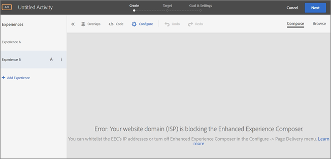
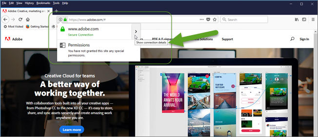
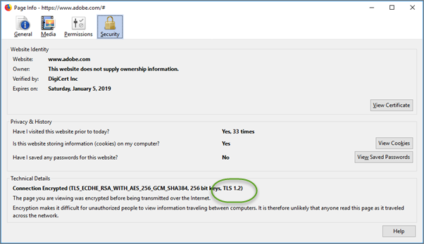

# Beheben von Problemen mit dem [!UICONTROL Enhanced Experience Composer] {#eec-issues}

>[!BEGINSHADEBOX]

**Auf dieser Seite:** Erfahren Sie, wie Sie die Probleme beheben, die nur den **[!UICONTROL Enhanced Experience Composer]** (EEC) betreffen, z. B. Seiten, die nicht geladen werden, weil die IP-Adressen des EEC-Proxys blockiert sind.

>[!ENDSHADEBOX]

Anzeigeprobleme treten unter bestimmten Bedingungen manchmal im [!DNL Adobe Target] **[!UICONTROL Enhanced Experience Composer]** (EEC) auf. Die folgenden Punkte beschreiben die Probleme, die nur den EEC betreffen und wie sie gelöst werden können.

## Zulassungsliste der IP-Adressen des EEC-Proxys {#eec-ip-addresses}

Der EEC lädt keine interne QA-URL, die nicht über eine öffentliche IP-Adresse zugänglich ist. Durch die Zulassungsauflistung der IP-Adressen des für den EEC-Proxy verwendeten [!DNL Adobe]-Servers wird dieses Problem behoben. Diese IP-Adressen sind nur für die Bearbeitung von Aktivitäten erforderlich, und die Besucher der Website benötigen sie nicht. Bitten Sie das IT-Team, die folgenden IP-Adressen auf die Zulassungsliste setzen.

### USA (va7)

```
40.70.154.136/29
52.254.106.240/28
52.254.106.160/28
52.254.107.16/28
20.186.185.181
20.22.83.112
20.186.185.227
52.254.106.192/28
52.254.106.0/28
52.254.107.128/28
52.254.107.80/28
52.254.106.176/28
52.254.107.32/28
52.254.105.192/28
52.254.107.64/28
52.254.106.208/28
52.254.107.0/28
52.254.106.224/28
20.14.241.153
20.186.185.239
4.152.211.251
52.254.107.144/28
52.254.106.144/28
```

### EMEA (nld2)

```
51.138.17.16/28
51.138.17.48/28
51.138.16.128/28
51.138.17.32/28
51.138.16.240/28
51.138.17.112/28
51.138.16.160/28
51.138.16.208/28
51.138.17.80/28
51.138.17.0/28
51.138.17.96/28
51.138.16.144/28
20.31.145.248
20.126.189.248
51.138.16.224/28
51.138.16.192/28
51.138.12.94
51.138.12.11
51.138.16.176/28
51.138.12.100
51.138.17.64/28
51.138.12.160/28
```

### APAC (aus)

```
20.43.104.160/28
20.227.35.177
20.40.188.227
20.43.104.112/28
20.43.104.128/28
20.43.104.144/28
20.40.188.166
20.53.206.128
20.43.104.80/28
20.43.104.16/28
20.43.105.48/28
20.43.104.96/28
20.43.104.48/28
20.40.188.194
20.43.104.32/28
20.40.191.224/28
20.43.105.16/28
20.40.191.96/28
20.43.104.176/28
20.40.191.240/28
20.43.104.64/28
20.43.105.32/28
20.43.104.192/28
20.43.105.0/28
20.43.104.0/28
```

### Legacy-IP-Adressen

Die folgenden Legacy-IP-Adressen sollten bis auf Weiteres weiter auf die Zulassungsliste gesetzt werden.

```
34.254.77.200
54.73.207.147
54.229.152.123
3.224.194.242
54.90.51.39
34.228.136.112
54.150.116.11
18.178.142.8
54.199.107.77
99.80.139.221
54.78.56.224
54.247.179.246
54.80.219.243
34.201.235.54
54.196.224.236
35.75.212.45
52.199.184.130
18.180.161.176
```

+++ Der EEC zeigt eine Fehlermeldung an, die besagt, dass die Website-Domain ihn blockiert

Die folgende Fehlermeldung kann in [!DNL Target] angezeigt werden:

`Error: Your website domain (ISP) is blocking the Enhanced Experience Composer. You can allowlist the Enhanced Experience Composer's IP addresses or turn off Enhanced Experience Composer in Configure > Page Delivery menu.`



Diese Fehlermeldung hat zwei mögliche Ursachen:

* Die Website Domain (ISP) blockiert den EEC. Um dieses Problem zu beheben, ändern Sie die IP-Adressen, die unter [&#x200B; aufgeführt sind, und wählen Sie die Zulassungsliste der IP-Adressen des EEC-Proxys aus](#eec-ip-addresses).
* Die IP-Adressen werden auf die Zulassungsliste gesetzt, aber die Website unterstützt TLS 1.2 nicht. Informationen zum Beheben des Problems finden Sie unter dem folgenden Punkt.

+++

+++ EEC wird nicht auf sicheren Seiten einer Site geladen, die TLS 1.0 verwendet

Die im vorherigen Element beschriebene Fehlermeldung kann angezeigt werden, wenn die IP-Adressen auf die Zulassungsliste gesetzt werden, die Website TLS 1.2 jedoch nicht unterstützt. [!DNL Target] verwendet derzeit Version 1.2 als Standardkonfiguration. Vor [!DNL Target] 18.4.1 (25. April 2018) unterstützte die Standardkonfiguration TLS 1.0. Weitere Informationen finden Sie unter [TLS-(Transport Layer Security)-Verschlüsselungsänderungen](https://experienceleague.adobe.com/docs/target-dev/developer/implementation/tls-transport-layer-security-encryption.html){target=_blank}.

So überprüfen Sie die TLS-Version einer Website in Firefox (andere Browser führen ähnliche Schritte aus):

1. Öffnen Sie die betroffene Website in Firefox.
1. Klicken Sie in **[!UICONTROL Adressleiste des Browsers auf]** Symbol „Site-Informationen anzeigen“.

   

1. Klicken Sie auf **[!UICONTROL Verbindungsdetails anzeigen]** > **[!UICONTROL Weitere Informationen]**.

   

1. Überprüfen Sie die TLS-Versionsinformationen unter **[!UICONTROL Technische Details]**.

   

1. Wenn auf der Website TLS 1.0 angezeigt wird, finden Sie [TLS (Transport Layer Security)-Verschlüsselungsänderungen](https://experienceleague.adobe.com/docs/target-dev/developer/implementation/tls-transport-layer-security-encryption.html){target=_blank} Informationen zur TLS-Unterstützungsrichtlinie von [!DNL Target]. Um vorläufig Abhilfe zu schaffen (gültig bis 12. September 2018), wenden Sie sich zur Konfiguration mit der TLS[Version und der Domain an die &#x200B;](/help/main/cmp-resources-and-contact-information.md#reference_ACA3391A00EF467B87930A450050077C)Kundenunterstützung“.

+++

+++ Zeitüberschreitungen oder Fehler „Zugriff verweigert“ werden angezeigt, wenn Websites mit aktiviertem Proxy geladen werden

Stellen Sie sicher, dass die Proxy-IP-Adressen in der Umgebung nicht blockiert werden. Die Adressen sind in [Zulassungsliste der IP-Adressen des EEC-Proxys](#eec-ip-addresses) aufgeführt.

+++
