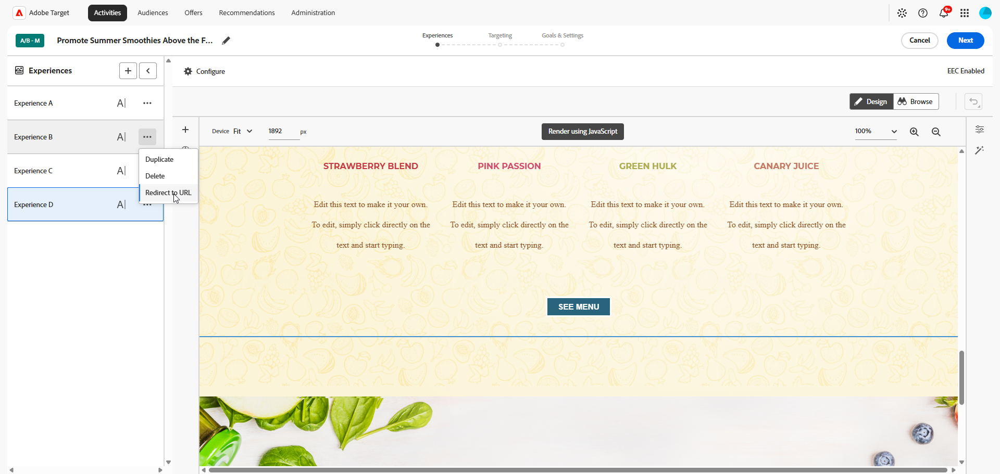
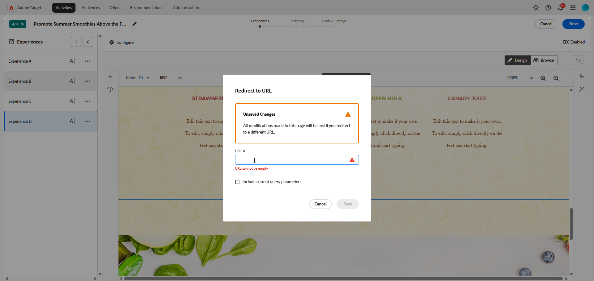

# Zu einer URL umleiten {#redirect-to-url}

>[!BEGINSHADEBOX]

**Auf dieser Seite:** Erfahren Sie, wie Sie mit der Option **[!UICONTROL Zu URL umleiten]** Besucher zu einer anderen Seite senden, anstatt Inhalte auf derselben Seite anzuzeigen.

>[!ENDSHADEBOX]

Die Option **[!UICONTROL Umleiten zur URL]** in [!DNL Adobe Target] sendet einen Besucher zu einer anderen Seite, anstatt Inhalte auf derselben Seite anzuzeigen. Es eignet sich für den Vergleich von zwei völlig verschiedenen Seiten, im Gegensatz zu Änderungen an Inhaltsfragmenten innerhalb einer Seite. Ein A/B-Test vergleicht dann Seite A mit Seite B: ein Erlebnis verweist auf die Standardseite A, und das andere leitet zu Seite B weiter.

Ein Umleitungsangebot führt den JavaScript-Code aus, der den Browser umleitet. Der Code verwendet die `window.location.replace();`-Methode, sodass die Seite, von der der Besucher umgeleitet wird, nicht im Browser-Verlauf gespeichert wird. Der Besucher kann daher weiterhin die Zurück-Schaltfläche des Browsers verwenden.

## Umleitungsangebot erstellen {#create-redirect-offer}

Das umgeleitete Erlebnis definiert die Seite, an die Besucher gesendet werden, und optional die Bedingungen der Umleitung.

1. Erstellen Sie ein Erlebnis.

1. Klicken Sie im **[!UICONTROL Erlebnisse]** auf das Symbol **[!UICONTROL Mehr Aktionen]** (  ) für das Erlebnis, das umleitet.

1. Klicken Sie auf **[!UICONTROL Zu URL umleiten]**.

   

1. Geben **[!UICONTROL im Dialogfeld Umleiten zur URL]** die URL von Seite B ein.

   

1. (Optional) Wählen Sie die Option aus, um die aktuellen Abfrageparameter einzuschließen.

   Wenn diese Option ausgewählt ist, wird alles, was nach dem `?` in der URL des Besuchers liegt, zum Zeitpunkt der Umleitung an die Umleitungs-URL angehängt.

## Einschränkungen

Umleitungsangebote weisen die folgenden Einschränkungen auf:

* **A4T:** Ein Umleitungsangebot in einer Aktivität, die A4T verwendet, erfordert eine Implementierung, die bestimmte Mindestanforderungen erfüllt, und es gelten andere wichtige Informationen. Siehe [Umleitungsangebote - Häufig gestellte Fragen zu A4T](/help/main/c-integrating-target-with-mac/a4t/r-a4t-faq/a4t-faq-redirect-offers.md).
* **Form-Based Experience Composer:** verwenden kein Umleitungsangebot in Mboxes, die Teil der Seite sind. Verwenden Sie ein Umleitungsangebot nur von einem Skript-Tag aus, das Teil der HTML-`<head>` ist, und verwenden Sie immer die automatische Erstellung und legen Sie das Umleitungsangebot für die globale Mbox fest.

>[!NOTE]
>
>Um den Referrer-Wert der Landingpage zu übergeben, verwenden Sie ein HTML-Angebot anstelle eines Umleitungsangebots.

## Bekannte Probleme

Umleitungsaktivitäten in at.js-Implementierungen können dazu führen, dass die Vorschau-URL in eine Schleife gerät, wobei das Angebot wiederholt bereitgestellt wird. Verwenden Sie [QA-Modus](/help/main/c-activities/c-activity-qa/activity-qa.md) um die Aktivität stattdessen in der Vorschau anzuzeigen und zu testen. Dieses Problem hat keine Auswirkungen auf die tatsächliche Bereitstellung des Angebots. (TGT-23019)
