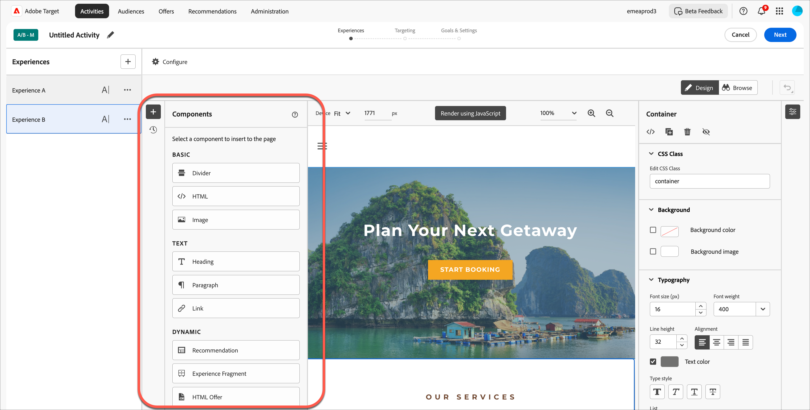
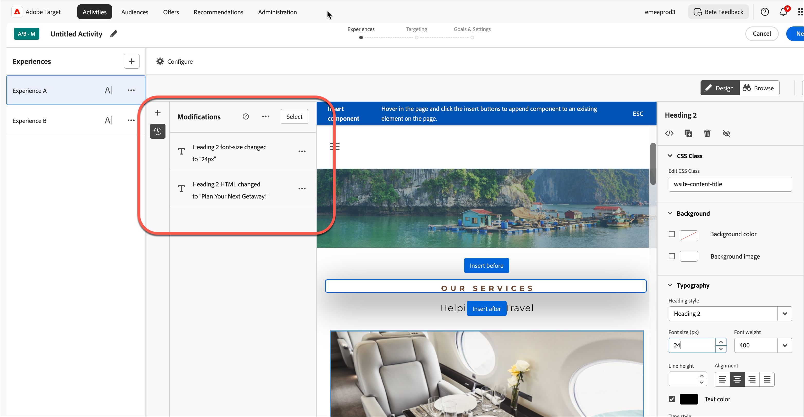

# [!UICONTROL Visual Experience Composer] Änderungen {#vec-changes}

>[!BEGINSHADEBOX]

**Auf dieser Seite:** Erfahren Sie, wie sich der aktualisierte [!UICONTROL Visual Experience Composer] (VEC), der in der Version [!DNL Adobe Target Standard/Premium] 25.2.1 eingeführt wurde, von der vorherigen Version unterscheidet.

>[!ENDSHADEBOX]

Mit der [!DNL Adobe Target Standard/Premium]-Version 25.2.1 (17. Februar 2025) wird ein aktualisierter [!UICONTROL Visual Experience Composer] (VEC) eingeführt. In diesem Artikel werden die Unterschiede zwischen der vorherigen und der aktualisierten Version des VEC erläutert.

>[!IMPORTANT]
>
>Der aktualisierte [!UICONTROL Visual Experience &#x200B;]) erfordert die [!DNL Adobe Experience Cloud] [**[!UICONTROL Visual Editing Helper &#x200B;]**-Erweiterung](/help/main/c-experiences/c-visual-experience-composer/r-troubleshoot-composer/visual-editing-helper-extension.md), die in der [!DNL Chrome Web Store] verfügbar ist.

Der VEC wird angezeigt, wenn eine Aktivität erstellt oder eine vorhandene Aktivität bearbeitet wird.

## Wichtige Änderungen am VEC

In den folgenden Abschnitten werden die wichtigsten Änderungen im aktualisierten VEC im Vergleich zur vorherigen Version erläutert.

### [!UICONTROL Erlebnisse] Leiste

Wie in der vorherigen Version **[!UICONTROL die Leiste]** Erlebnisse“ auf der linken Seite des VEC. Die **[!UICONTROL Erlebnisse]** kann nicht reduziert werden.

Erlebnisse werden mithilfe der Leiste „Erlebnisse“ erstellt **[!UICONTROL umbenannt]** entfernt.

Klicken Sie auf **[!UICONTROL Hinzufügen]**-Symbol (  ), um ein neues Erlebnis hinzuzufügen. Klicken Sie auf das Symbol **[!UICONTROL Mehr Aktionen]** (  ), um ein Erlebnis zu duplizieren, zu löschen oder umzuleiten.

### [!UICONTROL Komponenten] Leiste (neu)

Die neue **[!UICONTROL Komponenten]** Leiste fügt der Web-Seite eine Reihe von Komponenten hinzu, die dann bei Bedarf bearbeitet werden können.

Um eine neue Komponente hinzuzufügen, wählen Sie die gewünschte Komponente in der Leiste **[!UICONTROL Komponenten]** aus, bewegen Sie den Mauszeiger über ein vorhandenes Element auf der Seite und fügen Sie die Komponente dann vor oder nach dem ausgewählten Element ein.

Wenn in diesem Bereich **[!UICONTROL Leiste]**&#x200B;Änderungen“ anstelle der Leiste **[!UICONTROL Komponenten]** angezeigt wird, klicken Sie auf das Symbol **[!UICONTROL Komponenten anzeigen]** ( ). Das Symbol **[!UICONTROL Komponenten anzeigen]** (  ) und das Symbol **[!UICONTROL Änderungen anzeigen]** (  ) dienen als Umschalter, die die entsprechenden Optionen anzeigen.

Um die Leiste **[!UICONTROL Komponenten]** zu reduzieren und die Arbeitsfläche **[!UICONTROL Design]** zu vergrößern, während die Leiste **[!UICONTROL Komponenten]** geöffnet ist, klicken Sie auf das Symbol (  ).

### [!UICONTROL Änderungen] Leiste

Um die Leiste **[!UICONTROL Änderungen]** zu öffnen, klicken Sie auf das Symbol **[!UICONTROL Änderungen anzeigen]** (  anzeigen„) in der Leiste **[!UICONTROL Komponenten]**. Die **[!UICONTROL Änderungen]** der Leiste wurde von der rechten zur linken Seite der Arbeitsfläche für die Bearbeitung geändert.

>[!NOTE]
>
>Um die Leiste **[!UICONTROL Änderungen]** zu reduzieren und die Arbeitsfläche **[!UICONTROL Design]** zu vergrößern, während die Leiste **[!UICONTROL Änderungen]** geöffnet ist, klicken Sie auf das Symbol **[!UICONTROL Änderungen anzeigen]** (  ).

Die **[!UICONTROL Änderungen]** Leiste zeigt alle Änderungen an, die an der Seite in Visual Experience Composer vorgenommen wurden, und ermöglicht zusätzliche Änderungen (wie CSS-Auswahl, Mbox und benutzerdefinierter Code).

Klicken Sie auf das Symbol **[!UICONTROL Weitere Optionen]** (  ), um eine Änderung hinzuzufügen, alle Änderungen zu löschen oder alle ungültigen Änderungen zu löschen. Klicken Sie **[!UICONTROL Auswählen]**, um Massenvorgänge durchzuführen: **[!UICONTROL Auf alle Seiten anwenden]** oder **[!UICONTROL Löschen]**.

Um die Leiste **[!UICONTROL Änderungen]** erneut anzuzeigen, klicken Sie auf das Symbol **[!UICONTROL Änderungen ausblenden]** (  ) in der Leiste **[!UICONTROL Änderungen]**.

### [!UICONTROL Eigenschaften] Leiste (neu)

Die **[!UICONTROL Eigenschaften]** ändert die Eigenschaften ausgewählter Seitenelemente, unabhängig davon, ob es sich um HTML-Elemente oder [!DNL Target]-spezifische Objekte wie Empfehlungen oder Angebote handelt.

Klicken Sie auf die Symbole oben in der Leiste, um HTML-Code zu bearbeiten oder Elemente zu löschen, zu duplizieren oder auszublenden. Änderungen werden in der **[!UICONTROL Änderungen]** angezeigt.

Die **[!UICONTROL Eigenschaften]** ist in der rechten Leiste ausblendbar. Klicken Sie **[!UICONTROL rechts neben der Leiste auf das Symbol]** Eigenschaften anzeigen/ausblenden ), um die Leiste **[!UICONTROL Eigenschaften]** zu reduzieren oder anzuzeigen.

### Aktivitätseinstellungen/-konfiguration

Klicken Sie auf das **[!UICONTROL Konfigurieren]**-Symbol (  ), das über der Arbeitsfläche des Designs angezeigt wird, um das Menü mit den Eigenschaften der Aktivität anzuzeigen.

Die verschiedenen Optionen weisen Eigenschaften zu, bearbeiten Seitenbereitstellungsregeln, geben Site-Voreinstellungen an, fügen zusätzliche Seiten hinzu und aktivieren oder deaktivieren mehrseitige oder mehrere Zielgruppenaktivitäten. &quot;**[!UICONTROL &quot;]** eine [[!DNL Target Premium]](/help/main/c-intro/intro.md#premium) Funktion.

Position und Funktionalität sind mit der vorherigen VEC-Benutzeroberfläche vergleichbar.

### [!UICONTROL Design]/[!UICONTROL Browse]-Modi

Verwenden Sie die Umschalter **[!UICONTROL Design]**/**[!UICONTROL Durchsuchen]**, die oben in der Leiste **[!UICONTROL Eigenschaften]** angezeigt werden, um zwischen Design- und Durchsuchen-Modus zu wechseln.

Verwenden Sie den **[!UICONTROL Durchsuchen]**-Modus, um auf der Website zu navigieren und die Ansicht oder Seite auszuwählen, die aktualisiert werden soll. Wechseln Sie zurück in **[!UICONTROL Design]**-Modus, um Änderungen hinzuzufügen oder zu bearbeiten.

### [!UICONTROL Rückgängig]/[!UICONTROL Wiederholen]

Sie können Änderungen rückgängig machen, indem Sie auf das Symbol **[!UICONTROL Rückgängig]** klicken (Symbol  ).

Um eine Aktion wiederherzustellen, erweitern Sie die **[!UICONTROL Rückgängig]**/**[!UICONTROL Wiederholen]** und wählen Sie **[!UICONTROL Wiederholen]**.

### [!UICONTROL Design] Arbeitsfläche

Die **[!UICONTROL Design]**-Arbeitsfläche ermöglicht die Auswahl von Viewports, einschließlich „Fit-to-Screen“, **[!UICONTROL Desktop]**, **[!UICONTROL Tablet]**, **[!UICONTROL Mobile Querformat]** und **[!UICONTROL Mobile Hochformat]**.

Der aktualisierte VEC ermöglicht auch ein- oder auszoomen, indem Sie auf das entsprechende Symbol klicken ( oder  ).

## Visuelle Abbildung mit Änderungen der Benutzeroberfläche

Die folgende Abbildung zeigt die Änderungen an der Benutzeroberfläche auf hoher Ebene, die am aktualisierten VEC vorgenommen wurden. Auf der linken Seite der Abbildung wird die vorherige VEC-Benutzeroberfläche und auf der rechten Seite die aktualisierte Benutzeroberfläche angezeigt. Übereinstimmende Zahlen zeigen, wo sich verschiedene Elemente bewegt oder verändert haben.

{width="800" zoomable="yes"}

## Weitere Informationen zur aktualisierten Benutzeroberfläche

* [[!DNL Target Standard/Premium] 25.2.1 (17. Februar 2025) Versionshinweise](/help/main/r-release-notes/release-notes-for-previous-releases.md#ui-update-2): Bietet eine Zusammenfassung der wichtigsten Änderungen an der Benutzeroberfläche in [!DNL Target] für **&#x200B;**, **[!UICONTROL Recommendations]** und [!UICONTROL Visual Experience Composer] (VEC).

* [[!DNL Target Standard/Premium] 25.1.1 (9. Januar 2025) Versionshinweise](/help/main/r-release-notes/release-notes-for-previous-releases.md#ui-update-1): Bietet eine Zusammenfassung der wichtigsten Änderungen an der Benutzeroberfläche in [!DNL Target] für die **[!UICONTROL Angebotsbibliothek]**.

* [Grundlegendes zur  [!DNL Target] -Benutzeroberfläche](/help/main/c-intro/understand-the-target-ui.md): Bietet einen kurzen Überblick über [!DNL Target] mit Links zu detaillierteren Informationen und schrittweisen Anweisungen.

* [[!UICONTROL Visual Experience Composer] Optionen](/help/main/c-experiences/c-visual-experience-composer/viztarget-options.md): Erläutert die aktualisierte VEC-Benutzeroberfläche und ihre Optionen.

* [[!DNL Target] Häufig gestellte Fragen zur Aktualisierung der Benutzeroberfläche](/help/main/c-intro/updated-ui-faq.md) Behandelt häufige Fragen zur neuen [!DNL Target]-Benutzeroberfläche und [!UICONTROL Visual Experience Composer] (VEC), einschließlich Navigationsänderungen, Funktionsspeicherorte und der Einstellung des Umschalters für die temporäre Benutzeroberfläche.
