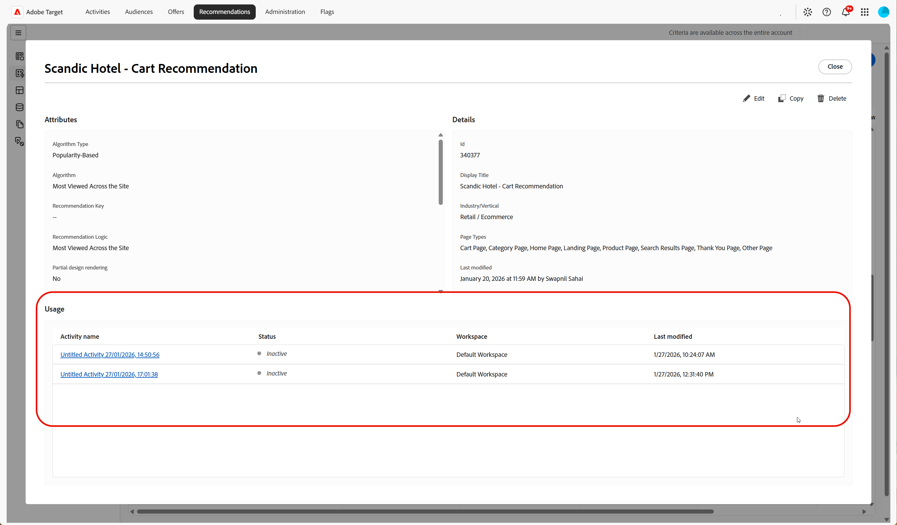

# Erste Schritte mit [!UICONTROL Kriterien] {#get-started-criteria}

>[!BEGINSHADEBOX]

**Auf dieser Seite** Erfahren Sie, wie Kriterien in [!DNL Adobe Target Recommendations] funktionieren und welche vertikalen Optionen für Branchen, Algorithmustyp und Empfehlungsschlüssel verfügbar sind.

>[!ENDSHADEBOX]

**[!UICONTROL Kriterien]** in [!DNL Adobe Target] [!DNL Recommendations] sind Regeln, die basierend auf einem vorab festgelegten Satz von Besucherverhalten bestimmen, welche Produkte oder Inhalte empfohlen werden sollen. Die Kriterien können auf angesagten Trends, dem aktuellen und früheren Verhalten eines Besuchers oder auf ähnlichen Produkten und Inhalten basieren. Einer Aktivität können mehrere Kriterien hinzugefügt werden, um mehrere Empfehlungstypen gegeneinander zu testen.

Die vertikalen Branchen und der ausgewählte Algorithmustyp bestimmen die Optionen, die bei der Erstellung von Kriterien verfügbar sind.

## Vertikaler Markt {#section_936BCFCF234C49A2BEC1C38AAC2D71AF}

Wenn Kriterien erstellt werden, wird basierend auf den Zielen der Recommendations-Aktivität eine vertikale Branche ausgewählt.

| Vertikaler Markt | Ziel |
|--- |--- |
| **[!UICONTROL Retail/eCommerce]** | Zum Kauf führende Konversion |
| **[!UICONTROL Lead-Generierung/B2B/Finanzdienstleistungen]** | Konversion ohne Kauf |
| **[!UICONTROL Medien/Veröffentlichen]** | Interaktion |

Andere Kriterienoptionen ändern sich je nach ausgewählter Branche. Die standardmäßige Branchenvertikale kann auf der Seite **[!UICONTROL Administration]** > **[!UICONTROL Recommendations]** festgelegt werden oder die Branchenvertikale kann für jedes Kriterium angegeben werden.

## Algorithmentyp {#section_885B3BB1B43048A88A8926F6B76FC482}

Der ausgewählte Algorithmustyp bestimmt die verfügbaren Algorithmen. In der folgenden Tabelle werden die Algorithmustypen und die zugehörigen Algorithmen erläutert.

| Algorithmustyp | Verwendungszeitpunkt | Verfügbare Algorithmen |
| --- | --- | --- |
| **[!UICONTROL Warenkorbbasiert]** | Empfehlungen auf der Grundlage des Warenkorbinhalts des Benutzers aussprechen. | <ul><li>**[!UICONTROL Personen, die diese angesehen haben, haben auch Folgendes angesehen]**</li><li>**[!UICONTROL Personen, die diese angesehen haben, kauften auch]**</li><li>**[!UICONTROL Personen, die diese gekauft haben, kauften auch]**</li></ul>Weitere Informationen finden Sie unter [Warenkorbbasiert](/help/main/c-recommendations/c-algorithms/base-the-recommendation-on-a-recommendation-key.md#cart-based) in *Stützen der Empfehlung auf einen Empfehlungsschlüssel*. |
| **[!UICONTROL Beliebtheitsbasiert]** | Empfehlungen auf der Grundlage der allgemeinen Popularität eines Elements auf der gesamten Website oder der Popularität von Elementen innerhalb der bevorzugten oder am häufigsten angezeigten Kategorie, Marke, Genre usw. des Benutzers geben. | <ul><li>**[!UICONTROL Am häufigsten auf der Website angezeigt]**</li><li>**[!UICONTROL Am häufigsten angezeigt nach Kategorie]**</li><li>**[!UICONTROL Am häufigsten angezeigt nach Elementattribut]**</li><li>**[!UICONTROL Meist gesehen nach Profilattribut]**</li><li>**[!UICONTROL Topverkäufe auf der Website]**</li><li>**[!UICONTROL Topverkäufe nach Kategorie]**</li><li>**[!UICONTROL Topverkäufe nach Artikelattribut]**</li><li>**[!UICONTROL Topverkäufe nach Profilattribut]**</li><li>**[!UICONTROL Am besten nach Analytics-Metrik]**</li></ul> |
| **[!UICONTROL Elementbasiert]** | Empfehlungen auf der Grundlage von Elementen geben, die einem Element ähneln, das der Benutzer gerade anzeigt oder kürzlich angeschaut hat. | <ul><li>**[!UICONTROL Personen, die dies angesehen haben, haben dies angesehen]**</li><li>**[!UICONTROL Leute, die das angesehen haben, kauften das]**</li><li>**[!UICONTROL Personen, die das gekauft haben, kauften das]**</li><li>**[!UICONTROL Elemente mit ähnlichen Attributen]**</li></ul> |
| **[!UICONTROL Benutzerbasiert]** | Empfehlungen auf der Grundlage des Benutzerverhaltens aussprechen. | <ul><li>**[!UICONTROL Vor Kurzem aufgerufene Artikel]**</li><li>**[!UICONTROL Empfohlen für Sie]**</li></ul> |
| **[!UICONTROL Benutzerdefinierte Kriterien]** | Empfehlungen basierend auf einer hochgeladenen benutzerdefinierten Datei aussprechen. | <ul><li>Benutzerdefinierter Algorithmus</li></ul> |

Weitere Informationen zu den einzelnen Algorithmen finden Sie unter [Stützen der Recommendation auf einen Recommendation-Schlüssel](/help/main/c-recommendations/c-algorithms/base-the-recommendation-on-a-recommendation-key.md).

## Verwenden eines benutzerdefinierten Empfehlungsschlüssels {#custom-key}

Empfehlungen können auch auf dem Wert eines benutzerdefinierten Profilattributs basieren. Beispielsweise können empfohlene Filme basierend auf dem Film angezeigt werden, den ein Benutzer zuletzt zur Warteschlange hinzugefügt hat.

1. Klicken Sie **[!UICONTROL Recommendations]** > **[!UICONTROL Kriterien]**.

1. Klicken Sie **[!UICONTROL Kriterien erstellen]** > **[!UICONTROL Kriterien erstellen]**.

   

1. Füllen Sie die Informationen im Abschnitt [Grundlegende Informationen](/help/main/c-recommendations/c-algorithms/create-new-algorithm.md#info) aus.

1. Wählen Sie im Abschnitt [Empfohlener ](/help/main/c-recommendations/c-algorithms/create-new-algorithm.md#rec-algo)&quot; **[!UICONTROL Elementbasiert]** aus der Liste **[!UICONTROL Algorithmustyp]** aus.

1. Wählen Sie **[!UICONTROL Personen, die dies angesehen haben, das angezeigt haben]** aus der Liste **[!UICONTROL Algorithmus]** aus.

1. Wählen Sie das benutzerdefinierte Profilattribut aus der Liste **[!UICONTROL Empfehlungsschlüssel]** aus (z. B. **[!UICONTROL Zuletzt angezeigt zur Watchlist hinzugefügt]**).

   >[!NOTE]
   >
   >Benutzerdefinierte Profilparameter können über JavaScript, API oder Integrationen an [!DNL Target] übergeben werden. Weitere Informationen zu benutzerdefinierten Profilattributen finden Sie unter [Besucherprofile](/help/main/c-target/c-visitor-profile/visitor-profile.md).

   

## Kriterieninformationen anzeigen {#section_7162DE58E4594FD688A4D7FDB829FD8B}

Die Kriteriendetails zeigen, wie ein Kriterium konfiguriert ist und welche Aktivitäten es verwenden.

1. Klicken Sie **[!UICONTROL Recommendations]** > **[!UICONTROL Kriterien]**, um die Liste der Kriterien anzuzeigen.

1. Klicken Sie auf die gewünschten Kriterien in der Spalte **[!UICONTROL Name]**.

1. Zeigen Sie in den Abschnitten **[!UICONTROL Attribute]** und Details allgemeine Informationen zu den ausgewählten Kriterien an, einschließlich **[!UICONTROL Name]**, **[!UICONTROL Beschreibung]**, **[!UICONTROL Industry Vertical]**, **[!UICONTROL Page Types]**, **[!UICONTROL Recommendation Key]**, **[!UICONTROL Recommendation Logic]**, **[!UICONTROL Algorithmus-ID]** und Informationen zur letzten Änderung (Datum und wer hat den Algorithmus geändert).

1. Die Liste der Aktivitäten, die auf die ausgewählten Kriterien verweisen, finden Sie **[!UICONTROL Abschnitt]** Nutzung“.

   >[!NOTE]
   >
   >Die **[!UICONTROL Algorithmusnutzung]** wird derzeit nur für [!DNL Recommendations] Aktivitäten unterstützt. Diese Funktion wird derzeit nicht für **[!UICONTROL A/B-]**-, **[!UICONTROL Automatische Zuordnung]**-, **[!UICONTROL Automatisches Targeting]**- und **[!UICONTROL Experience Targeting]** (XT)-Aktivitäten unterstützt, die [Recommendations als Angebot](/help/main/c-recommendations/recommendations-as-an-offer.md).

   
