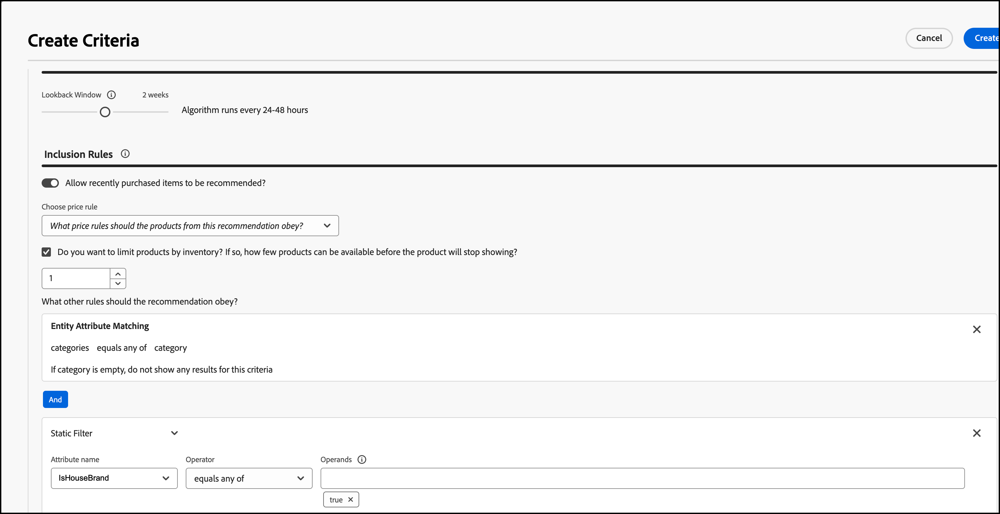

# Entitätsattributübereinstimmung {#entity-attribute-matching}

>[!BEGINSHADEBOX]

**Auf dieser Seite** Erfahren Sie, wie Sie Empfehlungen dynamisch in [!DNL Adobe Target Recommendations] filtern können, indem Sie einen Pool potenzieller empfohlener Elemente mit einem bestimmten Element vergleichen, mit dem der Besucher interagiert hat.

>[!ENDSHADEBOX]

**[!UICONTROL Abgleich der Entitätsattribute]** empfiehlt nur die Elemente, die mit einem Attribut eines Elements übereinstimmen, mit dem der Besucher interagiert hat. Der Prozess zum Erstellen und Verwenden von Einschlussregeln für Kriterien und Promotions ist ähnlich, genauso wie die Anwendungsfälle und Beispiele. Weitere Informationen finden Sie unter [Verwenden dynamischer und statischer Einschlussregeln](/help/main/c-recommendations/c-algorithms/use-dynamic-and-static-inclusion-rules.md).

## Beispiele für übereinstimmende Entitätsattribute

**[!UICONTROL Entitätsattributabgleich]** kann nur die Elemente empfehlen, die übereinstimmen, z. B.:

* Ein Attribut aus dem Element, das der Besucher derzeit anzeigt
* Das Element, das der Besucher zuletzt angezeigt hat
* Der Artikel, den der Besucher zuletzt gekauft hat
* Das Element, das der Besucher am häufigsten angezeigt hat
* Ein Element, das in einem benutzerdefinierten Attribut im Profil des Besuchers gespeichert ist

### Empfohlene Artikel basierend auf der Marke

Nachdem die Entitätsattributregeln erstellt wurden, filtern sie alle Recommendations mit Attributen heraus, die nicht mit dem auf der Seite übergebenen Entitätswert übereinstimmen. Der `entity.brand` muss in der Mbox auf den Seiten bereitgestellt werden, damit dieser Prozess funktioniert.

Bei dieser Art von dynamischer Einschlussregel muss nur eine Empfehlungsregel angegeben werden, um relevante Markenergebnisse über alle Markenseiten hinweg zurückzugeben, anstatt für jeden Markennamen eine Sammlung oder einen statischen Filter bereitzustellen.

Wenn beispielsweise eine Seite angezeigt wird, die ein Produkt von Marke A enthält, setzt die Seite den Wert des `entity.brand` auf „Marke A“. Auf einer Brand Landing Page gibt die Mbox `entity.brand=brandA` zurück.


Die Empfehlungen auf der Seite enthalten dann nur Produkte der Marke A.


Wenn eine Produktseite von Marke B angezeigt wird, wird der `entity.brand` auf „Marke B“ zurückgesetzt und es werden nur Produkte von Marke B empfohlen. Auf der Landingpage der Marke B werden auch nur Produkte der Marke B zurückgegeben.


### Upselling auf ein teureres Produkt

Um Besucher zu ermutigen, teurere und daher profitablere Artikel in Betracht zu ziehen, können die Anbieter „ist gleich“ und „ist zwischen“ teurere Artikel aus der gleichen Kategorie und der gleichen Marke bewerben. Beispielsweise kann ein retailer-Schuh teurere Laufschuhe fördern, um einem Besucher, der Laufschuhe sucht, Upsell zu bieten, wie im folgenden Beispiel gezeigt:


```
Entity Attribute Matching
category - equals - current item's - category 
And 
Entity Attribute Matching
brand - equals - current item's - brand 
And 
Entity Attribute Matching
value - is between - 100% and 1000% of - current item's - value
```

### Förderung von Eigenmarkenprodukten

Dynamische und statische Filter können kombiniert werden, um Eigenmarkenprodukte zu bewerben. So kann ein Bürozulieferer beispielsweise Tonerkassetten der Hausmarke des Unternehmens bewerben, um einen profitableren Verkauf für einen Besucher zu erzielen, der Toner sucht, und Stifte der Hausmarke des Unternehmens für einen Besucher, der Stifte betrachtet, wie in dem folgenden Beispiel dargestellt:



```
Entity Attribute Matching
category - equals - current item's - category 
And
Static Filter
IsHouseBrand - equals - true
```
