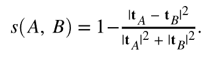

# Die Wissenschaft hinter den Empfehlungsalgorithmen von Target {#recommendations-algorithms}

>[!BEGINSHADEBOX]

**Auf dieser Seite** Erfahren Sie, wie die Algorithmen in [!DNL Adobe Target Recommendations] funktionieren, einschließlich der Logik und mathematischer Details des Modelltrainings und der Modellbereitstellung.

>[!ENDSHADEBOX]

Modelltraining ist der Prozess, durch den die [!DNL Adobe Target] Lernalgorithmen Empfehlungen generieren. Mit der Modellbereitstellung, auch Inhaltsbereitstellung genannt, werden [!DNL Target] diese Empfehlungen an die Besucher der Website weitergeleitet.

[!DNL Target] bietet die folgenden Arten von Algorithmen in [!DNL Recommendations]:

* **Artikelbasierte Algorithmen**: Befolgen Sie die Logik „Personen, die diesen Artikel angesehen/gekauft haben, haben auch diese Artikel angesehen/gekauft.“ Diese Algorithmen sind unter dem Begriff Element-Element-kollaboratives Filtern gruppiert. Dieser Typ enthält auch die Algorithmen **[!UICONTROL Elemente mit ähnlichen Attributen]**.

* **Benutzerbasierte Algorithmen**: Schließen Sie die Algorithmen **[!UICONTROL Kürzlich angezeigte Elemente]** und **[!UICONTROL Für Sie empfohlen]** ein.

* **Beliebtheitsalgorithmen**: Gibt die am häufigsten angezeigten oder am häufigsten gekauften Artikel auf der Website oder nach Kategorie oder Artikelattribut zurück.

* **Warenkorb-basierte Algorithmen**: Erstellen Sie Empfehlungen für mehrere Artikel mit der Logik „Personen, die diese Artikel angezeigt/gekauft haben, haben diese Artikel ebenfalls angesehen/gekauft“.

* **Benutzerdefinierte Kriterien**: Verwenden Sie benutzerdefinierte Dateien, die in [!DNL Target] als Quelle von Empfehlungen hochgeladen wurden.

Weitere Informationen zu den einzelnen Algorithmustypen und ihren Algorithmen finden Sie unter [Stützen der Empfehlung auf einen Empfehlungsschlüssel](/help/main/c-recommendations/c-algorithms/base-the-recommendation-on-a-recommendation-key.md).

Viele dieser Algorithmen sind auf einen oder mehrere Schlüssel angewiesen, die [!DNL Target] zum Zeitpunkt der Inhaltsbereitstellung (wenn Empfehlungen gegeben werden) verwendet, um ähnliche Elemente abzurufen. Kundenspezifische Schlüssel können das aktuelle Element sein, das der Besucher anzeigt, das zuletzt angezeigte oder gekaufte Element, das am häufigsten angezeigte Element, die aktuelle Kategorie oder die Favoritenkategorie des Besuchers. Andere Algorithmen, z. B. die Warenkorb- und benutzerbasierten Algorithmen, verwenden implizite Schlüssel, die vom Kunden nicht konfiguriert werden können. Weitere Informationen finden Sie unter [Empfehlungsschlüssel](/help/main/c-recommendations/c-algorithms/base-the-recommendation-on-a-recommendation-key.md#keys).

Schlüssel gelten nur zur Modellbereitstellungszeit (Inhaltsbereitstellung). Sie wirken sich nicht auf die Logik des Offline-Modelltrainings aus.

In den folgenden Abschnitten werden die Algorithmen nach der Ähnlichkeit ihrer Modelltrainingslogik gruppiert, sodass sich die Gruppen geringfügig von den oben genannten Typen unterscheiden.

## Partizipatives Filtern nach Elementen

Zu den Algorithmen gehören:

* **[!UICONTROL Personen, die dies angesehen haben, haben dies angesehen]**
* **[!UICONTROL Leute, die das angesehen haben, kauften das]**
* **[!UICONTROL Personen, die das gekauft haben, kauften das]**

Algorithmen zur kollaborativen Filterung von Elementen verwenden die Verhaltensmuster vieler Benutzer (daher „kollaborativ„), um Elemente zu empfehlen, die sich auf ein bestimmtes Element beziehen. Dadurch wird der Katalog möglicher Elemente gefiltert. Viele verschiedene Algorithmen fallen in den allgemeinen Rahmen der kollaborativen Filterung, und alle von ihnen verwenden Verhaltensdaten als Eingabe. [!DNL Target Recommendations] sind diese Eingaben die individuellen Ansichten und Käufe von Artikeln durch Benutzende.

Für die Algorithmen „Personen, die diesen Artikel angesehen/gekauft haben, haben auch diese Artikel angesehen/gekauft“ besteht das Ziel darin, eine Ähnlichkeit (A,B) zwischen allen Artikelpaaren zu berechnen. Für ein bestimmtes Element A sind die wichtigsten Empfehlungen die nach ihrer Ähnlichkeit(A,B) sortierten Elemente.

Ein Beispiel für eine Ähnlichkeit ist das gleichzeitige Auftreten von Artikeln: eine Anzahl der Benutzer, die beide Artikel gekauft haben. Diese Metrik ist intuitiv, aber naiv, da sie darauf ausgerichtet ist, beliebte Elemente zu empfehlen. In einem Lebensmittelgeschäft in retailer, wo die meisten Menschen Brot kaufen, kommt Brot häufig mit allen Artikeln vor, aber es ist nicht unbedingt eine gute Empfehlung. [!DNL Target] verwendet stattdessen das Log Likelihood Ratio (LLR). Diese Größe ist groß, wenn die Wahrscheinlichkeit des gleichzeitigen Auftretens von zwei Elementen, A und B, sehr verschieden von der Wahrscheinlichkeit ist, dass sie nicht gleichzeitig auftreten. Beispielsweise ist bei dem Algorithmus **[!UICONTROL People Who Viewed This, Bought That]** die LLR-Ähnlichkeit groß, wenn die Wahrscheinlichkeit, dass jemand B gekauft hat, *nicht* unabhängig davon ist, ob er A gesehen hat.

Element B wird nicht für Element A empfohlen, wenn Folgendes zutrifft:

Ausführliche Informationen zur Ähnlichkeitsberechnung des Log-Wahrscheinlichkeitsverhältnisses finden Sie unter [dieser PDF](/help/main/c-recommendations/c-algorithms/assets/log-likelihood-ratios-recommendation-algorithms.pdf).

Das folgende Diagramm zeigt den logischen Ablauf der Algorithmimplementierung:

Die Schritte lauten wie folgt:

* **Eingabedaten**: Verhaltensdaten in Form von Besucheransichten und Käufen, die beim [Implementieren von Target](https://experienceleague.adobe.com/docs/target-dev/developer/recommendations.html?lang=de){target=_blank} oder von [Adobe Analytics erfasst &#x200B;](/help/main/c-recommendations/c-algorithms/use-adobe-analytics-with-recommendations.md){target=_blank}.

* **Modell-**:

  * **Datenbereinigung und -**: Bei Algorithmen mit einem N-tägigen Lookback werden die Verhaltensdaten zunächst so gefiltert, dass nur die N Tage der Daten einbezogen werden. Sammlungsregeln und globale Ausschlüsse werden dann angewendet, um alle Elemente zu entfernen, die nicht empfohlen werden sollten. Schließlich werden die Nutzungsdaten von Besuchern, die mit mehr als 1.000 Elementen interagiert haben, auf 1.000 Elemente reduziert.
  * **Berechnung der Artikelähnlichkeit**: Der wichtigste Berechnungsschritt. [!DNL Target] berechnet die Ähnlichkeit des Log Likelihood-Verhältnisses zwischen allen möglichen Elementpaaren und ordnet die Paare nach diesem Score an.
  * **Offline-**: Alle weiteren anwendbaren dynamischen Filter werden angewendet (z. B. dynamische Kategorieausschlüsse). Die vorberechneten Empfehlungen werden dann global zwischengespeichert und können bereitgestellt werden.

* **Modellbereitstellung**: Die Empfehlungen werden vom [globalen &quot;Edge&quot;-Netzwerk](/help/main/c-intro/how-target-works.md#concept_0AE2ED8E9DE64288A8B30FCBF1040934) der [!DNL Target] bereitgestellt. Wenn eine Mbox-Anfrage an [!DNL Target] gesendet wird und festgelegt wird, dass Recommendations-Inhalte an die Seite gesendet werden sollen, wird der [Elementschlüssel](/help/main/c-recommendations/c-algorithms/base-the-recommendation-on-a-recommendation-key.md#keys) den der Algorithmus benötigt, entweder aus der Anfrage ausgewertet oder aus dem Besucherprofil nachgeschlagen. [!DNL Target] verwendet diesen Schlüssel, um die in den vorherigen Schritten berechneten Empfehlungen abzurufen, wendet weitere dynamische Filter an und rendert dann das entsprechende [Design](/help/main/c-recommendations/c-design-overview/create-design.md).

## Ähnlichkeit des Inhalts

Enthaltener Algorithmus:

* **[!UICONTROL Elemente mit ähnlichen Attributen]**

Bei diesem Algorithmus sind zwei Elemente verknüpft, wenn ihre Namen und Textbeschreibungen semantisch ähnlich sind. Im Gegensatz zu den meisten Recommendations-Algorithmen, die Verhaltensdaten erfordern, leiten Inhaltsähnlichkeits-Algorithmen die Ähnlichkeit zwischen Elementen aus Produktkatalog-Metadaten ab. [!DNL Target] können daher Empfehlungen in so genannten „Kaltstart“-Szenarien abgeben, in denen noch keine Verhaltensdaten erfasst wurden (z. B. zu Beginn einer [!DNL Target]).

Die Modellbereitstellung und Inhaltsbereitstellung für Inhaltsähnlichkeits-Algorithmen sind mit denen der anderen artikelbasierten Algorithmen identisch. Das Modell-Training ist sehr unterschiedlich: Es umfasst eine Reihe von Schritten zur Verarbeitung und Vorverarbeitung natürlicher Sprache, die in der folgenden Abbildung dargestellt werden. Der Kern der Ähnlichkeitsberechnung ist die Kosinusähnlichkeit von modifizierten tf-idf-Vektoren, die jedes Element im Katalog darstellen.

Die Schritte lauten wie folgt:

* **Eingabedaten**: Dieser Algorithmus verwendet nur Katalogdaten, die über einen Katalogfeed[&#x200B; die Entitäten-API oder [!DNL Target] Aktualisierungen auf der Seite aufgenommen &#x200B;](https://experienceleague.adobe.com/docs/target-dev/developer/recommendations.html?lang=de){target=_blank}.

* **Modell-**:

  * **Attributextraktion**: Nachdem statische Filter, Katalogregeln und globale Ausschlüsse angewendet wurden, extrahiert der Algorithmus die relevanten Textfelder aus dem Entitätsschema. [!DNL Target] verwendet automatisch die Felder Name, Nachricht und Kategorie der Entitätsattribute. Außerdem wird versucht, Zeichenfolgenfelder aus benutzerdefinierten (Entitätsattributen[&#x200B; zu &#x200B;](/help/main/c-recommendations/c-products/entity-attributes.md). Ein Feld wird als Zeichenfolgenfeld behandelt, wenn der Großteil seiner Werte nicht als Zahl, Datum oder Boolesch analysiert werden kann.
  * **Stemmen und Entfernen von Stoppwörtern**: Um die Übereinstimmung der Textähnlichkeit genauer zu machen, entfernt [!DNL Target] sehr gängige „Stopp“-Wörter, die die Bedeutung eines Elements nicht wesentlich ändern (z. B. „was“, „ist“ und „and„). Das Wortstammen reduziert Wörter mit unterschiedlichen Suffixen auf ihr Stammwort, das eine identische Bedeutung hat (z. B. haben „connect“, „connector“ und „connection“ alle das Stammwort „connect„). [!DNL Target] verwendet den Schneeballstamm. Zuerst führt es eine automatische Spracherkennung durch und kann Stoppwörter für bis zu 50 Sprachen entfernen und das Stemmen für 18 Sprachen durchführen.
  * **N-Gramm-Erstellung**: Nach den vorherigen Schritten wird jedes Wort als Token behandelt. Das Kombinieren zusammenhängender Sequenzen von Token zu einem einzigen Token wird als N-Gram-Erstellung bezeichnet. [!DNL Target] berücksichtigt bis zu 2 Gramm.
  * **tf-idf Berechnung**: Im nächsten Schritt werden tf-idf-Vektoren erstellt, die die relative Bedeutung von Token in der Artikelbeschreibung widerspiegeln. Für jeden Token bzw. Term t in einem Element i berechnet [!DNL Target] in einem Katalog D mit |D| Elementen zunächst die Termfrequenz TF(t, i), die die Anzahl der Auftritte des Terms in Element i ist, und die Dokumentenfrequenz DF(t, D), die die Anzahl der Elemente ist, in denen der Token t vorhanden ist. Die tf-idf-Kennzahl lautet dann:

    

    [!DNL Target] verwendet die Implementierung der *tf-idf*-Funktion von Apache Spark, bei der jedes Token in ein Leerzeichen von 2, Token  wird. In diesem Schritt wird auch das in den [Kriterien](/help/main/c-recommendations/c-algorithms/create-new-algorithm.md#similarity) angegebene Attribut angewendet, indem die Termfrequenzen in jedem Vektor angepasst werden.

  * **Berechnung der Artikelähnlichkeit**: Die endgültige Artikelähnlichkeit wird mit einer ungefähren Kosinusähnlichkeit berechnet. Für die beiden Positionen *A* und *B* mit den Vektoren tA und tB wird die Kosinusähnlichkeit wie folgt definiert:

    

    Um die signifikante Komplexität der Berechnung von Ähnlichkeiten zwischen allen N x N Elementen zu vermeiden, wird der *tf-idf* Vektor auf seine größten 500 Einträge gekürzt, und Kosinusähnlichkeiten zwischen Elementen werden aus dieser gekürzten Darstellung berechnet. Dieser Ansatz ist für dünne Vektorähnlichkeitsberechnungen robuster als andere Analogietechniken für „Näherungsnachbarn“ (Approximate Neast Neighbor, ANN), z. B. Hashing mit Ortsempfindlichkeit.

* **Modellbereitstellung**: Dieser Prozess ist identisch mit dem Prozess für die kollaborative Elementfilterung, der im vorherigen Abschnitt beschrieben wurde.

## Empfehlungen mit mehreren Schlüsseln

Zu den Algorithmen gehören:

* Warenkorb-basierte Empfehlungen
* **[!UICONTROL Empfohlen für Sie]**

**[!UICONTROL Empfohlen für Sie]** und die Warenkorb-basierten Algorithmen verwenden kollaborative Filtertechniken, um individuelle artikelbasierte Empfehlungen zu erstellen. Zum Zeitpunkt des Versands werden mehrere Elemente als Schlüssel zum Abrufen dieser artikelbasierten Empfehlungen verwendet: die Elemente im Browser-Verlauf des Besuchers (für **[!UICONTROL Empfohlen für Sie]**) oder im aktuellen Warenkorb des Besuchers (für Empfehlungen auf Warenkorbbasis). Die abgerufenen Recommendations werden zur endgültigen Liste zusammengeführt. Bei einem Algorithmus mit mehreren Schlüsseln sind Empfehlungen verfügbar, sobald ein Besucher einen Navigationsverlauf hat, und sie werden aktualisiert, um das neueste Besucherverhalten widerzuspiegeln.

Diese Algorithmen bauen auf den im Abschnitt Elementbasierte Empfehlungen beschriebenen partizipativen Filtertechniken auf und verwenden außerdem eine Hyperparameteroptimierung, um die optimale Ähnlichkeitsmetrik zwischen Elementen zu ermitteln. Der Algorithmus teilt die Verhaltensdaten der einzelnen Benutzer chronologisch auf und trainiert Empfehlungsmodelle anhand der früheren Daten, während er versucht, die Elemente vorherzusagen, die der Benutzer später ansieht oder kauft. Anschließend wird die Ähnlichkeitsmetrik mit der besten mittleren Genauigkeit ausgewählt.

Das folgende Diagramm zeigt die Logik der Schritte zum Modell-Training und zur Bewertung:

Die Schritte lauten wie folgt:

* **Eingabedaten**: Identisch mit den Methoden für das kollaborative Filtern (CF) nach Elementen. Sowohl **[!UICONTROL Empfohlen für Sie]** als auch Warenkorb-basierte Algorithmen verwenden Verhaltensdaten in Form von Benutzeransichten und Käufen, die bei der [Implementierung von Target](https://experienceleague.adobe.com/docs/target-dev/developer/recommendations.html?lang=de){target=_blank} oder von [Adobe Analytics erfasst &#x200B;](/help/main/c-recommendations/c-algorithms/use-adobe-analytics-with-recommendations.md){target=_blank}.

* **Modell-**:

  * **Datenbereinigung und -**: Wie bei den partizipativen Filtermethoden. Das Lookback-Fenster filtert die Verhaltensdaten in einen geeigneten Datumsbereich, woraufhin Katalogregeln und globale Ausschlüsse angewendet werden. Bei Besuchern, die mit mehr als 1.000 Elementen interagiert haben, werden nur die letzten 1.000 Verwendungen berücksichtigt.
  * **Trainingstest-Aufteilung**: Die Verwendungen der einzelnen Benutzenden werden chronologisch aufgeteilt. Die ersten 80 % werden den Schulungsdaten und die restlichen 20 % den Testdaten zugewiesen.
  * **Modell-Training für Artikelähnlichkeit**: Die Berechnung der Kernelement-Ähnlichkeit unterscheidet sich zwischen **[!UICONTROL Empfohlen für Sie]** und Warenkorbbasiert in der Erstellung der Vektoren für die möglichen Artikel. Für **[!UICONTROL Empfohlen für Sie]** haben die Elementvektoren Dimensions-NUsers, und jeder Eintrag ist die Summe der impliziten Bewertungen, die der Benutzer dem Element gegeben hat. Käufe haben ein 2faches Gewicht als Ansichten. Bei auf dem Warenkorb basierenden Empfehlungen haben die Artikelvektoren binäre Einträge. Wenn nur das Verhalten innerhalb einer Sitzung berücksichtigt wird, gibt es für jede Sitzung einen Eintrag. Andernfalls gibt es für jeden Besucher einen Eintrag.

    Im Trainingsschritt werden mehrere Typen von Vektorähnlichkeiten berechnet: LLR-Ähnlichkeit ([&#x200B; PDF](/help/main/c-recommendations/c-algorithms/assets/log-likelihood-ratios-recommendation-algorithms.pdf)), Kosinusähnlichkeit (wie zuvor definiert) und eine normalisierte L2-Ähnlichkeit, wie folgt definiert:

    

  * **Bewertung des Elementähnlichkeitsmodells**: Die im vorherigen Schritt generierten Empfehlungen werden anhand von Prognosen für den Testdatensatz ausgewertet. Die Online-Bewertungsphase wird nachgeahmt, indem die Elementnutzung jedes Benutzers im Testdatensatz chronologisch sortiert wird und dann 100 Empfehlungen für sortierte Untergruppen von Elementen gegeben werden, um spätere Ansichten und Käufe vorherzusagen. Die Qualität dieser Empfehlungen wird mit der durchschnittlichen Präzision bewertet, einer Metrik zum Abrufen von Informationen. Diese Metrik berücksichtigt die Reihenfolge der Empfehlungen und bevorzugt relevante Elemente weiter oben in der Liste, was eine wichtige Eigenschaft für Rangfolgesysteme ist.
  * **Modellauswahl**: Nach der Offline-Auswertung wird das Modell mit der höchsten mittleren Genauigkeit ausgewählt und alle individuellen Element-Element-Empfehlungen werden dafür berechnet.
  * **Offline-**: Die letzte Phase der Modellschulung wendet alle anwendbaren dynamischen Filter an. Die vorberechneten Empfehlungen werden dann global zwischengespeichert und können bereitgestellt werden.

* **Modellbereitstellung**: Im Gegensatz zu den vorherigen Algorithmen, die einen einzelnen Schlüssel zum Abrufen angeben und dann Geschäftsregeln anwenden, verwenden **[!UICONTROL Für Sie empfohlen]** und Warenkorbbasiert einen komplexeren Laufzeitprozess:

  * **Abrufen und Zusammenführen mehrerer Schlüssel**: Bei auf dem Warenkorb basierenden Empfehlungen werden bis zu zehn im Warenkorb übergebene Artikel als Schlüssel zum Abrufen verwendet und die Empfehlungen aus jedem Schlüssel werden gleich gewichtet. Bei **[!UICONTROL Empfohlen für Sie]** werden bis zu den letzten fünf Einzelansichtselementen und die letzten fünf Einzelkäufe als Schlüssel verwendet, und Empfehlungen von gekauften Elementen werden doppelt so stark gewichtet wie die von angezeigten Elementen. Wenn Empfehlungen zusammengeführt werden, werden die gewichteten Ähnlichkeitswerte eines Elements, das in mehreren Listen angezeigt wird, hinzugefügt. Das Ergebnis ist die zusammengeführte Liste neu gewichteter Empfehlungen, die in absteigender Reihenfolge angeordnet werden.
  * **Filtern**: Filterregeln, wie das Entfernen zuvor angezeigter oder gekaufter Artikel, und andere dynamische Geschäftsregeln werden angewendet.

Die folgende Abbildung zeigt diese Prozesse für einen Besucher, der Artikel A und Artikel B angesehen hat. Die einzelnen Empfehlungen werden mit den Offline-Ähnlichkeitsbewertungen abgerufen, die unter den einzelnen Artikelbeschriftungen angezeigt werden, und dann mit den gewichteten Ähnlichkeitsbewertungen zusammengeführt, die zusammengefasst werden. Wenn der Kunde angegeben hat, dass zuvor angezeigte und gekaufte Artikel herausgefiltert werden müssen, entfernt der Filterschritt die Artikel A und B aus der Liste der Empfehlungen.

## Beliebtheitsbasiert

Zu den Algorithmen gehören:

* **[!UICONTROL Am häufigsten auf der Website angezeigt]**
* **[!UICONTROL Am häufigsten angezeigt nach Kategorie]**
* **[!UICONTROL Am häufigsten angezeigt nach Elementattribut]**
* **[!UICONTROL Meist gesehen nach Profilattribut]**
* **[!UICONTROL Topverkäufe auf der Website]**
* **[!UICONTROL Topverkäufe nach Kategorie]**
* **[!UICONTROL Topverkäufe nach Artikelattribut]**
* **[!UICONTROL Topverkäufe nach Profilattribut]**

[!DNL Target] bietet Beliebtheitsalgorithmen für die am häufigsten angezeigten Elemente und für die meistverkauften Elemente, entweder auf der gesamten Website oder aufgeschlüsselt nach Artikelattribut oder Kategorie. Diese Algorithmen ordnen Artikel nach der Anzahl der Sitzungen, in denen der Artikel in einem bestimmten Zeitraum angezeigt oder gekauft wurde.

Alle diese Algorithmen kombinieren aggregierte Verhaltensdaten, die die Gesamtzahl der Sitzungen aufzeichnen, in denen Artikel angezeigt und gekauft wurden, sowohl bei stündlichen als auch bei täglichen Auflösungen. Jeder Algorithmus findet dann die am häufigsten angezeigten oder gekauften Artikel für das kundenkonfigurierte Lookback-Fenster.

Die Algorithmen unterscheiden sich wie folgt:

* **[!UICONTROL Am häufigsten auf der Website angezeigt]** und **[!UICONTROL Topverkäufe auf der Website]** sortieren Artikel nach der aggregierten Anzahl der Sitzungen, in denen die Artikel angezeigt bzw. gekauft wurden. Die Ausgabe ist eine einzelne (schlüssellose) Liste empfohlener Elemente.
* Die am häufigsten angezeigten und Topverkäufe nach Kategorie oder Artikelattribut bestellen Artikel ebenfalls nach der aggregierten Sitzungsanzahl, gruppieren sie jedoch nach Artikelkategorie oder nach einem bestimmten Artikelattribut. Die Ausgabe besteht aus Listen empfohlener Elemente, die durch die Werte der Kategorien oder Elementattribute verschlüsselt werden.
* **[!UICONTROL Am häufigsten angezeigt nach Profilattribut]** und **[!UICONTROL Topverkäufe nach Profilattribut]** sortieren Artikel auch nach aggregierter Ansicht oder Kaufanzahl, sie gruppieren jedoch nach einem Besucherprofilattribut, z. B. Land, Region oder Mitgliedschaftsstufe, anstelle einer Artikeleigenschaft. Die Anzahl jeder Sitzung wird dem Profilwert zugeordnet, den der Besucher zum Zeitpunkt der Interaktion gehalten hat, nicht einem Attribut des Elements. Das Ergebnis ist ein Satz von Empfehlungslisten, die durch die eindeutigen Werte dieses Profilattributs verschlüsselt sind.

## Kürzlich angesehen

Der Algorithmus „Recently Viewed“ ermöglicht die sitzungsinterne Personalisierung von Recommendations. Es ist kein Offline-Modell-Training erforderlich. Stattdessen verwendet [!DNL Target] das eindeutige [Besucherprofil](/help/main/c-target/c-visitor-profile/visitor-profile.md), um eine laufende Liste der in einer Sitzung angezeigten Elemente zu verwalten, und kann diese Elemente in Recommendations-Aktivitäten einblenden. Dies ermöglicht Echtzeit-Aktualisierungen für Recommendations und die Personalisierung der nächsten Seite.

## Benutzerdefinierte Kriterien

Benutzerdefinierte Kriterien ermöglichen es Kunden, [ihre eigenen Empfehlungen in Target hochzuladen](/help/main/c-recommendations/c-algorithms/recommendations-csv.md) was Flexibilität bietet und Funktionen für „Eigenes Modell mitbringen“ ermöglicht. Benutzerdefinierte Kriterien ersetzen den Offline-Trainings-Teil **[!UICONTROL (]**) Empfehlungen. Bei der Bereitstellung von Online-Inhalten verhalten sie sich wie die Algorithmen auf Elementbasis: Zum Abrufen von Empfehlungen wird ein einzelner Schlüssel verwendet, woraufhin Geschäftsregeln und Filter angewendet werden.
