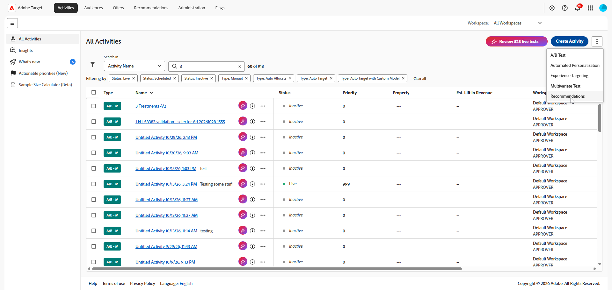

# Sammlungen {#collections}

>[!BEGINSHADEBOX]

**Auf dieser Seite** Erfahren Sie, wie Sie Sammlungen von Elementen in [!DNL Adobe Target Recommendations] erstellen, verwalten und verwenden.

>[!ENDSHADEBOX]

Eine Sammlung ist ein Satz von Produkten oder Artikeln, die für die Empfehlung infrage kommen. Eine Sammlung wird durch die Bedingungen definiert, die Elemente erfüllen müssen, um Teil derselben zu sein. Artikel können in jeder für das Unternehmen sinnvollen Weise gruppiert werden, wie z. B. ähnliche oder verwandte Artikel, Produkte in einer bestimmten Preisspanne oder Farbe oder Artikel, die in einem bestimmten geografischen Gebiet wahrscheinlich interessant sind.

Sammlungen organisieren Produkte in logischen Buckets. Wenn beispielsweise einige Elemente in einer Region, aber nicht in einer anderen Region verfügbar sind, kann eine Sammlung die Elemente ausschließen, die in der Region des Besuchers nicht verfügbar sind. Sammlungen können auch saisonale Artikel oder andere organisatorische Parameter organisieren, die für das Unternehmen gelten. Elemente können in Katalogen gruppiert werden, und dann können für jede Sammlung separate Empfehlungen erstellt werden.

Die folgenden Punkte beschreiben, wie Sammlungen mit dem Rest von [!DNL Recommendations] interagieren:

* [Sicherungsempfehlungen](/help/main/c-recommendations/c-algorithms/backup-recs.md), die für jedes Kriterium generiert werden, verwenden auch die Sammlung, sodass nur Elemente in der Sammlung in die Sicherungsempfehlung aufgenommen werden. Daher werden nur Produkte angezeigt, die für einen Standort sinnvoll sind.
* Sammlungen werden stets neu erstellt oder aktualisiert, wenn die einzelnen Kriterien ausgeführt werden.
* Sammlungsregeln gelten für Empfehlungselemente, die nach der Ausführung der Kriterien generiert werden. Sie wirken sich nur auf Entitätsempfehlungen (Entity Recommendations, ERs) in der Ausgabe aus, nicht auf den Schlüssel.
* Sammlungen werden nicht angewendet, wenn der Empfehlungsschlüssel **[!UICONTROL Kürzlich angezeigte Elemente]** verwendet wird.
* Einschlusskriterien können ähnliche Ergebnisse erzielen, müssen jedoch jedes Mal eingerichtet werden, wenn eine Aktivität erstellt wird. Eine Sammlung wird einmal erstellt und kann dann wiederverwendet werden, ohne erneut eingerichtet zu werden.
* Wenn eine [!DNL Recommendations] erstellt oder bearbeitet wird, wird der Sammlungsname neben der Beschriftung **[!UICONTROL Kriterien]** im Aktivitätsdiagramm angezeigt.

## Eine Sammlung erstellen {#task_1256DFF6842141FCAADD9E1428EF7F08}

Sammlungen sind im gesamten Konto verfügbar, sodass eine einmal erstellte Sammlung in jeder [!DNL Recommendations] ausgewählt werden kann. Die Regeln werden in der Sammlung definiert, sodass sie nicht für jede Aktivität neu eingerichtet werden müssen.

1. Klicken Sie **[!UICONTROL Recommendations]** > **[!UICONTROL Sammlungen]**, um die Liste der vorhandenen Sammlungen anzuzeigen.

   Um eine vorhandene Sammlung zu bearbeiten, zu kopieren oder zu löschen, klicken Sie auf das Symbol Mehr Aktionen (  ) neben der Sammlung und klicken Sie dann auf die gewünschte Option.

   >[!NOTE]
   >
   >Die „Anzahl der Elemente“, die für jede Sammlung in der Listenansicht **[!UICONTROL Sammlungen]** gemeldet wird, ist die Anzahl der Produkte, die den Regeln für diese Sammlung in der konfigurierten standardmäßigen Recommendations-[&#x200B; (Hostgruppe](/help/main/administrating-target/hosts.md) (Umgebung) entsprechen. Siehe [Einstellungen](https://experienceleague.adobe.com/docs/target-dev/developer/recommendations.html?lang=de){target=_blank} zum Ändern der Standardhostgruppe.

1. Klicken Sie **[!UICONTROL Sammlung erstellen]**.

   

1. Geben Sie einen **[!UICONTROL Namen]** für die Sammlung ein. Eine optionale **[!UICONTROL Beschreibung]** kann ebenfalls eingegeben werden.

1. (Bedingt) Wählen Sie eine [Umgebung](/help/main/administrating-target/environments.md) aus dem Filter **[!UICONTROL Umgebung]** aus, um eine Vorschau des Inhalts der Sammlung in dieser Umgebung anzuzeigen. Standardmäßig werden Ergebnisse aus der Standardhostgruppe angezeigt.

1. Legen Sie die Regeln fest, die für den Aufbau der Sammlung verwendet werden.

   Eine Sammlung kann auf einer Produkt-ID oder Kategorie, einer Spanne oder einem anderen Parameter in der Liste aufbauen. Fügen Sie Regeln hinzu, um mehrere Parameter zum Definieren einer Sammlung zu verwenden. Mehrere Regeln werden mit einem AND-Operator verbunden, sodass alle angegebenen Regeln übereinstimmen müssen, damit die Sammlung angewendet wird.

1. Klicken Sie **[!UICONTROL Erstellen]**.

1. Nachdem die Sammlung erstellt wurde, klicken Sie auf das Symbol Mehr Aktionen  ) und wählen Sie die entsprechende Option aus: **[!UICONTROL Bearbeiten]**, **[!UICONTROL Kopieren]** oder **[!UICONTROL Löschen]**.

   

<!--
## Create a collection using [!UICONTROL Advanced Search]

You can also create collections using [!UICONTROL Advanced Search] on the [Catalog Search](/help/main/c-recommendations/c-products/catalog-search.md#save-as) page ([!UICONTROL Recommendations] > [!UICONTROL Catalog Search] > [!UICONTROL Advanced Search]). 

After creating a search using "id > contains," for example, you can then click [!UICONTROL Save As] > [!UICONTROL Collection].

>[!IMPORTANT]
>
>The [!UICONTROL Advanced Search] functionality is case-insensitive; however, products returned at the time of delivery are based on case-sensitive search. This mismatch might lead to confusion. Ensure that you consider case-sensitivity when you create collections based on results using the [!UICONTROL Advanced Search] functionality. For example, if you perform a search for "Holiday," that initial search lists results containing "Holiday" and "holiday." If you then create a catalog with the intent to return products containing "holiday," only products containing "holiday" are returned. Products containing "Holiday" are not returned.
-->

## Verwenden einer Sammlung in einer Aktivität

Für jedes Erlebnis einer [!DNL Recommendations] wird eine Sammlung ausgewählt. Die Sammlung bestimmt, welche Elemente in den Empfehlungen dieses Erlebnisses angezeigt werden können.

1. [Sammlung erstellen](#task_1256DFF6842141FCAADD9E1428EF7F08).

   

1. Klicken Sie auf **[!UICONTROL Aktivitäten]** und [Erstellen einer neuen Recommendations-Aktivität](/help/main/c-recommendations/t-create-recs-activity/create-recs-activity.md) oder bearbeiten Sie eine vorhandene Aktivität.

   

1. Wählen Sie nach Auswahl eines Kriteriums und eines Designs die gewünschte Sammlung auf der Seite **[!UICONTROL Optionen]** aus.

1. (Bedingt) Um die Sammlung einer vorhandenen Aktivität zu ändern, klicken Sie auf einen Recommendations-Speicherort auf den **[!UICONTROL Erlebnisse]**-Seiten, klicken Sie auf **[!UICONTROL Sammlung ändern]** und wählen Sie dann die gewünschte Sammlung aus.
