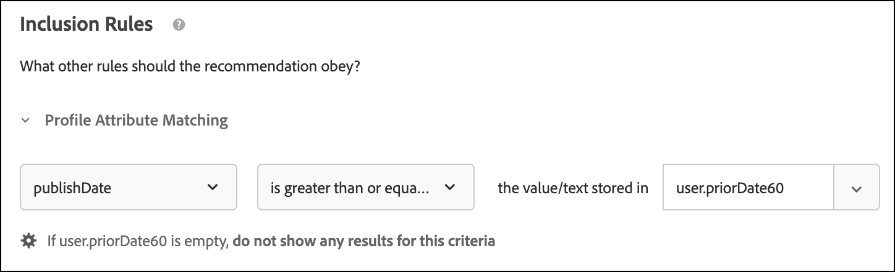

# Recommendations-FAQs {#recommendations-faq}

>[!BEGINSHADEBOX]

**Auf dieser Seite** finden Sie Antworten auf häufig gestellte Fragen zu [!DNL Adobe Target] [!DNL Recommendations].

>[!ENDSHADEBOX]

## Daten und APIs {#data-and-apis}

+++ Werden [!DNL Recommendations] über die API erstellten Objekte in der [!DNL Target]-Benutzeroberfläche angezeigt?

Ja. [!UICONTROL Recommendations]-Objekte (**[!UICONTROL Kriterien]**, **[!UICONTROL Designs]**, **[!UICONTROL Sammlungen]** und **[!UICONTROL Ausschlüsse]**), die über die API erstellt wurden, sind in der Benutzeroberfläche verfügbar und können über die API oder die [!DNL Target] Benutzeroberfläche bearbeitet werden.

+++

+++ Können visuelle Angebote, die in der [!DNL Target]-Benutzeroberfläche erstellt wurden, mit den [!DNL Target]-APIs verwaltet werden?

Nein. [!DNL Recommendations] Aktivitäten mit visuellen Angeboten, die in der [!DNL Target]-Benutzeroberfläche erstellt wurden, können nicht mit den [!DNL Target]-APIs verwaltet werden. Diese Aktivitäten werden in der Liste **[!UICONTROL Aktivitäten]** angezeigt, können jedoch nicht gelesen oder aktualisiert werden (mit GET oder PUT).

+++

+++ Welche Größenbeschränkung besteht für einen API-Aufruf zum Einfügen oder Aktualisieren von Produkten? Können 50.000 Produkte mit einem einzigen Aufruf anstelle eines Feeds aktualisiert werden?

[!DNL Target] begrenzt Posts auf Programmebene auf 50 MB, allerdings nur, wenn der Header des `application/x-www-form-urlencoded` Inhaltstyps übergeben wird.

Es kann ein Aufruf mit 50.000 Produkten durchgeführt werden. Wenn der Aufruf fehlschlägt, kann er in Batches aufgeteilt werden. Adobe empfiehlt Batches mit 5.000 oder 10.000 Produkten, um die Wahrscheinlichkeit eines Timeouts aufgrund der Systemauslastung zu verringern.

+++

+++ Wie groß dürfen CSV-Dateien für den Feedupload maximal sein?

Es gibt keine feste Begrenzung für die Anzahl der Zeilen oder die Dateigröße für einen Feed-CSV-Datei-Upload. Als Best Practice empfiehlt Adobe, die CSV-Datei auf 1 GB zu beschränken, um Fehler beim Hochladen zu vermeiden. Eine Datei, die größer als 1 GB ist, kann idealerweise in mehrere Feed-Dateien aufgeteilt werden.

Die maximale Anzahl benutzerdefinierter Attributspalten ist 100, und benutzerdefinierte Attribute sind auf 4.096 Zeichen beschränkt. Weitere Längenbeschränkungen für erforderliche Spalten finden Sie auf der Seite [[!DNL Target] Beschränkungen](/help/main/r-troubleshooting-target/target-limits.md).

+++

+++ Warum zeigt **[!UICONTROL Katalogsuche]** bei der Suche nach einem benutzerdefinierten Attribut mit einem numerischen Wert nicht die richtigen Ergebnisse an?

Wenn eine Katalogsuche nach einem benutzerdefinierten Attribut mit einem numerischen Wert durchgeführt wird, wird das Attribut als Zeichenfolge und nicht als numerischer Wert behandelt.

Derzeit ist keine Funktion verfügbar, mit der Kunden den Attributtyp ändern können. Wenn Sie eine Änderung vornehmen möchten, [ein Kundenproblem öffnen](/help/main/cmp-resources-and-contact-information.md#reference_ACA3391A00EF467B87930A450050077C) das auf die Attribute verweist, deren Typ von „Zeichenfolge“ in „numerisch“ geändert werden muss.

+++

## Timing aktualisieren {#update-timing}

+++ Wie lange dauert es, bis Aktualisierungen an Elementen im Katalog auf der Website angezeigt werden?

Der Zeitrahmen und die Ergebnisse hängen davon ab, wie die Elemente aktualisiert werden.

| Aktualisierung | Recommendations | Katalogsuche |
| --- | --- | --- |
| Elementattribute über eine Mbox oder die API aktualisiert | Innerhalb von 15 Minuten | Nach dem Katalogindex (3-8 Stunden) |
| Elementattribute über einen Feed aktualisiert | Nach der Futteraufnahme (2-8 Stunden) | Nach der Feed-Aufnahme (2-8 Stunden) und dem anschließenden Katalogindex (3-8 Stunden), insgesamt innerhalb von 5-16 Stunden |
| Element aus dem Katalog über die [!DNL Target]-Benutzeroberfläche oder -API gelöscht | Innerhalb von 15 Minuten | Nach dem Katalogindex (3-8 Stunden) |
| Element, das über eine Mbox oder die API zum Katalog hinzugefügt wird | Nach der nächsten Algorithmusausführung. Algorithmusausführungen sind für 1- bis 2-tägige Algorithmen alle 12 Stunden und für 7- oder längere Algorithmen alle 24 Stunden geplant | Nach dem Katalogindex (3-8 Stunden) |
| Element, das über einen Feed zum Katalog hinzugefügt wird | Nach der Feed-Aufnahme (2-8 Stunden) und der anschließenden Ausführung des Algorithmus, der für 1-2-tägige Algorithmen alle 12 Stunden und für 7-tägige oder längere Algorithmen alle 24 Stunden geplant ist, insgesamt also innerhalb von 2-32 Stunden | Nach der Feed-Aufnahme (2-8 Stunden) und dem Katalogindex (3-8 Stunden), insgesamt innerhalb von 5-16 Stunden |

Bis die Aktualisierungen verfügbar sind, wird der folgende Inhalt angezeigt:

* Für aktualisierte oder gelöschte Elemente werden die vorhandenen Empfehlungen und Elementattribute angezeigt.
* Für ein hinzugefügtes Element werden die vorhandenen Empfehlungen angezeigt, wenn das hinzugefügte Element kein angeforderter Schlüssel ist. Sicherungsempfehlungen werden angezeigt, wenn das hinzugefügte Element ein angeforderter Schlüssel ist.

Nachdem eine Feed-Datei importiert oder Entitätsaktualisierungen über die API oder eine Mbox empfangen wurden, werden die folgenden Änderungen in maximal 60 Minuten angezeigt:

* Wenn ein Element zuvor ausgeschlossen wurde, jetzt aber eingeschlossen werden sollte, wird das Element bei der nächsten Algorithmusausführung (12-24 Stunden) eingeschlossen.

  Dies geschieht, weil [!DNL Target] Ausschlüsse sowohl online als auch offline anwendet. Wenn ein Element neu ausgeschlossen wird, wird der Online-Ausschluss schnell angewendet. Wenn ein Element neu eingeschlossen wird, wird der Online-Ausschluss schnell beendet, aber der Offline-Ausschluss wird erst beendet, wenn der nächste Algorithmus ausgeführt wird.

* Wenn ein Element zuvor eingeschlossen war, aber jetzt ausgeschlossen werden soll, wird das Element entsprechend den Zeitleisten in der Tabelle ausgeschlossen, je nach Quelle: 15 Minuten über eine Mbox oder die API oder 12-24 Stunden über einen Feed.

Die folgenden Änderungen werden erst dann übernommen, wenn der nächste Algorithmus ausgeführt wird (innerhalb von 12-24 Stunden):

* Elementattribute, die in den Sammlungsregeln der Aktivität verwendet werden.
* Artikelattribute, die in einer Promotion verwendet werden, die auf einem Attribut oder einer Sammlung basiert, die mit der Aktivität verknüpft ist.
* Die Artikelkategorie, in der der Artikel für eine „Aktuelle Kategorie“ oder „Favoritenkategorie“ im Algorithmus **[!UICONTROL Topverkäufe]** oder **[!UICONTROL Am häufigsten angezeigt]** angezeigt wird.
* Das Ranking der empfohlenen Elemente, wenn das geänderte Attribut ein benutzerdefiniertes Attribut ist, das als benutzerdefinierter Schlüssel für einen Algorithmus verwendet wird.
* Die Rangfolge empfohlener Elemente basierend auf einem oder mehreren geänderten Attributen, wenn die Empfehlungslogik „Elemente mit ähnlichen Attributen“ lautet oder wenn die Faktoren „Inhaltsähnlichkeit“ oder „Attributgewichtung“ verwendet werden.

>[!NOTE]
>
>Eine Feed-Datei wird als importiert erachtet, wenn sich ihr Status von „Elemente werden importiert“ in „Aktualisierungen des Suchindex werden vorbereitet“ ändert. Es kann mehr als 60 Minuten dauern, bis Aktualisierungen in der Benutzeroberfläche **[!UICONTROL Katalogsuche]** angezeigt werden. **[!UICONTROL Katalogsuche]** ist auf dem neuesten Stand, wenn sich der Feed-Status in „Updates abgeschlossen“ ändert. Auch wenn **[!UICONTROL Katalogsuche]** noch nicht aktuell ist, spiegelt die Site die Aktualisierungen innerhalb der oben aufgeführten Zeitrahmen wider. Die aktuelle Indexaktualisierungszeit **[!UICONTROL Katalogsuche]** wird auf der Seite **[!UICONTROL Katalogsuche“]**.

+++

+++ Wie lange dauert es, bis eine Konfigurationsänderung einer Aktivität, eines Angebots[!UICONTROL &#x200B; einer Promotion oder &#x200B;] Kriterieneinstellungen auf der Site wirksam wird?

* Es kann bis zu fünf Stunden dauern, bis eine Änderung an den Promotion-Einstellungen auf der Website angezeigt wird.
* Eine Änderung anderer Kriterieneinstellungen wird möglicherweise erst angezeigt, wenn der nächste Algorithmus ausgeführt wird:

  * Einige Kriterieneinstellungen, z. B. das Hinzufügen einer dynamischen Einschlussregel, werden sofort angezeigt.
  * Andere Kriterieneinstellungen, z. B. das Entfernen einer dynamischen Einschlussregel oder einer Änderung des Lookback-Fensters, können erst nach Ausführung des nächsten Algorithmus eingebunden werden.
  * Diese Änderungen werden in einem Trigger ausgeführt, dessen Ausführung bis zu 24 Stunden dauern kann. Algorithmen können auch nach einem Zeitplan alle 12-24 Stunden ausgeführt werden.

+++

+++ Wie lange dauert es, bis das Verhalten eines Benutzers (z. B. Klick auf Produkt A und Kauf von Produkt B) in den Empfehlungen berücksichtigt wird, die derselbe Benutzer erhält?

* Das aktuell angezeigte oder gekaufte Produkt oder der aktuell gekaufte Inhalt beeinflusst die Empfehlungen, die der Benutzer in derselben Seitenansicht oder [!DNL Target] Inhaltsanfrage erhält.
* Früheres Benutzerverhalten, wie „Zuletzt angezeigtes Produkt“, „Am häufigsten angezeigtes Produkt“ und der gesamte Anzeige- und Kaufverlauf werden mit dieser Anfrage aktualisiert. Sie beeinflusst die Empfehlungen, die der Benutzer bei der nächsten Seitenansicht oder Inhaltsanfrage erhält. Beispielsweise werden die Algorithmen **[!UICONTROL Kürzlich angezeigte Artikel]** und **[!UICONTROL Für Sie empfohlen]** mit jeder Produktansicht oder jedem Kauf aktualisiert, und die Aktualisierung wird in der nachfolgenden Inhaltsanfrage angezeigt.

+++

+++ Wie lange dauert es, bis das Verhalten eines Benutzers in den Empfehlungen berücksichtigt wird, die andere Benutzer erhalten?

Das Gesamtverhalten der Benutzer wird in den Offline-Verarbeitungsalgorithmus integriert. Diese Verarbeitung erfolgt mit jedem ausgeführten Algorithmus alle 12-24 Stunden.

+++

+++ Werden Empfehlungen, die auf kürzlich betrachteten Artikeln basieren, für einen einzelnen Besucher auf mehreren Geräten angezeigt?

Wenn ein Besucher eine Sitzung initiiert, wird die Sitzungs-ID an einen einzigen Edge-Computer gebunden und ein temporärer Profil-Cache wird auf diesem Computer gespeichert. Nachfolgende Anfragen aus derselben Sitzung lesen diesen Profil-Cache, einschließlich der zuletzt angezeigten Elemente.

Wenn die Sitzung beendet wird (in der Regel, wenn sie nach 30 Minuten ohne Aktivität abläuft), wird der Sitzungsstatus einschließlich der zuletzt angezeigten Elemente in einem permanenteren Profilspeicher am selben geografischen Edge-Computer gespeichert. Nachfolgende Sitzungen auf verschiedenen Geräten können dann auf diese zuletzt angezeigten Elemente zugreifen, sofern die neue Sitzung mit dem Kundenprofil über dieselbe Marketing Cloud ID (MCID), Experience Cloud ID (ECID) oder CustomerID oder `mbox3rdPartyId` verknüpft ist.

Wenn ein Besucher gleichzeitig zwei aktive Sitzungen hat, werden die zuletzt angezeigten Elemente auf einem Gerät nicht auf dem anderen Gerät aktualisiert, es sei denn, die Geräte werden gezwungen, die Sitzungs-ID freizugeben. Es gibt eine mögliche Problemumgehung, aber [!DNL Target] unterstützt nicht direkt die Freigabe einer Sitzungs-ID auf mehreren Geräten. Der Kunde muss diese ID-Freigabe verwalten.

Dieses Verhalten tritt auch auf, wenn ein Besucher auf einem Gerät aktiv ist und einige Minuten später auf dem anderen Gerät aktiv wird. Die Sitzung des ersten Geräts läuft 30 Minuten lang nicht ab, und es kann bis zu fünf Minuten dauern, bevor der Profilstatus in den permanenten Status geschrieben und verarbeitet wird. Warten Sie beim Testen dieses Verhaltens 35 Minuten, bis die Sitzung beendet und das Profil gespeichert ist.

Wenn der Besucher nicht gleichzeitig zwei aktive Sitzungen hat, aktualisieren die zuletzt angezeigten Elemente auf einem Gerät die zuletzt angezeigten Elemente auf dem anderen Gerät, solange die Sitzung beendet ist. Warten Sie beim Testen dieses Verhaltens 35 Minuten, bis die Sitzung beendet ist.

+++

## Kriterien, Designs und Promotions {#criteria-designs-promotions}

+++ Warum stehen beim Erstellen einer [!DNL Recommendations] Aktivität nicht alle Kriterien, einschließlich benutzerdefinierter Kriterien, zur Auswahl?

Die verfügbaren Kriterien hängen von der aktuellen Kategorie ab. Wenn Recommendations-Angebote erstellt werden, zeigt die Algorithmusauswahl Kriterien basierend auf der Kategorie-ID an. Wenn der Speicherort, an dem die Kriterien angewendet werden, nicht die Kategorie-ID enthält, sind bestimmte Kriterien in der Algorithmusauswahl nicht verfügbar. Wenn ein Speicherort verwendet wird, an dem die Kategorie-ID in der Mbox vorhanden ist, enthält die Kriterienauswahl alle anwendbaren Kriterien.

[!DNL Target] verfügt über eine Einstellung [Inkompatible Kriterien filtern](https://experienceleague.adobe.com/docs/target-dev/developer/recommendations.html?lang=de){target=_blank} die die intelligente Filterung der Algorithmusauswahl steuert. Um auf die Einstellung **[!UICONTROL Inkompatible Kriterien filtern]** zuzugreifen, klicken Sie auf **[!UICONTROL Administration]** > **[!UICONTROL Recommendations]**.


* Wenn die Einstellung **[!UICONTROL Inkompatible Kriterien filtern]** nicht aktiviert ist, filtert [!DNL Target] die Algorithmen in der Algorithmusauswahl nicht, und es werden alle Algorithmen angezeigt.
* Wenn die Einstellung aktiviert ist, liest [!DNL Target] in [!UICONTROL Visual Experience Composer]-Aktivitäten (VEC) die entityId und die Kategorie-ID aus dem ausgewählten Speicherort. Anschließend werden Algorithmen basierend auf `currentItem|currentCategory` angezeigt, wenn die entsprechenden Werte für diesen Speicherort vorhanden sind. Daher werden standardmäßig nur die Algorithmen in der Algorithmusauswahl angezeigt, die mit dem ausgewählten Speicherort kompatibel sind. Die nicht kompatiblen Algorithmen können weiterhin angezeigt werden, indem Sie das Kontrollkästchen **[!UICONTROL Kompatibel]** bei der Auswahl von Kriterien deaktivieren.

  

[!DNL Target] wird das Kontrollkästchen **[!UICONTROL Kompatibel]** in folgenden Sonderfällen nicht angezeigt:

* Die entityId und die Kategorie-ID sind beide im Speicherort vorhanden, sodass nichts gefiltert wird.
* [!DNL mbox.js] Version 55 oder früher wird verwendet.
* Auf der Seite wird kein Mbox-Aufruf ausgelöst (`!config.isAutoCreateGlobalMbox && !config.isRegionalMbox`).
* Es sind keine [!DNL Target]-Parameter definiert.

>[!NOTE]
>
>Die Einstellung **[!UICONTROL Inkompatible Kriterien filtern]** gilt nur für Aktivitäten, die in [!UICONTROL Visual Experience Composer] (VEC) erstellt wurden. Diese Einstellung gilt nicht für Aktivitäten, die im **[!UICONTROL formularbasierten Experience Composer]** erstellt wurden, da [!DNL Target] keinen Speicherortkontext hat.

+++

+++ Was ist der Unterschied zwischen der allgemeinen Attributgewichtung und der Inhaltsähnlichkeits-spezifischen Attributgewichtung?

Die Attributgewichtung gibt es in zwei Formen: „Standardattributgewichtung“ und „Inhaltsähnlichkeits-Attributgewichtung“.

* Die „Standardattributgewichtung“ gilt für die meisten Kriterientypen, nicht nur **[!UICONTROL Inhaltsähnlichkeit]**. Dieser Gewichtungstyp gewichtet bestimmte Attributwerte stärker. Im folgenden Beispiel werden Nike-Produkte in den Ausgabeempfehlungen angestoßen.

  

* Die „Gewichtung der Inhaltsähnlichkeits-Attribute“ gilt nur für **[!UICONTROL Inhaltsähnlichkeits]**-Kriterien. Diese Art der Gewichtung ist dynamischer und basiert auf dem aktuellen „Empfehlungsschlüssel“ (dem aktuell angezeigten Element). Im folgenden Beispiel (Marke x 16) wird ein Besucher, der Nike-Turnschuhe ansieht, mit größerer Wahrscheinlichkeit für andere Nike-Produkte (nicht unbedingt nur Turnschuhe) empfohlen als die Turnschuhe der Konkurrenz. Wenn Sie Sneaker von Adidas ansehen, werden Ihnen wahrscheinlich Adidas-Produkte empfohlen.

  

+++

+++ Muss der Mbox-Name beim Erstellen [!DNL Recommendations] Testregeln für Kriterien, Promotions oder Vorlagen angegeben werden?

Wenn eine Testregel für [!DNL Recommendations], Promotions oder Vorlagen basierend auf einem Mbox-Parameter erstellt wird, fordert `mboxParameter` nicht mehr zur `mboxName` auf. Der Mbox-Name ist jetzt optional. Diese Änderung ermöglicht die Verwendung von Parametern aus mehreren Mboxes oder einen Verweis auf einen Parameter, der noch nicht auf der Edge aufgezeichnet wurde.

Verwenden Sie eine der folgenden Methoden, um den gewünschten Parameter auszuwählen:

* Wählen Sie beim Erstellen einer Testregel für Kriterien, Promotions oder Vorlagen einen Parameternamen aus der Liste aus. Beginnen Sie mit der Eingabe der ersten Zeichen des Parameternamens oder geben Sie den vollständigen Namen ein.
* Wenn der Mbox-Name bekannt ist, der Parametername jedoch nicht, verwenden Sie das Kontrollkästchen, um nach einer bekannten Mbox zu filtern, die den gewünschten Parameter weitergibt.

Bei keiner der Methoden besteht eine Verknüpfung zwischen der mbox und dem Parameter. Die Testregel für Kriterien, Promotions oder Vorlagen funktioniert basierend auf dem Parameter in allen Mboxes, die diesen Parameter übergeben.

Wenn eine vorhandene Testregel für Kriterien, Promotions oder Vorlagen bearbeitet wird, zeigt die Filterung den Mbox-Namen an, der bei der Erstellung angegeben wurde.

+++

+++ Was kann getan werden, wenn Sonderzeichen ein Array zerstören?

Verwenden Sie Escape-Werte in JavaScript. Das Array kann durch Anführungszeichen (&quot;) umbrochen werden. Der folgende Codeausschnitt ist ein Beispiel für Escape-Werte:

```
#set($String='') 
#set($escaper=$String.class.forName('org.apache.commons.lang.StringEscapeUtils')) 
<script type="text/javascript"> 
console.log("$escaper.escapeJavaScript($entity1.name)") 
console.log("$escaper.escapeJavaScript($entity2.name)") 
console.log('$escaper.escapeJavaScript($entity3.name)') 
names.push("$escaper.escapeJavaScript($entity4.name)") 
</script>
```

+++

+++ Kann eine Entität dynamisch ausgeschlossen werden?

Ja. Entitäts-IDs für die Entitäten, die von den Recommendations ausgeschlossen werden sollen, können in der Abfragezeichenfolge übergeben werden. Beispielsweise können Artikel ausgeschlossen werden, die sich bereits im Warenkorb befinden.

Verwenden Sie den Mbox-Parameter `excludedIds`, um die Ausschlussfunktion zu aktivieren. Dieser Parameter verweist auf eine Liste kommagetrennter Entitäts-IDs, z. B. `mboxCreate(..., "excludedIds=1,2,3,4,5")`. Der Wert wird gesendet, wenn die Empfehlungen angefordert werden.

Der Ausschluss gilt nur für den aktuellen [!DNL Target]. Elemente werden bei nachfolgenden [!DNL Target]-Aufrufen nur ausgeschlossen, wenn der `excludedIds` erneut übergeben wird. Wenn Sie die Artikel im Warenkorb auf jeder Seite aus den Empfehlungen ausschließen möchten, müssen Sie den `excludedIds` Wert auf jeder Seite übergeben.

Hängen Sie zum Ausschluss von `entityIds` das `&excludes=${mbox.excludedIds}`-Token an die Inhalts-URL des Angebots an. Wenn die Inhalts-URL extrahiert wird, werden die erforderlichen Parameter durch die aktuellen Mbox-Anfrageparameter ersetzt.

Diese Funktion ist für neu erstellte Empfehlungen standardmäßig aktiviert. Vorhandene Empfehlungen müssen gespeichert werden, um dynamisch ausgeschlossene Entitäten zu unterstützen.

>[!NOTE]
>
>Wenn zu viele Entitäten ausgeschlossen werden, verhalten sich die Recommendations so, als ob nicht genügend Entitäten zum Ausfüllen der Recommendations-Vorlage vorhanden wären.

+++

+++ Warum kann eine alte [!DNL Recommendations]-Aktivität nicht gespeichert werden, nachdem eine neue Zielgruppe definiert wurde?

Stellen Sie sicher, dass die Zielgruppe einen eindeutigen Namen aufweist. Wenn die Zielgruppe denselben Namen wie eine bestehende Zielgruppe hat, kann die alte [!DNL Recommendations]-Aktivität (eine [!DNL Recommendations]-Aktivität, die vor Oktober 2016 erstellt wurde) nicht gespeichert werden.

+++

+++ Kann ein in [!DNL Adobe Recommendations Classic] erstellter Algorithmus in [!DNL Recommendations Premium] verwendet werden?

Ein in [!DNL Recommendations Classic] erstellter Algorithmus wird in [!DNL Recommendations Premium] nicht unterstützt. Der alte Algorithmus kann zwar in [!DNL Target Premium] verwendet werden, er kann jedoch zu Synchronisationsproblemen führen, wenn die Aktivität in der [!DNL Target Premium]-Benutzeroberfläche deaktiviert oder gelöscht wird. Weitere Informationen zu den Unterschieden zwischen den beiden Lösungen finden Sie unter [[!DNL Recommendations Classic] versus [!DNL Recommendations] activities in [!DNL Target Premium]](/help/main/c-recommendations/c-recommendations-faq/recommendations-classic-versus-recommendations-activities-target-premium.md).

+++

+++ Wie können nur neue Artikel oder Videos empfohlen werden?

Kunden und Kundinnen in den Bereichen Medien und Publishing möchten oft, dass die empfohlenen Elemente nur die neuesten Artikel oder Videos enthalten. Beispielsweise hat ein [!DNL Target]-Kunde den folgenden Ansatz verwendet, um Artikel zu empfehlen, die weniger als 60 Tage alt sind:

1. Übergeben Sie das Veröffentlichungsdatum des Artikels im JJJJMMTT-Format als benutzerdefiniertes Entitätsattribut. Beispiel:

   | Entitätsattribut | Beispiel |
   | --- | --- |
   | issueDate | 2021218 |
   | lastViewDate | 2021701 |
   | parentCategory | commentary |
   | publishDate | 20210113 |
   | publishDateDisplay | &#x200B;13. Januar 2021 |

1. Erstellen Sie ein Profilskript, das das heutige Datum abzüglich 60 Tage zurückgibt, auch im JJJJMMTT-Format.

   

1. Verwenden Sie eine dynamische Einschlussregel in den Kriterien, sodass `publish date > today's date minus 60 days`.

   

Dieses Beispiel kann auch mit der Parameterübereinstimmung erreicht werden, indem der `priorDate60`-Wert als Mbox-Parameter übergeben wird.

+++

## Fehlerbehebung {#troubleshooting}

+++ Warum ist [!DNL Target] manchmal nicht in der Lage, Empfehlungen anzuzeigen?

[!DNL Target] kann manchmal keine Empfehlungen anzeigen, wenn zu wenige Empfehlungen verfügbar sind.

Die Anzahl der für jedes Kriterium generierten Werte ist die dreifache Anzahl der im Design angegebenen Entitäten. Die Laufzeitfilterung (z. B. Inventar oder Mbox-Attributabgleich) wird angewendet, nachdem die 3x-Werte generiert wurden, sodass zur Versandzeit weniger als 3x-Werte verbleiben können. Erhöhen Sie zum Mindern dieser Situation die Anzahl der Entitäten im Design, indem Sie andere Entitäten ausblenden.

Das folgende JavaScript kann zu Beginn des Designs verwendet werden, um die Anzahl der angeforderten Entitäten zu erhöhen. In diesem Beispiel ist die angeforderte Anzahl von Entitäten 30 (3 x 10).

```
#foreach($entity in $entities) 
 #if( $foreach.count > 10 ) 
  #break 
 #end 
 #set ($foo = $entity.id) 
#end 
```

+++

+++ Was bedeutet die Antwort NO_CONTENT, die manchmal im [!DNL Recommendations] Inhaltstrace zurückgegeben wird?

NO_CONTENT wird zurückgegeben, wenn für die angeforderte Algorithmus- und Schlüsselkombination keine Recommendations verfügbar sind. Diese Situation tritt im Allgemeinen auf, wenn Backups für den Algorithmus deaktiviert sind und mindestens eine der folgenden Bedingungen ebenfalls zutrifft:

* Die Ergebnisse sind noch nicht bereit.

  Diese Situation tritt normalerweise auf, wenn eine neu erstellte Aktivität zum ersten Mal gespeichert wird oder nachdem Konfigurationsänderungen an der Sammlung, den Kriterien oder den in der Aktivität verwendeten Promotions vorgenommen wurden.

* Die Ergebnisse sind bereit, jedoch noch nicht auf dem nächstgelegenen Edge-Server für die angeforderte Algorithmus- und Schlüsselkombination zwischengespeichert.

  Die Anfrage initiiert einen Caching-Vorgang, sodass dieses Problem nach einigen Seitenneuladungen oder nach einigen Minuten behoben wird.

* Die Ergebnisse sind bereit, aber für den bereitgestellten Schlüsselwert nicht verfügbar.

  Diese Situation tritt in der Regel auf, wenn Empfehlungen für ein Element angefordert werden, das nach der Ausführung des letzten Algorithmus zum Katalog hinzugefügt wurde. Es wird nach der nächsten Algorithmusausführung aufgelöst.

* Das teilweise Vorlagen-Rendering ist deaktiviert, weswegen nicht genügend Ergebnisse zum Ausfüllen der Vorlage verfügbar sind.

  Diese Situation tritt in der Regel mit einer dynamischen Einschlussregel auf, die aggressiv viele Elemente aus den möglichen Ergebnissen filtert. Um diese Situation zu vermeiden, aktivieren Sie Sicherungen und wenden Sie die Einschlussregel nicht auf Sicherungen an. Oder verwenden Sie die Kriterien in Folge mit weniger aggressiv gefilterten Kriterien.

+++

+++ Was sollte getan werden, wenn eine Sammlung in [!DNL Recommendations] den Wert null (0) annimmt?

Beachten Sie Folgendes, wenn eine Sammlung, die zuvor nicht bei null war, den Wert null annimmt:

* Speichern Sie die Sammlung erneut und überprüfen Sie, ob die Zahl aktualisiert wird. Beim erneuten Speichern werden alle Algorithmen, die diese Sammlung verwenden, erneut ausgeführt.
* Überprüfen Sie, ob die richtige Umgebung angezeigt wird. Klicken Sie auf **[!UICONTROL Administration]** > **[!UICONTROL Recommendations]** und überprüfen Sie dann die Einstellung **[!UICONTROL Standard-Hostgruppe]** im Abschnitt **[!UICONTROL Produktkatalog]**.

  

* Überprüfen Sie, ob der Index auf dem neuesten Stand ist. Klicken Sie auf **[!UICONTROL Recommendations]** > **[!UICONTROL Katalogsuche]** und überprüfen Sie, wie alt der Index ist (z. B. „Vor 3 Stunden indiziert„). Der Index kann bei Bedarf aktualisiert werden.
* Überprüfen Sie, ob sich etwas im Feed oder in der Datenschicht geändert hat, was dazu geführt hat, dass die Entitäten nicht mehr den Sammlungsregeln entsprechen. Achten Sie darauf, dass die Groß-/Kleinschreibung übereinstimmt (bei den Regeln wird zwischen Groß- und Kleinschreibung unterschieden).
* Überprüfen Sie, ob der Feed erfolgreich ausgeführt wurde oder ob jemand das FTP-Verzeichnis, das Kennwort usw. geändert hat.
* [!DNL Target] aktualisiert den Versand (auf der Kundenseite oder in der App) so schnell wie möglich und muss außerdem eine Darstellung für den Marketing-Experten in der Benutzeroberfläche bereitstellen. [!DNL Target] wartet mit Bereitstellungsaktualisierungen nicht auf die Synchronisierung der Benutzeroberflächenaktualisierungen. Verwenden Sie [mboxTrace](/help/main/c-activities/c-troubleshooting-activities/content-trouble.md), um zu sehen, was sich zu dem Zeitpunkt im System befindet, zu dem eine Anfrage eingeht.

+++

+++ Warum schlägt die Aktion **[!UICONTROL Daten herunterladen]** in einer [!DNL Recommendations] Aktivität fehl?

Wenn **[!UICONTROL Daten herunterladen]** auf der Seite **[!UICONTROL Aktivitätsübersicht]** einer [!DNL Recommendations] Aktivität angeklickt wird, zeigt die [!DNL Target] möglicherweise den Fehler `Error while fetching recommendation data file.`

Dieser Fehler tritt normalerweise auf, wenn die Aktivität eine sehr große Ergebnismenge aufweist. Die generierte CSV-Datei überschreitet die Antwortgröße, die über die Benutzeroberfläche von in einem einzigen Download zurückgegeben werden kann. Die Empfehlungsdaten selbst sind intakt. Nur der Download-Pfad im Browser kann eine Datei dieser Größe nicht bereitstellen.

+++

## Bekannte Probleme {#known-issues}

Die folgenden Probleme bei [!UICONTROL Recommendations]-Aktivitäten sind bekannt:

* Wenn [!DNL Target] ein JSON-Angebot mit `getOffer()` zurückgibt, wird ein JSON-Typ zurückgegeben. Ein JSON-[!DNL Recommendations]-Design gibt jedoch einen Typ von HTML zurück.
* Abgelaufene Entitäten sind nach 60 Tagen, nachdem sie keine Aktualisierungen über einen Feed oder die API erhalten haben, korrekt abgelaufen. Die abgelaufenen Entitäten werden jedoch nach Ablauf nicht aus dem **[!UICONTROL Katalogsuche]** entfernt. Entitäten, die über einen Feed oder die API gelöscht wurden, werden derzeit auch nicht aus dem Index **[!UICONTROL Katalogsuche]** entfernt. (IRI-857)
* [!DNL Recommendations] Angebote in A/B- und Erlebnis-Targeting-Aktivitäten zeigen keine visuelle Vorschau des [!DNL Recommendations] an. (TGT-33426)
* Der Feed-Status für benutzerdefinierte Kriterien, der in der Ansicht der Kriterienliste (Karte) angezeigt wird, wird alle zehn Minuten aktualisiert und ist in seltenen Fällen möglicherweise mehr als zehn Minuten veraltet. Der in der Bearbeitungsansicht für benutzerdefinierte Kriterien angezeigte Status wird in Echtzeit abgerufen und ist stets auf dem neuesten Stand. (TGT-35896, TGT-36173)
